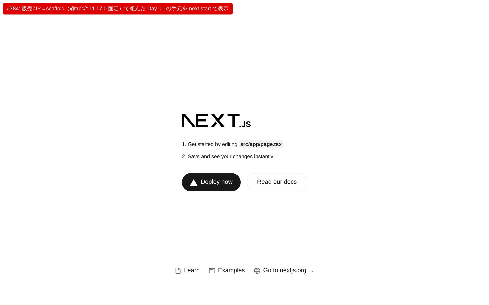

# #784 の確かめ（2026-11-27）

販売 ZIP（`bash scripts/build-zip.sh`）を空のフォルダに展開し、Day 01 の手順どおり `bash scripts/scaffold-from-scratch.sh` を流した（Linux コンテナ、Docker なし・ローカル PostgreSQL）。

## 直す前（`@trpc/*@^11.8.0` のまま。#783 の枝の販売 ZIP（next 15.5.29）で流した。tRPC の行は main と同じ）
```text
npm error code ERESOLVE
npm error ERESOLVE could not resolve
npm error Found: @trpc/client@11.32.0
npm error Conflicting peer dependency: @trpc/client@11.28.5
rc=1
```

最小の再現（next の版に関係なく起きる）:
```text
$ npm install --dry-run next@15.5.24 react@^18.3.1 react-dom@^18.3.1 @trpc/client@^11.8.0 @trpc/server@^11.8.0 @trpc/react-query@^11.8.0 @trpc/next@^11.8.0 @tanstack/react-query@^5.59.0
npm error code ERESOLVE
npm error ERESOLVE could not resolve
npm error Conflicting peer dependency: @trpc/client@11.28.5
$ npm view @trpc/react-query@11.29.0 deprecated
@trpc/react-query only gets bug fixes and will be removed in the next major version of tRPC. Use @trpc/tanstack-react-query instead: https://trpc.io/docs/client/tanstack-react-query/migrating
```

## 直した後（このPR の販売 ZIP、`@trpc/*@11.17.0`）
```text
初期セットアップは完了しました。
カリキュラムの Day 01 の続きを進めてください。
rc=0
+-- @trpc/client@11.17.0
+-- @trpc/next@11.17.0
+-- @trpc/react-query@11.17.0
`-- @trpc/server@11.17.0
npx tsc --noEmit: rc=0
npm run build: rc=0
```

`next start -p 3100` で開いた画面（Playwright、注釈は赤い帯）:


