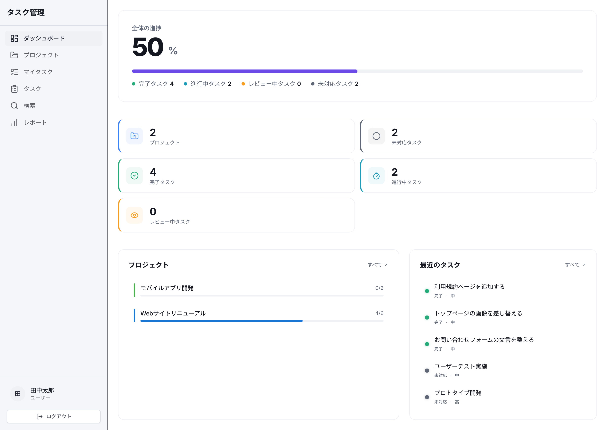
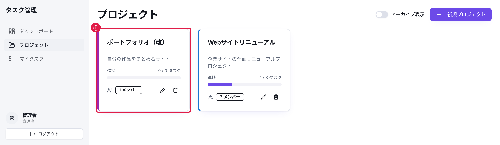
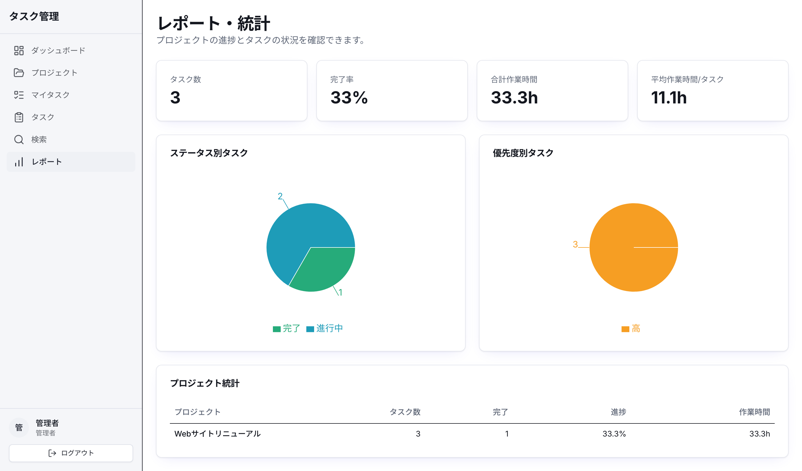

# 参考資料リンク集

このカリキュラムで使用している技術の公式ドキュメントと学習に役立つリソースをまとめました。

---

## 公式ドキュメント

### フロントエンド

| 技術 | 公式ドキュメント | 概要 |
|------|------------------|------|
| React | https://react.dev/ | UI ライブラリの公式ドキュメント。チュートリアルが充実 |
| Next.js | https://nextjs.org/docs | App Router、Route Handlers（`app/api` 配下の API）、デプロイなど網羅的 |
| TypeScript | https://www.typescriptlang.org/docs/ | 型システムのハンドブックが充実 |
| Tailwind CSS | https://tailwindcss.com/docs | ユーティリティクラスの全リファレンス |
| shadcn/ui | https://ui.shadcn.com/ | コンポーネントの API ドキュメントと使用例 |
| Radix UI | https://www.radix-ui.com/primitives/docs/overview/introduction | shadcn/ui の基盤となるプリミティブコンポーネント |
| Lucide Icons | https://lucide.dev/icons/ | アイコン一覧と検索 |
| Recharts | https://recharts.org/ | グラフ・チャートコンポーネントの API |
| TanStack Query | https://tanstack.com/query/latest | tRPC の `useQuery` / `useMutation` の土台。キャッシュの持ち方と再取得（refetch）の挙動 |
| react-hook-form | https://react-hook-form.com/docs | フォームの値の管理とバリデーションの連携 |

### バックエンド

| 技術 | 公式ドキュメント | 概要 |
|------|------------------|------|
| tRPC | https://trpc.io/docs | 型安全 API の構築方法 |
| Prisma | https://www.prisma.io/docs | スキーマ定義、クエリ API、マイグレーション（データベースの構造変更を履歴として管理する仕組み） |
| PostgreSQL | https://www.postgresql.org/docs/ | SQL リファレンス、チューニングガイド |
| Zod | https://zod.dev/ | バリデーションスキーマの定義方法。このカリキュラムは v3 系を使います。[v3 のドキュメント](https://v3.zod.dev/)を読んでください |

### 認証

| 技術 | 公式ドキュメント | 概要 |
|------|------------------|------|
| jose | https://github.com/panva/jose | JWT 生成・検証の API |
| bcryptjs | https://github.com/dcodeIO/bcrypt.js | パスワードハッシュ化 |

### 開発ツール

| 技術 | 公式ドキュメント | 概要 |
|------|------------------|------|
| Git | https://git-scm.com/doc | バージョン管理の基本コマンド |
| Biome | https://biomejs.dev/ | リンター・フォーマッターの設定方法 |
| Vitest | https://vitest.dev/ | テストの書き方、設定、API |
| Vercel | https://vercel.com/docs | デプロイ設定、環境変数の管理 |
| Docker | https://docs.docker.com/ | コンテナの基本操作 |

---

## 学習リソース

### JavaScript / TypeScript 基礎

- [MDN Web Docs](https://developer.mozilla.org/ja/) - Web 技術の包括的なリファレンス（日本語対応）
- [JavaScript Primer](https://jsprimer.net/) - JavaScript 入門書（日本語、無料）
- [サバイバル TypeScript](https://typescriptbook.jp/) - TypeScript 入門書（日本語、無料）

### React / Next.js

- [React 公式チュートリアル](https://react.dev/learn/tutorial-tic-tac-toe) - 三目並べゲームを作りながら学ぶ
- [Next.js 公式チュートリアル](https://nextjs.org/learn) - ダッシュボードアプリを作りながら学ぶ

### データベース

- [Prisma 公式チュートリアル](https://www.prisma.io/docs/getting-started) - Prisma の基本操作
- [SQLBolt](https://sqlbolt.com/) - SQL の基礎を対話的に学ぶ（英語）

### Git

- [Git 公式チュートリアル](https://git-scm.com/book/ja/v2) - Pro Git 日本語版（無料）
- [Learn Git Branching](https://learngitbranching.js.org/?locale=ja) - ブランチ操作を視覚的に学ぶ

### テスト

- [Vitest 公式ガイド](https://vitest.dev/guide/) - テストの基本的な書き方
- [Testing Library](https://testing-library.com/docs/) - UI テストのベストプラクティス

---

## 便利なツール

| ツール | 入手先・起動方法 | 用途 |
|--------|-----|------|
| VS Code | https://code.visualstudio.com/ | コードエディタ |
| ブラウザの開発者ツール（Network タブ） | Chrome / Edge / Firefox に標準搭載 | このアプリの tRPC 通信を画面の操作と合わせて確認する |
| pgAdmin | https://www.pgadmin.org/ | PostgreSQL 管理ツール |
| Prisma Studio | `npx prisma studio` | データベースの GUI 管理 |
| React Developer Tools | https://react.dev/learn/react-developer-tools | Chrome・Firefox・Edge で React コンポーネントをデバッグ |

---

## 戻る

- 目次: [カリキュラム目次](./00_カリキュラム目次.md)
- 全体の地図: [学びのロードマップ](./00-1_学びのロードマップ.md)

<!-- textlint-disable ja-technical-writing/ja-no-mixed-period, ja-technical-writing/no-doubled-conjunction, ja-technical-writing/no-exclamation-question-mark -->

---

## 奥付

| | |
|---|---|
| タイトル | 参考資料リンク集 |
| 著者 | 磯貝光佑 |
| 版 | 第1版（2026年9月19日） |

© 2026 磯貝光佑

本書は購入者個人の利用に限ります。本書に掲載されたコードの写経、および自分のプロジェクトへの転用・改変は自由です。本書（PDF・Markdown）および付属コードの再配布・転売・第三者との共有は、形態を問わず禁止します。

<!-- textlint-enable ja-technical-writing/ja-no-mixed-period, ja-technical-writing/no-doubled-conjunction, ja-technical-writing/no-exclamation-question-mark -->
