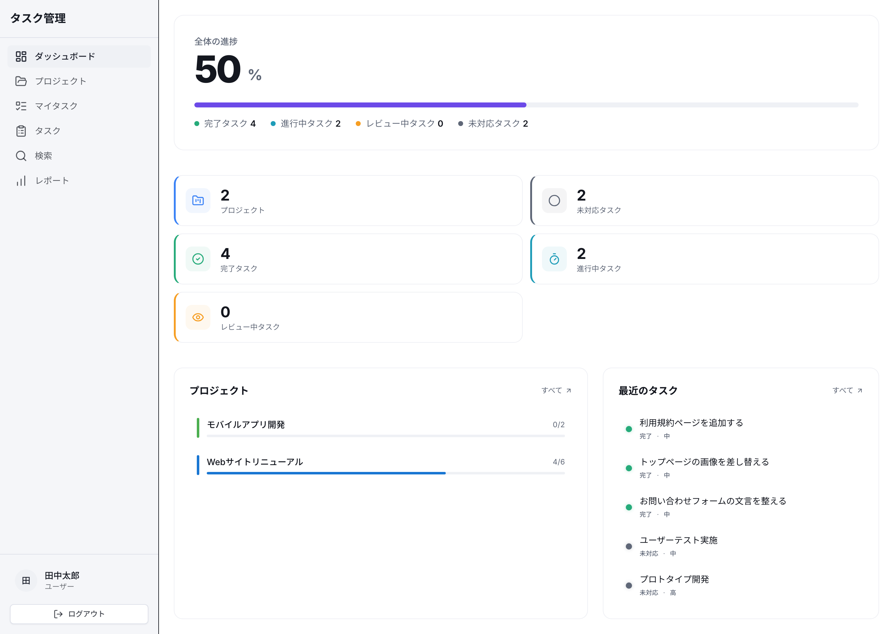
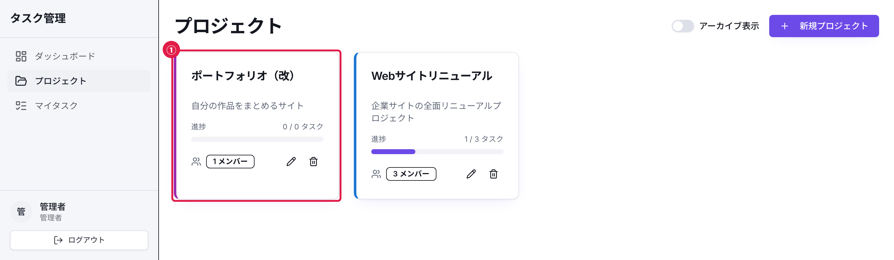
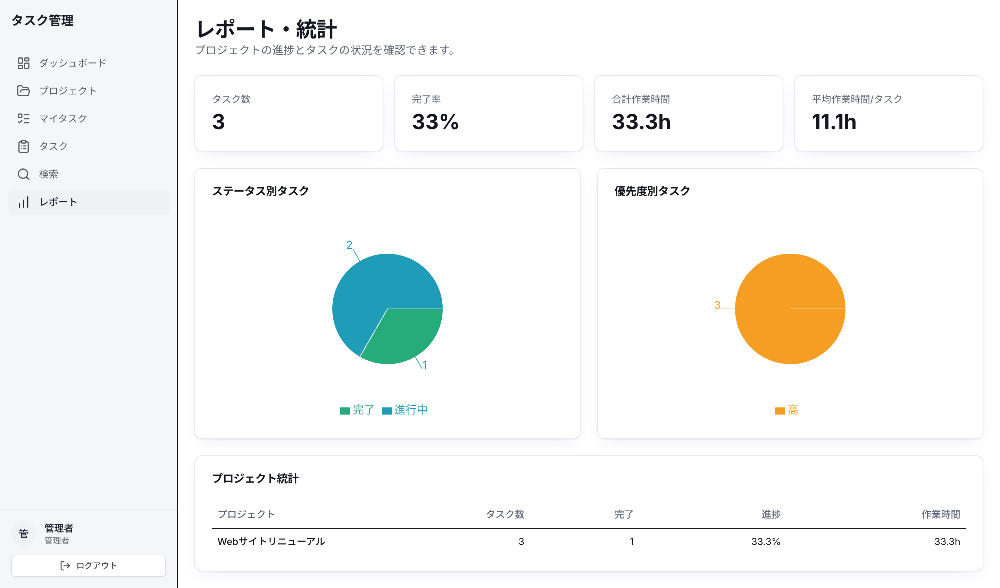

# さらなる学習のために

30日間のカリキュラムお疲れさまでした。次に取り組む機能や学習テーマの候補を紹介します。







---

## レベル1: Task-App を拡張する

まずはこのカリキュラムで作った Task-App に新機能を追加してみましょう。本編で書いたコードを使いながら取り組めます。

### おすすめの拡張機能

| 機能 | 難易度 | 学べること | 出発点 |
|------|--------|------------|--------|
| アプリ内通知 | 中級 | リアルタイム通信、状態管理 | Day 18 のコメント投稿（`src/server/api/routers/comment.ts` の `create`）に通知の保存と取得を足す |
| ファイル添付 | 中級 | ファイルアップロード、クラウドストレージ連携 | 無い（Prisma に添付ファイルのモデルを足すところから） |
| カンバンボード表示 | 上級 | ドラッグ&ドロップ、複雑なUI状態管理 | Day 13 のタスク一覧（`src/app/task/page.tsx`）と Day 16 の `task.update` のステータス変更 |
| メール通知 | 中級 | 外部APIの連携、非同期処理 | 無い（Day 12 の `project.addMember` の成功時を送信の合図にできる） |
| ダークモード | 初級 | テーマシステム、CSS変数 | `src/app/globals.css` の `.dark` の変数を切り替えるところから |
| 多言語対応（i18n） | 中級 | 国際化ライブラリ、翻訳管理 | `src/lib/constant/status.ts` の `TASK_STATUS_LABELS` のような表示名のまとまり |
| ガントチャート | 上級 | 日付計算、SVG/Canvas描画 | Day 22 のレポート画面（`src/app/report/page.tsx` の Recharts）と Task の `dueDate`・Project の `startDate`/`endDate` |
| アクティビティログ | 中級 | イベント駆動設計、ログ設計 | 無い（Day 15 の `task.update` に変更の記録を足すところから） |

### 取り組み方

1. まず仕様を紙やメモに書き出す
2. 必要なデータベース変更を考える（Prisma スキーマ）
3. API を設計する（tRPC ルーター）
4. UI を実装する（React コンポーネント）
5. テストを書く

---

## レベル2: 新しいプロジェクトに挑戦

Task-App で学んだ技術スタックを使ってゼロから新しいアプリを作ってみましょう。

### プロジェクトアイデア

| プロジェクト | 概要 | 新しく学べること |
|-------------|------|------------------|
| ブログプラットフォーム | 記事の CRUD、マークダウン対応 | リッチテキストエディタ、SEO 対策 |
| 家計簿アプリ | 収支管理、グラフ表示 | データ集計、チャート応用 |
| レシピ管理アプリ | レシピの CRUD、検索、カテゴリ | 画像管理、全文検索 |
| チャットアプリ | リアルタイムメッセージング | WebSocket、リアルタイム通信 |
| EC サイト | 商品管理、カート、決済 | 決済 API 連携、トランザクション管理（複数の DB 操作を全部成功か全部取消のどちらかに揃える仕組み） |

### ゼロから始めるときの手順

```bash
# 1. Next.jsプロジェクトの作成
npx create-next-app@15.5.24 my-new-app \
  --typescript --tailwind --app --src-dir \
  --import-alias "@/*" --yes
cd my-new-app

# 2. 必要なパッケージの追加
npm install @trpc/server@11.17.0 @trpc/client@11.17.0 \
  @trpc/react-query@11.17.0 @tanstack/react-query@5.100.14
npm install prisma@6.19.3 @prisma/client@6.19.3
npm install zod@3.25.76

# 3. Prismaの初期化
npx prisma init

# 4. 開発開始！
npm run dev
```

1番の `create-next-app` がフォルダと設定ファイルを作ります。`cd my-new-app` でそのフォルダへ移ってから2番のパッケージを入れてください。`@11` のようなメジャーだけの指定はその時点で最新の11.x が入るので、ここでは教材が実際に動かしている版まで固定しています。版の変更による型エラーや実行時エラーを避けるためです。インストールだけでは画面とサーバーはつながりません。Day 07〜09 を参考にして Provider・ルーター・API の接続を自分で設定してください。

3番の `prisma init` は `schema.prisma` と `.env` を作ります。この2つが無いと `npx prisma migrate dev` がテーブルを作れません。Day 01 で走らせたセットアップ用のスクリプトはここまでをまとめて済ませてくれていました。今回は自分の手で1つずつ通すことになります。

4番まで進むと開発サーバーが表示した URL に Next.js の初期画面が出ます。Day 01 の教材スターターにあった認証や共通部品はまだ入っていません。必要な機能を1つずつ追加していきましょう。

---

## レベル3: 技術を深掘りする

関心のある技術領域を選んで詳しく学びましょう。

### フロントエンド特化

- **パフォーマンス最適化**（React.memo、useMemo、useCallback、コード分割）
- **アクセシビリティ（a11y）**（WAI-ARIA、キーボードナビゲーション、スクリーンリーダー対応）
- **アニメーション**（Framer Motion、CSS Animations）
- **状態管理の深化**（Zustand、Jotai、React Query（TanStack Query）の高度な使い方）

### バックエンド特化

- **データベース設計**（正規化、インデックス（検索を速くするための索引）の設計、クエリ最適化）
- **認証・認可の深化**（OAuth 2.0（外部サービスへ「このアプリに操作を任せる」権限を渡す仕組み）と、その上で本人確認する OpenID Connect、ロールベースアクセス制御［RBAC］）
- **API 設計**（REST vs GraphQL vs tRPC の比較、ページネーション、レートリミット）
- **セキュリティ**（OWASP Top 10、CSRF 対策、XSS 対策、SQL インジェクション対策）

「Google でログイン」は OAuth 2.0 と OpenID Connect を組み合わせたものです。

### インフラ・DevOps

- **CI/CD**（GitHub Actions、自動テスト、自動デプロイ）
- **コンテナ**（Docker Compose、マルチステージビルド）
- **モニタリング**（エラートラッキング（Sentry）、ログ管理）
- **スケーリング**（Redis（メモリ上の高速データストア）でキャッシュ、ロードバランシング（アクセスを複数のサーバーへ振り分ける仕組み）、CDN（静的ファイルを各地から配信）で高速化）

---

## レベル4: チーム開発を経験する

一人での開発を経験したらチームでの開発にも挑戦してみましょう。

### チーム開発で重要なスキル

- **コードレビュー**（Pull Request のレビュー方法、建設的なフィードバック）
- **ブランチ戦略**（Git Flow、GitHub Flow の理解と実践）
- **Issue 管理**（要件の分割、見積もり、優先度付け）
- **ドキュメント**（README の書き方、API ドキュメント、アーキテクチャ文書）

### おすすめの活動

1. OSS（オープンソースソフトウェア）に貢献する
   - `good first issue` ラベルの Issue から始める
   - ドキュメントの修正や typo の修正も立派な貢献

2. ハッカソンに参加する
   - 短期間でチーム開発を経験できる
   - 異なるスキルセットのメンバーとの協働を学ぶ

3. 勉強会に参加する
   - connpass や meetup でイベントを探す
   - LT（ライトニングトーク）で発表すると学びが深まる

---

## 継続的な学習のために

### 情報収集のおすすめ

- **Zenn**（日本語の技術記事プラットフォーム）
- **Qiita**（日本語の技術情報共有サービス）
- **dev.to**（英語の技術コミュニティ）
- **YouTube**（Web Dev Simplified、Fireship などのチャンネル）

### 学習を続けるコツ

1. **毎日少しずつ**（1日30分でも継続することが大切）
2. **アウトプットする**（学んだことをブログや記事にまとめる）
3. **実際に作る**（チュートリアルで学んだことを自分のプロジェクトで試す）
4. **コミュニティに参加する**（質問することや他の人の質問に答えることから始める）
5. **完璧を求めない**（まず動くものを作ってから改善する）

---

次に作りたい機能を1つ選んで試してみましょう。

---

## 戻る

- 目次: [カリキュラム目次](./00_カリキュラム目次.md)
- 全体の地図: [学びのロードマップ](./00-1_学びのロードマップ.md)

<!-- textlint-disable ja-technical-writing/ja-no-mixed-period, ja-technical-writing/no-doubled-conjunction, ja-technical-writing/no-exclamation-question-mark -->

---

## 奥付

| | |
|---|---|
| タイトル | さらなる学習のために |
| 著者 | 磯貝光佑 |
| 版 | 第1版（2026年9月19日） |

© 2026 磯貝光佑

本書は購入者個人の利用に限ります。本書に掲載されたコードの写経、および自分のプロジェクトへの転用・改変は自由です。本書（PDF・Markdown）および付属コードの再配布・転売・第三者との共有は、形態を問わず禁止します。

<!-- textlint-enable ja-technical-writing/ja-no-mixed-period, ja-technical-writing/no-doubled-conjunction, ja-technical-writing/no-exclamation-question-mark -->
