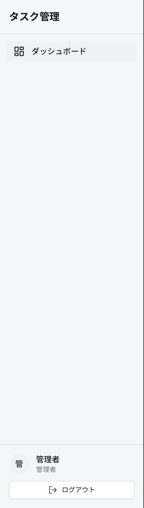
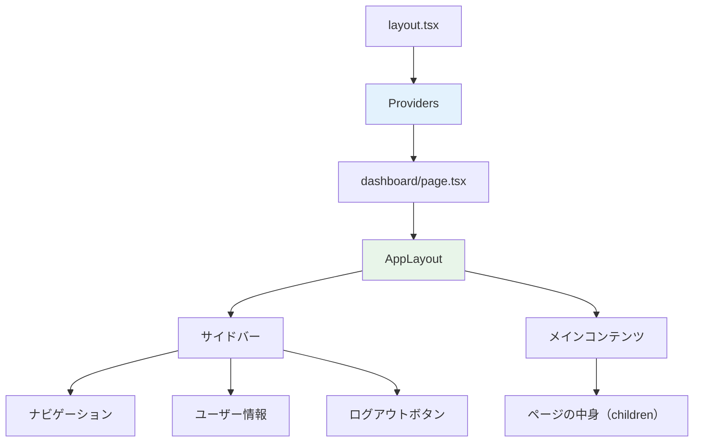
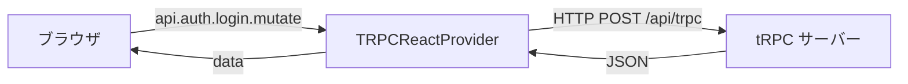
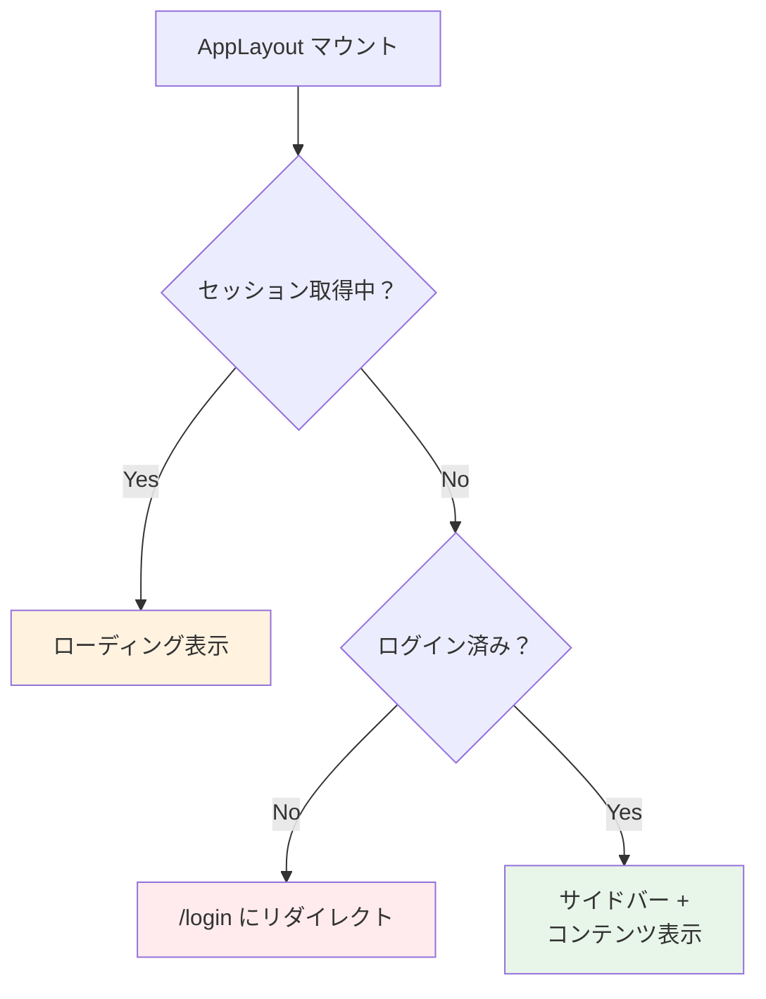
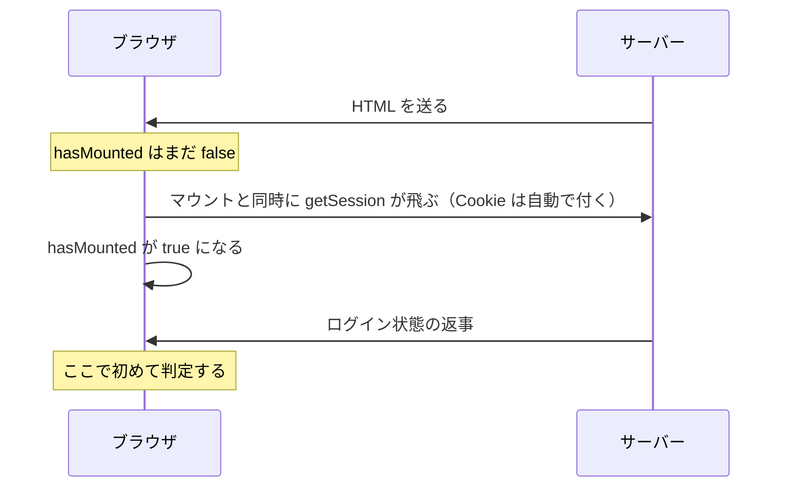
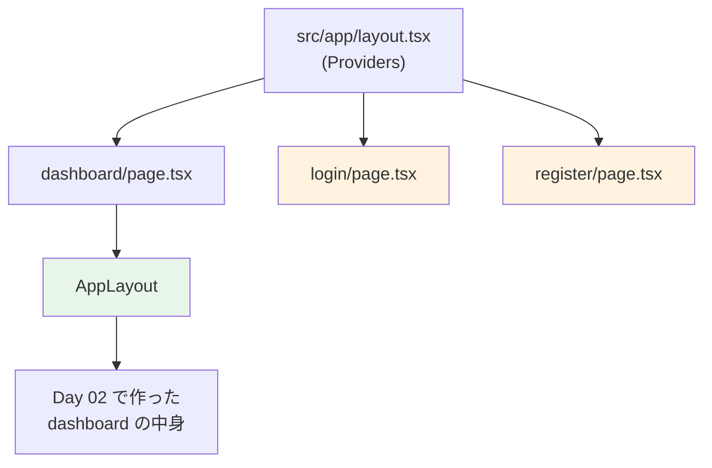
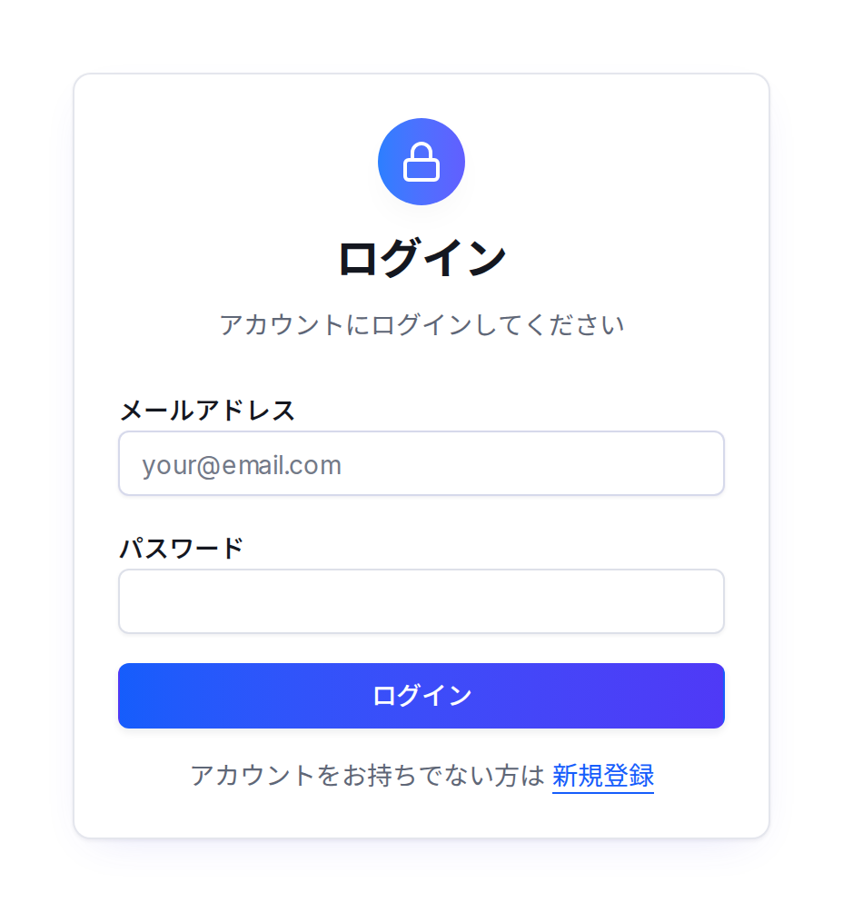
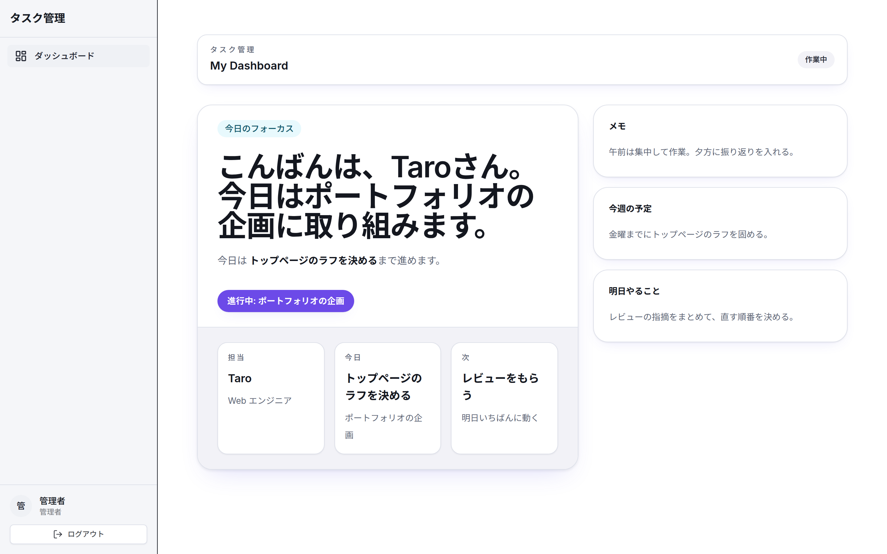
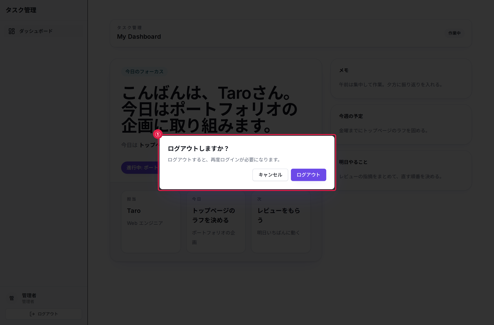

# Day 08: サイドバー付きのアプリレイアウトを作ろう



赤い枠が今日作るサイドバーです。メニューは「ダッシュボード」「プロジェクト」「マイタスク」の3つになります。
残りのメニューは Day 13 以降で画面を作るたびに1つずつ足していきます。

## 前回の振り返り

Day 07 で認証バックエンドを作りました。
ログイン・登録・ログアウトが全部動くようになりました。

でも今のアプリ、ログインした先に何もありません。
今日はサイドバー付きの共通レイアウトを自分の手で作って
「アプリっぽい骨格」を完成させます。

---

## 今日のゴール

サイドバー付きのレイアウトを自分で作って
まずダッシュボードにこのレイアウトを適用します。Day 09 以降のページには作るたびに同じレイアウトを適用していきます。

- [ ] `src/app/providers.tsx` — 配布済みの tRPC Provider を読んで、どこまで届くか確認する
- [ ] `src/component/layout/app-layout.tsx` — サイドバー + メインコンテンツ
- [ ] `src/app/dashboard/page.tsx` — AppLayout の中で動くダッシュボード
- [ ] ログアウトが動作することを確認する

## なぜこれを作るのか

Day 07 のログイン API は動きます。ただしフロント側とはまだ繋がっていません。
ブラウザから tRPC を呼ぶには「tRPC クライアント」をアプリ全体に設定します。
そしてログイン後のページには共通のサイドバーが必要です。

> **例え話**: Day 07 で厨房（サーバー）を作りました。今日は客席のレイアウト（テーブル配置・通路・メニュー看板）を作ります。客が座ったときに「ちゃんとしたお店だな」と感じる骨格の部分です。

### 今日作る構造



図は上から下へ、部品が別の部品を包む順番を表しています。いちばん外側の `layout.tsx` は全ページ共通の枠で、その内側に `Providers` を置くと下にぶら下がるページ全部から tRPC を呼べます。さらに内側の `AppLayout` がサイドバーとメインコンテンツに分かれ、サイドバーの中にナビゲーション・ユーザー情報・ログアウトボタンが並びます。

包む順番はそのまま「どこまで届くか」になります。仮に `Providers` をダッシュボードの内側だけに置くとログイン画面から tRPC を呼び出せません。

### やること / やらないこと

| やること | やらないこと |
|---------|-------------|
| 配布済みの tRPC クライアント設定を読んで、フロントから API を呼べる理由を掴む | tRPC クライアント設定の自作（scaffold で配布済み） |
| サイドバー + レイアウトを自分の手で書く | モバイル対応のナビゲーション（Day 25 で追加します） |
| ログアウトを AlertDialog 付きで実装する | ユーザー編集機能 |

### 新しく学ぶ概念

| 概念 | 読み方 | 役割 | 例え |
|------|--------|------|------|
| Provider | プロバイダー | コンポーネントツリー全体に値を配る仕組み | 建物全体に電気を通す配電盤 |
| use client（Day 02 の復習） | ユーズクライアント | ブラウザ側で動くと宣言する | 「この部品はお客さんの手元で動きます」 |
| useQuery | ユーズクエリ | サーバーからデータを取得する React Hook | 注文票を厨房に出して結果を待つ |
| useMutation | ユーズミューテーション | サーバーのデータを変更する React Hook | 注文を厨房に送信する |

## 実装ステップ一覧

| ステップ | 作業内容 | 所要時間 | 作成ファイル |
|---------|---------|---------|-------------|
| Step 1 | providers.tsx の中身を読む（tRPC + React Query） | 8分 | `src/app/providers.tsx` |
| Step 2 | ルートレイアウトのどこで Provider が囲んでいるか読む | 5分 | `src/app/layout.tsx` 確認 |
| Step 3 | AppLayout を作る（サイドバーの骨格） | 15分 | `src/component/layout/app-layout.tsx` |
| Step 4 | ダッシュボードに AppLayout を適用する | 5分 | `src/app/dashboard/page.tsx` |
| Step 5 | ログインして全体の動作を確認する | 5分 | なし |

**合計時間**: 約 38 分です。

表と Step 見出しの分数は説明とコードを読んで中身をつかむまでの目安です。コードを打ち込む Step では打ち込む時間と詰まって調べる時間がこの分数に加わります。

---

### Step 1: providers.tsx を読む（tRPC クライアント設定・8分）

**ゴール**: 配布済みの設定を読んで、フロントエンドから tRPC API を呼べる仕組みを掴みます。

Day 07 で作った tRPC サーバーを、ブラウザ側から呼ぶには
「クライアント」が必要です。scaffold は `src/trpc/` の設定ファイルと、
それをアプリ全体に適用する Provider の両方を配布済みです。
今日はどちらも書き足さず、中身を読んで仕組みを掴みます。



矢印はボタンを押してから画面が変わるまでの一往復です。ブラウザ側では `api.auth.login.mutate` のような関数呼び出しを書くだけで、`TRPCReactProvider` がそれを `/api/trpc` への HTTP リクエストに変換して送ります。返ってきた JSON も同じ道を逆にたどり、型の付いた値としてブラウザに戻ります。

この Provider が無いと `api` は送り先を知らないため呼んだ瞬間にエラーで止まります。

`src/app/providers.tsx` は Day 01 の scaffold が配布済みです。新しく作らず、開いて中身を確認します。

```tsx
// filepath: src/app/providers.tsx
'use client';

import { Toaster } from 'react-hot-toast';
import { TRPCReactProvider } from '@/trpc/react';

export function Providers({ children }: { children: React.ReactNode }) {
  return (
    <TRPCReactProvider>
      {children}
      <Toaster />
    </TRPCReactProvider>
  );
}
```

| コード | 意味 |
|--------|------|
| `'use client'` | この Provider はブラウザ側で動く |
| `TRPCReactProvider` | scaffold が用意した tRPC + React Query の設定 |
| `Toaster` | `toast()` で出す通知の表示場所。これが無いと通知は一切出ない |
| `children` | この下に置かれる全コンポーネントが tRPC を使える |

> scaffold の `src/trpc/react.tsx` の中身が気になったら開いてみてもいいです。QueryClient と httpBatchLink の設定が入っています。

**確認ポイント**:
- [ ] `src/app/providers.tsx` の中身を確認した
- [ ] `'use client'` が先頭にある
- [ ] `<Toaster />` が入っている

---

### Step 2: ルートレイアウトのどこで Provider が囲んでいるか読む（5分）

**ゴール**: アプリ全体で tRPC が使える理由を、ルートレイアウトを読んで掴みます。

`src/app/layout.tsx` を開きます。こちらも scaffold が配布済みで、Provider はすでに組み込まれています。書き換えずに、どこで囲んでいるかを確認します。

```tsx
// filepath: src/app/layout.tsx
import type { Metadata } from 'next';
import { Inter, JetBrains_Mono, Noto_Sans_JP } from 'next/font/google';
import { Providers } from './providers';
import './globals.css';

const inter = Inter({
  subsets: ['latin'],
  variable: '--font-inter',
  display: 'swap',
});
```

同じ書き方で `JetBrains_Mono` を `--font-jetbrains-mono`、`Noto_Sans_JP` を `--font-noto-sans-jp` として読み込んでいます。続きは次のとおりです。

```tsx
// filepath: src/app/layout.tsx（続き）
export default function RootLayout({
  children,
}: {
  children: React.ReactNode;
}) {
  return (
    <html lang="ja" className={`${inter.variable} ${jetBrainsMono.variable} ${notoSansJP.variable}`}>
      <body>
        <Providers>{children}</Providers>
      </body>
    </html>
  );
}
```

| 確認する箇所 | 意味 |
|--------|------|
| `import { Providers }` | Step 1 で見た Provider を読み込む |
| `<Providers>{children}</Providers>` | 全ページを Provider で囲む |
| `className={...}` | フォントの変数を全ページへ渡す |

> `--font-inter` などの変数名は`src/app/layout.tsx` にある `Inter({ variable: '--font-inter' })` などの `variable` 指定で決めています。Day 01 で書いた `globals.css` がこの変数を参照しているので消すとフォント指定が黙って効かなくなります。
>
> `<Providers>` で全体を囲んだのでアプリのどこからでも `api.auth.login.useMutation()` のように tRPC を呼べます。

**確認ポイント**:
- [ ] `src/app/layout.tsx` に `<Providers>` が入っていることを確認した
- [ ] この時点で `npm run dev` してエラーが出ないことを確認

---

### Step 3: AppLayout を作る（サイドバーの骨格・15分）

**ゴール**: サイドバー + メインコンテンツのレイアウトコンポーネントを作ります。

ここが今日のメインです。認証チェック、ナビゲーション、ログアウトを 1 つのレイアウトに組み込みます。



この分岐はAppLayout が中身を描く前に必ず通る判定です。セッションの問い合わせが終わるまでは読み込み中の表示を出し、終わってからログイン済みかどうかを見ます。ログインしていなければ何も描かずに `/login` へ送るので未ログインの人にサイドバーが一瞬でも見えることはありません。

この書き方は問い合わせ自体が失敗したときも未ログインとして扱います。ログイン済みの人が通信の失敗でログイン画面へ送られることがある、ということです。実務では `error` も受け取り、失敗したときは再試行の案内を出してから判断します。

この判定をレイアウト側に置いたおかげで、この先に作るページは自分で認証を確認せずに済みます。

`src/component/layout/app-layout.tsx` を新規作成します。

#### 3-1. インポートと型定義

```tsx
// filepath: src/component/layout/app-layout.tsx
'use client';

import { useQueryClient } from '@tanstack/react-query';
import {
  FolderOpen,
  LayoutDashboard,
  ListTodo,
  LogOut,
} from 'lucide-react';
import Link from 'next/link';
import { usePathname, useRouter } from 'next/navigation';
import { useEffect, useState } from 'react';
import {
  AlertDialog,
  AlertDialogAction,
  AlertDialogCancel,
  AlertDialogContent,
  AlertDialogDescription,
  AlertDialogFooter,
  AlertDialogHeader,
  AlertDialogTitle,
  AlertDialogTrigger,
} from '@/component/ui/alert-dialog';
```

import はこのファイルで使う道具を先に並べる宣言です。`useQueryClient` は画面をまたいで保存された問い合わせ結果を操作します。`lucide-react` はサイドバーのアイコン、`Link` はページ移動、`usePathname` は今いるページの URL を取る道具で、現在のメニューを目立たせるときに使います。`useState` は画面の状態を覚えておく仕組みです。`useEffect`（画面が表示された後など、決まったタイミングで処理を走らせる React の仕組み）はあとで「ブラウザ側の準備が終わったか」を記録するときに使います。

`AlertDialog` で始まる 9 個はログアウト前の確認ダイアログを組み立てる部品一式です。shadcn/ui のダイアログは 1 つの部品ではなく、枠・見出し・本文・ボタンに分かれています。だから使う分だけ名前を並べて取り込みます。1 つでも取り込み漏れがあるとその名前を書いた行で「定義されていない」というエラーが出ます。

**確認ポイント**:
- [ ] ログアウト確認に使う `AlertDialog` 一式を import している

```tsx
// filepath: src/component/layout/app-layout.tsx（続き）
import { Button } from '@/component/ui/button';
import { cn } from '@/lib/utils';
import { api } from '@/trpc/react';
```

`cn` は条件によって変わるクラス名を1つの文字列にまとめる関数です。あとでメニューの現在地を色分けするとき選択中と未選択のクラスを混ぜて渡します。

`+` でつないでも動きます。ただ、空白を1つ入れ忘れると `text-smfont-bold` のようにくっついてそのクラスだけ効かなくなります。画面は崩れず、ただ色が付かないだけです。だから原因を探すのに時間がかかります。

`api` は tRPC のクライアントです。これを取り込まないとあとで書く `api.auth.getSession` の行で「名前が見つからない」というエラー画面が出て、ページを表示できなくなります。

**確認ポイント**:
- [ ] ログアウト用の `AlertDialog` を import している
- [ ] tRPC 用の `api` を import している

```tsx
// filepath: src/component/layout/app-layout.tsx（続き）
interface MenuItem {
  text: string;
  icon: React.ReactNode;
  path: string;
}

const menuItems: MenuItem[] = [
  {
    text: 'ダッシュボード',
    icon: <LayoutDashboard className="h-5 w-5" />,
    path: '/dashboard',
  },
  {
    text: 'プロジェクト',
    icon: <FolderOpen className="h-5 w-5" />,
    path: '/project',
  },
  {
    text: 'マイタスク',
    icon: <ListTodo className="h-5 w-5" />,
    path: '/my-task',
  },
];
```

メニュー1件の形をここで決めておくと項目を足すときに何を書けばよいかが決まります。`icon` の型が `React.ReactNode` になっているのは文字列ではなく `<LayoutDashboard />` のような画面部品をそのまま入れるからです。

| コード | 意味 |
|--------|------|
| `'use client'` | ユーザー操作（ナビゲーション、ログアウト）があるので Client Component |
| `lucide-react` | アイコンライブラリ（scaffold でインストール済み） |
| `AlertDialog` | ログアウト前の確認ダイアログ（scaffold の UI コンポーネント） |
| `menuItems` | サイドバーに表示するメニュー項目の定義 |

#### 3-2. コンポーネント本体（認証チェック + ログアウト）

```tsx
// filepath: src/component/layout/app-layout.tsx（続き）
export function AppLayout({
  children,
}: {
  children: React.ReactNode;
}) {
  const [hasMounted, setHasMounted] = useState(false);
  const queryClient = useQueryClient();
  const pathname = usePathname();
  const router = useRouter();

  const { data: session, isLoading } =
    api.auth.getSession.useQuery();

  const logoutMutation = api.auth.logout.useMutation({
    onSuccess: async () => {
      await queryClient.cancelQueries();
      queryClient.clear();
      router.push('/login');
      router.refresh();
    },
  });
```

状態と問い合わせを、関数の先頭でまとめて宣言しています。`useState` や `useQuery` のようなフックは毎回同じ順番で呼ばれることを前提に作られています。`if` の中や `return` より後ろに置くと順番が変わり、React が値を取り違えてエラーになります。並べる場所には理由があります。

`logoutMutation` を関数の先頭で用意しておくのは`useMutation` もフックだからです。フックは毎回同じ順番で呼ばれる前提なので`onClick` の中には書けません。実際に通信が始まるのはボタンが押されて `mutate` が呼ばれたときです。

ログアウト API が成功した後の処理は、次の順番です。

| 順番 | 処理 |
|---|---|
| 1 | `cancelQueries()` で実行中の問い合わせを止める |
| 2 | `clear()` で、前の利用者の名前やタスクをブラウザ内のキャッシュ（取得済みデータを一時保存する場所）から消す |
| 3 | ログイン画面へ移動し、`router.refresh()` でサーバー側の表示を作り直す |

問い合わせの停止を待つため、`onSuccess` に `async` を付けて `await` を使います。停止と削除の順番が逆だと、消した直後に遅れて終わった問い合わせが前の利用者のデータを入れ直す可能性があります。

**確認ポイント**:
- [ ] `getSession` でログイン状態を取得している
- [ ] 実行中の問い合わせを止めてからキャッシュを消している
- [ ] ログアウト成功後に `/login` へ戻している

```tsx
// filepath: src/component/layout/app-layout.tsx（続き）
  useEffect(() => {
    setHasMounted(true);
  }, []);

  useEffect(() => {
    if (hasMounted && !isLoading && !session) {
      router.push('/login');
    }
  }, [hasMounted, isLoading, session, router]);

  if (!hasMounted || isLoading) {
    return (
      <div className="flex h-screen items-center justify-center">
        <p className="text-muted-foreground">読み込み中...</p>
      </div>
    );
  }

  if (!session?.user) {
    return null;
  }
```

読み込み中の表示をここでは自分で書いています。Day 09 で別のページの読み込み中表示を作るときは、配布済みの `PageLoadingSpinner` を使います。今日の `AppLayout` は仕組みを追いやすいように素の要素のまま完成させます。

| コード | 意味 | 例え |
|--------|------|------|
| `hasMounted` | SSR（サーバー側で先に HTML を組み立てる仕組み）と CSR（ブラウザ側で後から HTML を組み立てる仕組み）のズレ防止フラグ | 店が開店してから初めて客をチェックする |
| `api.auth.getSession.useQuery()` | サーバーに「今ログインしているか」を問い合わせる | 入口でリストバンドチェック |
| `logoutMutation` | ログアウト API を呼ぶ準備 | 退出手続きのボタン |
| `router.push('/login')` | ログイン画面へ飛ばす | 受付に案内する |

> `hasMounted` が必要な理由: Next.js はサーバーで HTML を生成してからブラウザに送ります（SSR）。session Cookie には Day 07 で `httpOnly` を付けたのでブラウザ側の JavaScript からは中身を読めません。ログイン状態を知る道は`api.auth.getSession.useQuery()` でサーバーに聞くことだけです。このとき Cookie はリクエストへ自動で付いて飛び、中身を開いて誰なのかを判定するのはサーバー側です。答えが返ってくるのは画面が出たあとなのでこのフラグで「ブラウザ側の準備ができてから判定する」ようにしてチラつきを防ぎます。



時間の流れは上から下です。`useQuery` に `enabled` を渡していないので問い合わせはマウントと同時に始まります。応答が届く前のリダイレクトを防ぐのは`useEffect` 内の `!isLoading` です。

`hasMounted` を使うと初回は必ず読み込み中の表示になります。このフラグだけを外しても`!isLoading` があるため応答を待たずにログイン画面へ移動することはありません。

#### 3-3. レイアウト JSX（サイドバー + コンテンツ）

```tsx
// filepath: src/component/layout/app-layout.tsx（続き）
  return (
    <div className="flex h-screen bg-background">
      {/* サイドバー */}
      <aside className="hidden w-64 flex-col border-r bg-sidebar md:flex">
        {/* ロゴ */}
        <div className="border-b border-sidebar-border p-4">
          <h1 className="text-lg font-bold text-sidebar-foreground">
            タスク管理
          </h1>
        </div>
```

サイドバーを `<div>` ではなく `<aside>` で書いています。見た目はどちらも同じですが`<aside>` には「ここは本文ではなく脇の案内です」という意味が付きます。読み上げソフトを使う人はこの目印でページの主役がどこかを判断します。`<div>` で揃えてしまうとその手がかりが消えます。

`hidden` と `md:flex` を並べているのは画面が狭いときにサイドバーを隠すためです。`w-64` は幅 256px を指します。スマートフォンの画面にこの帯が居座ると本文に残る幅が 100px ほどになり、文章が1文字ずつ折り返されて読めなくなります。

ここで先に断っておくことがあります。消えるのはサイドバーの帯ごとなので幅 768px 未満では
**ナビゲーションのリンクとログアウトボタンがまとめて画面から消えます**。
代わりのハンバーガーメニューを、このカリキュラムでは作りません。
Day 04 で公開した URL をスマートフォンから開くとログインした先に移動する手段の無い画面が出ます。
動作確認はパソコンのブラウザで進めてください。
パソコンのブラウザでウィンドウ幅を 768px 以上に広げると帯が戻ります。自分の書き間違いではありません。

**確認ポイント**:
- [ ] 左側にサイドバーを作っている
- [ ] サイドバー上部のロゴとして `タスク管理` を表示している
- [ ] 画面幅を 768px より狭くするとサイドバーごと消えることを確認した（仕様どおりの動き）

```tsx
        {/* filepath: src/component/layout/app-layout.tsx（続き） */}
        {/* ナビゲーション */}
        <nav className="flex-1 p-3">
          <ul className="space-y-1">
            {menuItems.map((item) => (
              <li key={item.path}>
                <Link
                  href={item.path}
                  className={cn(
                    'flex items-center gap-3 rounded-md px-3 py-2 text-sm ' +
                      'transition-colors',
                    pathname === item.path
                      ? 'bg-sidebar-accent text-sidebar-accent-foreground' +
                        ' font-medium'
                      : 'text-sidebar-foreground/70 hover:bg-sidebar-accent/50' +
                        ' hover:text-sidebar-foreground',
                  )}
```

この前半でリンク先と、現在地に応じた色を決めています。続きでアイコンと文字を描き、一覧のタグを閉じます。2つのブロックは同じ `Link` の続きなので、間に別のコードは入れません。

```tsx
                {/* filepath: src/component/layout/app-layout.tsx（続き） */}
                >
                  {item.icon}
                  {item.text}
                </Link>
              </li>
            ))}
          </ul>
        </nav>
```

メニューを `map` で組み立てるのは項目を増やすときに `menuItems` へ1行足すだけで済むようにするためです。`<li>` を3つ手で書き並べても今は動きます。ただし項目が増えるたびに同じクラス名を書き写すことになり、1つだけ直し忘れた項目がいずれ出ます。`key` に `item.path` を渡すのはReact が並び替えのときにどの項目が動いたかを見分けるためです。

`pathname === item.path` の比較で、今開いているページのリンクだけ背景色を変えています。この目印が無いとユーザーは自分がどこにいるかを画面から判断できません。移動したかどうかも分からなくなります。

**確認ポイント**:
- [ ] `menuItems.map` でメニューを表示している
- [ ] 現在ページは背景色で強調している

```tsx
        {/* filepath: src/component/layout/app-layout.tsx（続き） */}
        {/* ユーザー情報 + ログアウト */}
        <div className="border-t border-sidebar-border p-4">
          <div className="mb-3 flex items-center gap-3">
            <div className="flex h-9 w-9 items-center justify-center rounded-full bg-sidebar-accent text-sm font-medium text-sidebar-accent-foreground">
              {session.user.name?.[0] || 'U'}
            </div>
            <div className="flex flex-col">
              <span className="text-sm font-medium text-sidebar-foreground">
                {session.user.name}
              </span>
              <span className="text-xs text-sidebar-foreground/60">
                {session.user.role === 'ADMIN'
                  ? '管理者'
                  : 'ユーザー'}
              </span>
            </div>
          </div>
```

ここはサイドバーの下に、今ログインしている人の情報を出す部分です。`session.user.name?.[0]` は名前の 1 文字目だけを取り出し、丸いアイコンの中に入れます。`?.` は途中の値が無ければそこで止めて `undefined` を返す書き方で、名前が未設定でも画面が落ちません。取り出せなかったときは `|| 'U'` が働き、丸の中は `U` になります。

この `session` は 3-2 で書いた `getSession` の結果なのでログインした本人の名前と権限がそのまま出ます。別のユーザーでログインし直せばここの表示も入れ替わります。

**確認ポイント**:
- [ ] サイドバー下部にユーザー名と権限を表示している

```tsx
          {/* filepath: src/component/layout/app-layout.tsx（続き） */}
          {/* ログアウトボタン（確認ダイアログ付き） */}
          <AlertDialog>
            <AlertDialogTrigger asChild>
              <Button
                variant="outline"
                size="sm"
                className="w-full gap-2 border-sidebar-border text-sidebar-foreground/80 hover:bg-sidebar-accent hover:text-sidebar-foreground"
              >
                <LogOut className="h-4 w-4" />
                ログアウト
              </Button>
            </AlertDialogTrigger>
```

`AlertDialogTrigger` はダイアログを開くきっかけになる部品です。`asChild` を付けるとこの部品は自分でボタンを描かず、中に置いた `<Button>` へきっかけ役だけを渡します。付け忘れるとボタンが二重に描かれ、サイドバーの見た目が崩れます。

ログアウトをすぐ実行せずダイアログを挟むのは押し間違いで作業中の画面から追い出されるのを防ぐためです。Day 07 で作ったログアウトは呼べばその場でセッションが消えます。取り消せない操作の手前に一段置く、という考え方はこの先の削除機能でも同じです。

**確認ポイント**:
- [ ] ボタンを押すと確認ダイアログが開く

```tsx
            {/* filepath: src/component/layout/app-layout.tsx（続き） */}
            <AlertDialogContent>
              <AlertDialogHeader>
                <AlertDialogTitle>
                  ログアウトしますか？
                </AlertDialogTitle>
                <AlertDialogDescription>
                  ログアウトすると、再度ログインが必要になります。
                </AlertDialogDescription>
              </AlertDialogHeader>
              <AlertDialogFooter>
                <AlertDialogCancel>キャンセル</AlertDialogCancel>
                <AlertDialogAction
                  onClick={() => logoutMutation.mutate()}
                >
                  ログアウト
                </AlertDialogAction>
              </AlertDialogFooter>
            </AlertDialogContent>
          </AlertDialog>
        </div>
      </aside>
```

ダイアログの中身は見出し・説明・下部のボタンという 3 つの区画に分かれています。`AlertDialogCancel` は何もせずに閉じるだけの出口です。`AlertDialogAction` を押したときだけ `logoutMutation.mutate()` が走ります。

`mutate()` を呼ぶとサーバーのログアウト手続きが動き、成功したら 3-2 で書いた `onSuccess` が `/login` へ戻します。`onClick` を `AlertDialogCancel` の側に書いてしまうとキャンセルのつもりでログアウトする画面になります。押した先で何が起きるかはこの 2 行のどちらに `onClick` を置くかで決まります。

**確認ポイント**:
- [ ] ログアウト前に確認ダイアログを表示している

```tsx
{/* filepath: src/component/layout/app-layout.tsx（続き） */}

      {/* 画面に main は1つだけ置くため、各ページ側では書かない */}
      <main className="flex-1 overflow-y-auto p-6">
        {children}
      </main>
    </div>
  );
}
```

**AlertDialog の構造**:

| パーツ | 役割 |
|--------|------|
| `AlertDialogTrigger` | ダイアログを開くボタン |
| `AlertDialogContent` | ダイアログの中身 |
| `AlertDialogAction` | 確定（ログアウト実行） |
| `AlertDialogCancel` | キャンセル（閉じるだけ） |

> `asChild` を付けると中の `<Button>` がそのままトリガーになります。見た目を自由にカスタマイズできます。

**確認ポイント**:
- [ ] `src/component/layout/app-layout.tsx` が作成できた
- [ ] `'use client'` が先頭にある
- [ ] `menuItems` に 3 つのメニュー項目がある
- [ ] ログアウトボタンに `AlertDialog` が付いている

**学んだこと**: `useQuery` でサーバーのセッション情報を取得し、無ければログイン画面へ送ります。レイアウト全体が認証ゲートの役割を持ちます。

---

### Step 4: ダッシュボードに AppLayout を適用する（5分）

**ゴール**: Day 02 で作ったダッシュボードを、サイドバー付きの AppLayout で囲みます。

Day 09 以降も、各ページを同じ方法で AppLayout の中へ入れます。
ファイルは移動せず、`src/app/dashboard/page.tsx` をそのまま編集します。



図のいちばん上にある `src/app/layout.tsx` はすべてのページの親なのでログイン画面と登録画面もここを通ります。一方 `AppLayout` はダッシュボードの内側にだけ置きます。サイドバーを出したい画面と出したくない画面はこの置き場所だけで分かれます。

ページを増やすときも同じで、サイドバーが要るページだけ `AppLayout` で囲みます。ログイン画面を囲んでしまうとログインしていない人が認証チェックに引っかかり、ログイン画面から `/login` へ送られ続けます。

`src/app/dashboard/page.tsx` の import に AppLayout を追加します。

```tsx
// filepath: src/app/dashboard/page.tsx（import に追加）
import { AppLayout } from '@/component/layout/app-layout';
```

次にDay 02 で作った外側の `<main>...</main>` を
`<div>...</div>` に変え、その全体を
`<AppLayout>...</AppLayout>` で囲みます。
AppLayout 側が `<main>` を持つため内側は `<div>`
にして重複を避けます。中身は消さず、そのまま残してください。

```tsx
// filepath: src/app/dashboard/page.tsx（return の外側を変更）
  return (
    <AppLayout>
      <div className="min-h-screen bg-background text-foreground">
        {/* Day 02 で作った内容は、そのままここに残す */}
      </div>
    </AppLayout>
  );
```

AppLayout がサイドバーと認証チェックを担当し、
内側の `<div>` は Day 02 のダッシュボード表示を担当します。
ログイン画面と登録画面は AppLayout で囲まないため
認証前でもサイドバーなしで表示されます。

**確認ポイント**:
- [ ] `src/app/dashboard/page.tsx` に AppLayout の import がある
- [ ] `return` の外側が `<AppLayout>...</AppLayout>` で囲まれている
- [ ] Day 02 の外側の `<main>` を `<div>` に変え、中身が残っている

---

### Step 5: ログインして全体の動作を確認する（5分）

**ゴール**: ここまでの全 Step が正しく連携して動くことを確認します。

```bash
npm run dev
```

ここで一度ログアウトした状態に戻します。Day 07 でログインしたときの Cookie（ブラウザに保存された合言葉）は7日間有効なので続けて進めた人はまだログイン済みです。そのままだと手順1のリダイレクトが起きません。

ブラウザのシークレットウィンドウ（Cookie を持ち込まない別ウィンドウ）を開いてください。Chrome なら Mac は `Command + Shift + N`、Windows は `Ctrl + Shift + N` です。以降の確認はこのウィンドウで行います。

シークレットウィンドウで `http://localhost:3000` を開きます。



**確認フロー**:

1. `/dashboard` へアクセス → middleware が `/login` にリダイレクト。
2. `admin@example.com` / `password123` でログイン。
3. ダッシュボードが表示される（サイドバー付き）。



4. サイドバーに「ダッシュボード」「プロジェクト」「マイタスク」の3つのメニューが見える。
   （「プロジェクト」と「マイタスク」を押すと 404 になるがこれは正常。ページは Day 09 と Day 17 で作る）
5. サイドバー下部に「管理者」の名前とロールが表示される。
6. 「ログアウト」ボタンを押す → 確認ダイアログが出る。



7. 「ログアウト」を押す → `/login` に戻る。

**確認ポイント**:
- [ ] `npm run dev` でエラーが出ない
- [ ] サイドバーが左側に表示される
- [ ] ユーザー名「管理者」とロール「管理者」が見える
- [ ] ナビゲーションのアクティブ状態が正しい（現在のページがハイライト）
- [ ] ログアウト → 確認ダイアログ → ログイン画面に戻る

> **うまくいかないとき**: 「つまずきポイント」セクションを確認してください。

---

## Pro パターンで書こう（`use client` の影響範囲を最小化する）

Step 3 では AppLayout 全体を `'use client'` にしました。
これは今日のスコープでは正しい書き方ですが次のステップでさらに改善できます。

### Before（改善前のコード）

```tsx
// filepath: 読み比べ用サンプル（実ファイルには対応しません）
// app-layout.tsx 全体が 'use client'
// → ナビゲーションリンク（静的）まで Client Component になる
```

今日書いた `app-layout.tsx` は先頭に `'use client'` を置いたのでこのファイルの中身はまとめてブラウザへ送られます。ロゴやリンク一覧のように押しても何も起きない部分まで一緒に送られるためその分だけ読み込むファイルが増えます。動きは正しく、最初に書く形としてはこれで問題ありません。

### After（プロが書くコード）

```tsx
// filepath: 読み比べ用サンプル（実ファイルには対応しません）
// app-layout.tsx から 'use client' を外す
// （Server Component に）
// ログアウトボタンだけ別ファイルに分離して 'use client'
```

**強み**: 静的な枠（ロゴ、リンク一覧）は Server Component のまま残せます。
対話が必要な部品（ログアウト、認証チェック）だけを Client Component にします。
→ ブラウザへ送るコードが減り、初期表示が速くなります。

> **覚えておきたいエッセンス**: `use client` はファイル全体に効くスイッチです。サイドバーでは「静的な枠は Server、押せる部品は Client」に分けるのがプロの基本です。今日の段階では全体を Client のままにしておいて問題ありません。この最適化は Day 09 以降で必要になったタイミングで取り組みます。

---

## 完成コード全体

今日は4つのファイルを扱いました。このうち `providers.tsx` と `layout.tsx` は中身の確認だけです。断片を貼り重ねる作業が続いたので途中でどこへ貼ったか分からなくなった場合は以下のコードと自分のファイルを見比べてください。上から順に読めばStep 1 から Step 4 で扱ったものがどう1つのファイルになったかを確かめられます。各ファイルの最後のブロックがそのファイルの全文です。

| ファイル | 役割 | 対応する Step |
|---------|------|--------------|
| `src/app/providers.tsx` | tRPC と通知の入口をアプリ全体へ配る | Step 1 |
| `src/app/layout.tsx` | 全ページを Provider で囲む土台 | Step 2 |
| `src/component/layout/app-layout.tsx` | サイドバーとログイン判定 | Step 3 |
| `src/app/dashboard/page.tsx` | AppLayout で囲んだダッシュボード | Step 4 |

### `src/app/providers.tsx`

### `src/app/layout.tsx`

**取り込みとフォントの読み込み**:

```tsx
// filepath: src/app/layout.tsx
// 取り込みとフォントの読み込み
import type { Metadata } from 'next';
import { Inter, JetBrains_Mono, Noto_Sans_JP } from 'next/font/google';
import { Providers } from './providers';
import './globals.css';

const inter = Inter({
  subsets: ['latin'],
  variable: '--font-inter',
  display: 'swap',
});

const jetBrainsMono = JetBrains_Mono({
  subsets: ['latin'],
  variable: '--font-jetbrains-mono',
  display: 'swap',
});

const notoSansJP = Noto_Sans_JP({
  subsets: ['latin'],
  weight: ['400', '500', '700'],
  variable: '--font-noto-sans-jp',
  display: 'swap',
});
```

**題名と全ページの外枠**:

```tsx
// filepath: src/app/layout.tsx（同じファイルの続き）
// 題名と全ページの外枠
export const metadata: Metadata = {
  title: 'TaskApp - プロジェクト・タスク管理',
  description:
    'チームで使えるプロジェクト・タスク管理アプリケーション。' +
      'プロジェクト管理、タスクトラッキング、進捗レポート機能を提供します。',
};

export default function RootLayout({ children }: { children: React.ReactNode }) {
  return (
    <html
      lang="ja"
      className={`${inter.variable} ${jetBrainsMono.variable} ${notoSansJP.variable}`}
    >
      <body>
        <Providers>{children}</Providers>
      </body>
    </html>
  );
}
```

<!-- code-block-length-exception: complete-copy-unit -->
```tsx
// filepath: src/app/layout.tsx
// 完成版: ファイル全体
import type { Metadata } from 'next';
import { Inter, JetBrains_Mono, Noto_Sans_JP } from 'next/font/google';
import { Providers } from './providers';
import './globals.css';

const inter = Inter({
  subsets: ['latin'],
  variable: '--font-inter',
  display: 'swap',
});

const jetBrainsMono = JetBrains_Mono({
  subsets: ['latin'],
  variable: '--font-jetbrains-mono',
  display: 'swap',
});

const notoSansJP = Noto_Sans_JP({
  subsets: ['latin'],
  weight: ['400', '500', '700'],
  variable: '--font-noto-sans-jp',
  display: 'swap',
});

export const metadata: Metadata = {
  title: 'TaskApp - プロジェクト・タスク管理',
  description:
    'チームで使えるプロジェクト・タスク管理アプリケーション。' +
      'プロジェクト管理、タスクトラッキング、進捗レポート機能を提供します。',
};

export default function RootLayout({ children }: { children: React.ReactNode }) {
  return (
    <html
      lang="ja"
      className={`${inter.variable} ${jetBrainsMono.variable} ${notoSansJP.variable}`}
    >
      <body>
        <Providers>{children}</Providers>
      </body>
    </html>
  );
}
```

### `src/component/layout/app-layout.tsx`

**ブラウザ側の宣言と外部ライブラリの取り込み**:

```tsx
// filepath: src/component/layout/app-layout.tsx
// ブラウザ側の宣言と外部ライブラリの取り込み
'use client';

import { useQueryClient } from '@tanstack/react-query';
import {
  FolderOpen,
  LayoutDashboard,
  ListTodo,
  LogOut,
} from 'lucide-react';
import Link from 'next/link';
import { usePathname, useRouter } from 'next/navigation';
import { useEffect, useState } from 'react';
```

**画面部品と tRPC の取り込み**:

```tsx
// filepath: src/component/layout/app-layout.tsx（同じファイルの続き）
// 画面部品と tRPC の取り込み
import {
  AlertDialog,
  AlertDialogAction,
  AlertDialogCancel,
  AlertDialogContent,
  AlertDialogDescription,
  AlertDialogFooter,
  AlertDialogHeader,
  AlertDialogTitle,
  AlertDialogTrigger,
} from '@/component/ui/alert-dialog';
import { Button } from '@/component/ui/button';
import { cn } from '@/lib/utils';
import { api } from '@/trpc/react';
```

**メニュー項目の型**:

```tsx
// filepath: src/component/layout/app-layout.tsx（同じファイルの続き）
// メニュー項目の型
interface MenuItem {
  text: string;
  icon: React.ReactNode;
  path: string;
}
```

**メニュー項目の一覧**:

```tsx
// filepath: src/component/layout/app-layout.tsx（同じファイルの続き）
// メニュー項目の一覧
const menuItems: MenuItem[] = [
  {
    text: 'ダッシュボード',
    icon: <LayoutDashboard className="h-5 w-5" />,
    path: '/dashboard',
  },
  {
    text: 'プロジェクト',
    icon: <FolderOpen className="h-5 w-5" />,
    path: '/project',
  },
  {
    text: 'マイタスク',
    icon: <ListTodo className="h-5 w-5" />,
    path: '/my-task',
  },
];
```

**状態とサーバーへの問い合わせ**:

```tsx
// filepath: src/component/layout/app-layout.tsx（同じファイルの続き）
// 状態とサーバーへの問い合わせ
export function AppLayout({
  children,
}: {
  children: React.ReactNode;
}) {
  const [hasMounted, setHasMounted] = useState(false);
  const queryClient = useQueryClient();
  const pathname = usePathname();
  const router = useRouter();

  const { data: session, isLoading } =
    api.auth.getSession.useQuery();

  const logoutMutation = api.auth.logout.useMutation({
    onSuccess: async () => {
      await queryClient.cancelQueries();
      queryClient.clear();
      router.push('/login');
      router.refresh();
    },
  });
```

**未ログインの人を送り出す判定**:

```tsx
// filepath: src/component/layout/app-layout.tsx（同じファイルの続き）
// 未ログインの人を送り出す判定
  useEffect(() => {
    setHasMounted(true);
  }, []);

  useEffect(() => {
    if (hasMounted && !isLoading && !session) {
      router.push('/login');
    }
  }, [hasMounted, isLoading, session, router]);

  if (!hasMounted || isLoading) {
    return (
      <div className="flex h-screen items-center justify-center">
        <p className="text-muted-foreground">読み込み中...</p>
      </div>
    );
  }

  if (!session?.user) {
    return null;
  }
```

**サイドバーの外枠とロゴ**:

```tsx
// filepath: src/component/layout/app-layout.tsx（同じファイルの続き）
// サイドバーの外枠とロゴ
  return (
    <div className="flex h-screen bg-background">
      {/* サイドバー */}
      <aside className="hidden w-64 flex-col border-r bg-sidebar md:flex">
        {/* ロゴ */}
        <div className="border-b border-sidebar-border p-4">
          <h1 className="text-lg font-bold text-sidebar-foreground">
            タスク管理
          </h1>
        </div>
```

**ナビゲーション**:

```tsx
        {/* filepath: src/component/layout/app-layout.tsx（同じファイルの続き） */}
        {/* ナビゲーション */}
        {/* ナビゲーション */}
        <nav className="flex-1 p-3">
          <ul className="space-y-1">
            {menuItems.map((item) => (
              <li key={item.path}>
                <Link
                  href={item.path}
                  className={cn(
                    'flex items-center gap-3 rounded-md px-3 py-2 text-sm ' +
                      'transition-colors',
                    pathname === item.path
                      ? 'bg-sidebar-accent text-sidebar-accent-foreground' +
                        ' font-medium'
                      : 'text-sidebar-foreground/70 hover:bg-sidebar-accent/50' +
                        ' hover:text-sidebar-foreground',
                  )}
```

```tsx
                {/* filepath: src/component/layout/app-layout.tsx（同じファイルの続き） */}
                {/* ナビゲーションの続き */}
                >
                  {item.icon}
                  {item.text}
                </Link>
              </li>
            ))}
          </ul>
        </nav>
```

**ユーザー情報**:

```tsx
        {/* filepath: src/component/layout/app-layout.tsx（同じファイルの続き） */}
        {/* ユーザー情報 */}
        {/* ユーザー情報 + ログアウト */}
        <div className="border-t border-sidebar-border p-4">
          <div className="mb-3 flex items-center gap-3">
            <div className="flex h-9 w-9 items-center justify-center rounded-full bg-sidebar-accent text-sm font-medium text-sidebar-accent-foreground">
              {session.user.name?.[0] || 'U'}
            </div>
            <div className="flex flex-col">
              <span className="text-sm font-medium text-sidebar-foreground">
                {session.user.name}
              </span>
              <span className="text-xs text-sidebar-foreground/60">
                {session.user.role === 'ADMIN'
                  ? '管理者'
                  : 'ユーザー'}
              </span>
            </div>
          </div>
```

**ログアウトボタン**:

```tsx
          {/* filepath: src/component/layout/app-layout.tsx（同じファイルの続き） */}
          {/* ログアウトボタン */}
          {/* ログアウトボタン（確認ダイアログ付き） */}
          <AlertDialog>
            <AlertDialogTrigger asChild>
              <Button
                variant="outline"
                size="sm"
                className="w-full gap-2 border-sidebar-border text-sidebar-foreground/80 hover:bg-sidebar-accent hover:text-sidebar-foreground"
              >
                <LogOut className="h-4 w-4" />
                ログアウト
              </Button>
            </AlertDialogTrigger>
```

**ログアウトの確認ダイアログ**:

```tsx
            {/* filepath: src/component/layout/app-layout.tsx（同じファイルの続き） */}
            {/* ログアウトの確認ダイアログ */}
            <AlertDialogContent>
              <AlertDialogHeader>
                <AlertDialogTitle>
                  ログアウトしますか？
                </AlertDialogTitle>
                <AlertDialogDescription>
                  ログアウトすると、再度ログインが必要になります。
                </AlertDialogDescription>
              </AlertDialogHeader>
              <AlertDialogFooter>
                <AlertDialogCancel>キャンセル</AlertDialogCancel>
                <AlertDialogAction
                  onClick={() => logoutMutation.mutate()}
                >
                  ログアウト
                </AlertDialogAction>
              </AlertDialogFooter>
            </AlertDialogContent>
          </AlertDialog>
        </div>
      </aside>
```

**本文の置き場所**:

```tsx
      {/* filepath: src/component/layout/app-layout.tsx（同じファイルの続き） */}
      {/* 本文の置き場所 */}
      {/* 画面に main は1つだけ置くため、各ページ側では書かない */}
      <main className="flex-1 overflow-y-auto p-6">
        {children}
      </main>
    </div>
  );
}
```

<!-- code-block-length-exception: complete-copy-unit -->
```tsx
// filepath: src/component/layout/app-layout.tsx
// 完成版: ファイル全体
'use client';

import { useQueryClient } from '@tanstack/react-query';
import {
  FolderOpen,
  LayoutDashboard,
  ListTodo,
  LogOut,
} from 'lucide-react';
import Link from 'next/link';
import { usePathname, useRouter } from 'next/navigation';
import { useEffect, useState } from 'react';

import {
  AlertDialog,
  AlertDialogAction,
  AlertDialogCancel,
  AlertDialogContent,
  AlertDialogDescription,
  AlertDialogFooter,
  AlertDialogHeader,
  AlertDialogTitle,
  AlertDialogTrigger,
} from '@/component/ui/alert-dialog';
import { Button } from '@/component/ui/button';
import { cn } from '@/lib/utils';
import { api } from '@/trpc/react';

interface MenuItem {
  text: string;
  icon: React.ReactNode;
  path: string;
}

const menuItems: MenuItem[] = [
  {
    text: 'ダッシュボード',
    icon: <LayoutDashboard className="h-5 w-5" />,
    path: '/dashboard',
  },
  {
    text: 'プロジェクト',
    icon: <FolderOpen className="h-5 w-5" />,
    path: '/project',
  },
  {
    text: 'マイタスク',
    icon: <ListTodo className="h-5 w-5" />,
    path: '/my-task',
  },
];

export function AppLayout({
  children,
}: {
  children: React.ReactNode;
}) {
  const [hasMounted, setHasMounted] = useState(false);
  const queryClient = useQueryClient();
  const pathname = usePathname();
  const router = useRouter();

  const { data: session, isLoading } =
    api.auth.getSession.useQuery();

  const logoutMutation = api.auth.logout.useMutation({
    onSuccess: async () => {
      await queryClient.cancelQueries();
      queryClient.clear();
      router.push('/login');
      router.refresh();
    },
  });

  useEffect(() => {
    setHasMounted(true);
  }, []);

  useEffect(() => {
    if (hasMounted && !isLoading && !session) {
      router.push('/login');
    }
  }, [hasMounted, isLoading, session, router]);

  if (!hasMounted || isLoading) {
    return (
      <div className="flex h-screen items-center justify-center">
        <p className="text-muted-foreground">読み込み中...</p>
      </div>
    );
  }

  if (!session?.user) {
    return null;
  }

  return (
    <div className="flex h-screen bg-background">
      {/* サイドバー */}
      <aside className="hidden w-64 flex-col border-r bg-sidebar md:flex">
        {/* ロゴ */}
        <div className="border-b border-sidebar-border p-4">
          <h1 className="text-lg font-bold text-sidebar-foreground">
            タスク管理
          </h1>
        </div>

        {/* ナビゲーション */}
        <nav className="flex-1 p-3">
          <ul className="space-y-1">
            {menuItems.map((item) => (
              <li key={item.path}>
                <Link
                  href={item.path}
                  className={cn(
                    'flex items-center gap-3 rounded-md px-3 py-2 text-sm ' +
                      'transition-colors',
                    pathname === item.path
                      ? 'bg-sidebar-accent text-sidebar-accent-foreground' +
                        ' font-medium'
                      : 'text-sidebar-foreground/70 hover:bg-sidebar-accent/50' +
                        ' hover:text-sidebar-foreground',
                  )}

                >
                  {item.icon}
                  {item.text}
                </Link>
              </li>
            ))}
          </ul>
        </nav>

        {/* ユーザー情報 + ログアウト */}
        <div className="border-t border-sidebar-border p-4">
          <div className="mb-3 flex items-center gap-3">
            <div className="flex h-9 w-9 items-center justify-center rounded-full bg-sidebar-accent text-sm font-medium text-sidebar-accent-foreground">
              {session.user.name?.[0] || 'U'}
            </div>
            <div className="flex flex-col">
              <span className="text-sm font-medium text-sidebar-foreground">
                {session.user.name}
              </span>
              <span className="text-xs text-sidebar-foreground/60">
                {session.user.role === 'ADMIN'
                  ? '管理者'
                  : 'ユーザー'}
              </span>
            </div>
          </div>

          {/* ログアウトボタン（確認ダイアログ付き） */}
          <AlertDialog>
            <AlertDialogTrigger asChild>
              <Button
                variant="outline"
                size="sm"
                className="w-full gap-2 border-sidebar-border text-sidebar-foreground/80 hover:bg-sidebar-accent hover:text-sidebar-foreground"
              >
                <LogOut className="h-4 w-4" />
                ログアウト
              </Button>
            </AlertDialogTrigger>

            <AlertDialogContent>
              <AlertDialogHeader>
                <AlertDialogTitle>
                  ログアウトしますか？
                </AlertDialogTitle>
                <AlertDialogDescription>
                  ログアウトすると、再度ログインが必要になります。
                </AlertDialogDescription>
              </AlertDialogHeader>
              <AlertDialogFooter>
                <AlertDialogCancel>キャンセル</AlertDialogCancel>
                <AlertDialogAction
                  onClick={() => logoutMutation.mutate()}
                >
                  ログアウト
                </AlertDialogAction>
              </AlertDialogFooter>
            </AlertDialogContent>
          </AlertDialog>
        </div>
      </aside>

      {/* 画面に main は1つだけ置くため、各ページ側では書かない */}
      <main className="flex-1 overflow-y-auto p-6">
        {children}
      </main>
    </div>
  );
}
```

### `src/app/dashboard/page.tsx`

**取り込みと型定義**:

```tsx
// filepath: src/app/dashboard/page.tsx
// 取り込みと型定義
import { AppLayout } from '@/component/layout/app-layout';

type DashboardOwner = {
  name: string;
  role: string;
  todayFocus: string;
  todayGoal: string;
  nextAction: string;
};

type FocusCard = {
  label: string;
  value: string;
  description: string;
};
```

**表示する値とあいさつの組み立て**:

```tsx
// filepath: src/app/dashboard/page.tsx（同じファイルの続き）
// 表示する値とあいさつの組み立て
const dashboardOwner: DashboardOwner = {
  name: 'Taro',
  role: 'Web エンジニア',
  todayFocus: 'ポートフォリオの企画',
  todayGoal: 'トップページのラフを決める',
  nextAction: 'レビューをもらう',
};

function getGreetingByHour(hour: number): string {
  if (hour < 12) {
    return 'おはよう';
  }

  if (hour < 18) {
    return 'こんにちは';
  }

  return 'こんばんは';
}
```

**画面の関数とカードの並び**:

```tsx
// filepath: src/app/dashboard/page.tsx（同じファイルの続き）
// 画面の関数とカードの並び
function buildMainMessage(owner: DashboardOwner, hour: number): string {
  const greeting = getGreetingByHour(hour);

  return `${greeting}、${owner.name}さん。今日は${owner.todayFocus}に取り組みます。`;
}

export default function DashboardPage() {
  const currentHour = new Date().getHours();
  const mainMessage = buildMainMessage(dashboardOwner, currentHour);
  const focusCards: FocusCard[] = [
    {
      label: '担当',
      value: dashboardOwner.name,
      description: dashboardOwner.role,
    },
```

**残りのカードと外枠の開始**:

```tsx
// filepath: src/app/dashboard/page.tsx（同じファイルの続き）
// 残りのカードと外枠の開始
    {
      label: '今日',
      value: dashboardOwner.todayGoal,
      description: dashboardOwner.todayFocus,
    },
    {
      label: '次',
      value: dashboardOwner.nextAction,
      description: '明日いちばんに動く',
    },
  ];

  return (
    <AppLayout>
      <div className="min-h-screen bg-background text-foreground">
        <div className="mx-auto flex min-h-screen max-w-6xl flex-col px-6 py-8 lg:px-10">
```

**ヘッダー**:

```tsx
          {/* filepath: src/app/dashboard/page.tsx（同じファイルの続き） */}
          {/* ヘッダー */}
          <header className="flex flex-col gap-3 rounded-2xl border border-border bg-card px-5 py-4 shadow-sm sm:flex-row sm:items-center sm:justify-between">
            <div className="space-y-1">
              <p className="text-xs font-medium uppercase tracking-[0.24em] text-muted-foreground">
                タスク管理
              </p>
              <h1 className="text-lg font-semibold text-card-foreground">
                My Dashboard
              </h1>
            </div>

            <div className="inline-flex w-fit items-center rounded-full bg-secondary px-3 py-1.5 text-xs font-medium text-secondary-foreground">
              作業中
            </div>
          </header>
```

**主役のメッセージ**:

```tsx
          {/* filepath: src/app/dashboard/page.tsx（同じファイルの続き） */}
          {/* 主役のメッセージ */}
          <section className="mt-8 grid gap-6 lg:grid-cols-[1.2fr_0.8fr]">
            <article className="overflow-hidden rounded-3xl border border-border bg-card shadow-md">
              <div className="border-b border-border px-8 py-6">
                <span className="inline-flex items-center rounded-full bg-accent px-3 py-1 text-sm font-medium text-accent-foreground">
                  今日のフォーカス
                </span>

                <h2 className="mt-6 max-w-4xl text-4xl font-semibold tracking-tight text-card-foreground sm:text-5xl">
                  {mainMessage}
                </h2>
```

**説明文と集中テーマの帯**:

```tsx
                {/* filepath: src/app/dashboard/page.tsx（同じファイルの続き） */}
                {/* 説明文と集中テーマの帯 */}
                <p className="mt-4 max-w-2xl text-base leading-8 text-muted-foreground">
                  今日は
                  <span className="font-semibold text-foreground"> {dashboardOwner.todayGoal}</span>
                  まで進めます。
                </p>

                <div className="mt-8 inline-flex items-center rounded-full bg-primary px-4 py-2 text-sm font-semibold text-primary-foreground shadow-sm">
                  進行中: {dashboardOwner.todayFocus}
                </div>
              </div>
```

**下段の3枚のカード**:

```tsx
              {/* filepath: src/app/dashboard/page.tsx（同じファイルの続き） */}
              {/* 下段の3枚のカード */}
              <div className="grid gap-4 bg-secondary px-8 py-6 md:grid-cols-3">
                {focusCards.map((card) => (
                  <article
                    key={card.label}
                    className="rounded-2xl border border-border bg-background px-4 py-4 shadow-xs"
                  >
                    <p className="text-xs font-medium uppercase tracking-[0.18em] text-muted-foreground">
                      {card.label}
                    </p>
                    <p className="mt-3 text-lg font-semibold text-foreground">
                      {card.value}
                    </p>
                    <p className="mt-2 text-sm leading-7 text-muted-foreground">
                      {card.description}
                    </p>
                  </article>
                ))}
              </div>
            </article>
```

**右側の補助カード**:

```tsx
            {/* filepath: src/app/dashboard/page.tsx（同じファイルの続き） */}
            {/* 右側の補助カード */}
            <aside className="space-y-4">
              <article className="rounded-3xl border border-border bg-card p-6 shadow-sm">
                <p className="text-sm font-semibold text-card-foreground">
                  メモ
                </p>
                <p className="mt-4 text-sm leading-8 text-muted-foreground">
                  午前は集中して作業。夕方に振り返りを入れる。
                </p>
              </article>

              <article className="rounded-3xl border border-border bg-card p-6 shadow-sm">
                <p className="text-sm font-semibold text-card-foreground">
                  今週の予定
                </p>
                <p className="mt-4 text-sm leading-8 text-muted-foreground">
                  金曜までにトップページのラフを固める。
                </p>
              </article>
```

**最後のカードと閉じタグ**:

```tsx
              {/* filepath: src/app/dashboard/page.tsx（同じファイルの続き） */}
              {/* 最後のカードと閉じタグ */}
              <article className="rounded-3xl border border-border bg-card p-6 shadow-sm">
                <p className="text-sm font-semibold text-card-foreground">
                  明日やること
                </p>
                <p className="mt-4 text-sm leading-8 text-muted-foreground">
                  レビューの指摘をまとめて、直す順番を決める。
                </p>
              </article>
            </aside>
          </section>
        </div>
      </div>
    </AppLayout>
  );
}
```

<!-- code-block-length-exception: complete-copy-unit -->
```tsx
// filepath: src/app/dashboard/page.tsx
// 完成版: ファイル全体
import { AppLayout } from '@/component/layout/app-layout';

type DashboardOwner = {
  name: string;
  role: string;
  todayFocus: string;
  todayGoal: string;
  nextAction: string;
};

type FocusCard = {
  label: string;
  value: string;
  description: string;
};

const dashboardOwner: DashboardOwner = {
  name: 'Taro',
  role: 'Web エンジニア',
  todayFocus: 'ポートフォリオの企画',
  todayGoal: 'トップページのラフを決める',
  nextAction: 'レビューをもらう',
};

function getGreetingByHour(hour: number): string {
  if (hour < 12) {
    return 'おはよう';
  }

  if (hour < 18) {
    return 'こんにちは';
  }

  return 'こんばんは';
}

function buildMainMessage(owner: DashboardOwner, hour: number): string {
  const greeting = getGreetingByHour(hour);

  return `${greeting}、${owner.name}さん。今日は${owner.todayFocus}に取り組みます。`;
}

export default function DashboardPage() {
  const currentHour = new Date().getHours();
  const mainMessage = buildMainMessage(dashboardOwner, currentHour);
  const focusCards: FocusCard[] = [
    {
      label: '担当',
      value: dashboardOwner.name,
      description: dashboardOwner.role,
    },

    {
      label: '今日',
      value: dashboardOwner.todayGoal,
      description: dashboardOwner.todayFocus,
    },
    {
      label: '次',
      value: dashboardOwner.nextAction,
      description: '明日いちばんに動く',
    },
  ];

  return (
    <AppLayout>
      <div className="min-h-screen bg-background text-foreground">
        <div className="mx-auto flex min-h-screen max-w-6xl flex-col px-6 py-8 lg:px-10">

          <header className="flex flex-col gap-3 rounded-2xl border border-border bg-card px-5 py-4 shadow-sm sm:flex-row sm:items-center sm:justify-between">
            <div className="space-y-1">
              <p className="text-xs font-medium uppercase tracking-[0.24em] text-muted-foreground">
                タスク管理
              </p>
              <h1 className="text-lg font-semibold text-card-foreground">
                My Dashboard
              </h1>
            </div>

            <div className="inline-flex w-fit items-center rounded-full bg-secondary px-3 py-1.5 text-xs font-medium text-secondary-foreground">
              作業中
            </div>
          </header>

          <section className="mt-8 grid gap-6 lg:grid-cols-[1.2fr_0.8fr]">
            <article className="overflow-hidden rounded-3xl border border-border bg-card shadow-md">
              <div className="border-b border-border px-8 py-6">
                <span className="inline-flex items-center rounded-full bg-accent px-3 py-1 text-sm font-medium text-accent-foreground">
                  今日のフォーカス
                </span>

                <h2 className="mt-6 max-w-4xl text-4xl font-semibold tracking-tight text-card-foreground sm:text-5xl">
                  {mainMessage}
                </h2>

                <p className="mt-4 max-w-2xl text-base leading-8 text-muted-foreground">
                  今日は
                  <span className="font-semibold text-foreground"> {dashboardOwner.todayGoal}</span>
                  まで進めます。
                </p>

                <div className="mt-8 inline-flex items-center rounded-full bg-primary px-4 py-2 text-sm font-semibold text-primary-foreground shadow-sm">
                  進行中: {dashboardOwner.todayFocus}
                </div>
              </div>

              <div className="grid gap-4 bg-secondary px-8 py-6 md:grid-cols-3">
                {focusCards.map((card) => (
                  <article
                    key={card.label}
                    className="rounded-2xl border border-border bg-background px-4 py-4 shadow-xs"
                  >
                    <p className="text-xs font-medium uppercase tracking-[0.18em] text-muted-foreground">
                      {card.label}
                    </p>
                    <p className="mt-3 text-lg font-semibold text-foreground">
                      {card.value}
                    </p>
                    <p className="mt-2 text-sm leading-7 text-muted-foreground">
                      {card.description}
                    </p>
                  </article>
                ))}
              </div>
            </article>

            <aside className="space-y-4">
              <article className="rounded-3xl border border-border bg-card p-6 shadow-sm">
                <p className="text-sm font-semibold text-card-foreground">
                  メモ
                </p>
                <p className="mt-4 text-sm leading-8 text-muted-foreground">
                  午前は集中して作業。夕方に振り返りを入れる。
                </p>
              </article>

              <article className="rounded-3xl border border-border bg-card p-6 shadow-sm">
                <p className="text-sm font-semibold text-card-foreground">
                  今週の予定
                </p>
                <p className="mt-4 text-sm leading-8 text-muted-foreground">
                  金曜までにトップページのラフを固める。
                </p>
              </article>

              <article className="rounded-3xl border border-border bg-card p-6 shadow-sm">
                <p className="text-sm font-semibold text-card-foreground">
                  明日やること
                </p>
                <p className="mt-4 text-sm leading-8 text-muted-foreground">
                  レビューの指摘をまとめて、直す順番を決める。
                </p>
              </article>
            </aside>
          </section>
        </div>
      </div>
    </AppLayout>
  );
}
```

## 今日のまとめ

- [ ] `src/app/providers.tsx` — 配布済みの tRPC Provider の中身を確認した
- [ ] `src/app/layout.tsx` — `<Providers>` が組み込まれていることを確認した
- [ ] `src/component/layout/app-layout.tsx` — サイドバー付きレイアウトを作った
- [ ] `src/app/dashboard/page.tsx` — AppLayout で囲んだ
- [ ] ログイン → サイドバー表示 → ログアウトの一連の流れを確認した

## つまずきポイント

| エラー/問題 | 原因 | 解決方法 |
|------------|------|---------|
| `api is not defined` | `@/trpc/react` からの import 漏れ | `import { api } from '@/trpc/react'` を確認 |
| `Cannot find module '@/component/ui/alert-dialog'` | UI コンポーネント未配置 | `src/component/ui/alert-dialog.tsx` が存在するか確認 |
| サイドバーが表示されない | `dashboard/page.tsx` を `AppLayout` で囲んでいない | Step 4 の import と return を確認 |
| ログイン後に白い画面 | `AppLayout` の `if (!session?.user) { return null; }` に入ったまま。セッションが取れていない | Step 3 の `getSession` の呼び出しと、ログインが済んでいるかを確認する |
| `useQuery` でエラー | `auth` ルーターの登録、tRPC の Route Handler、または開発サーバーでエラーが発生している | Day 07 の Step 4 で `root.ts` の `auth: authRouter` と `src/app/api/trpc/[trpc]/route.ts` を確認する。両方が合っていれば、`npm run dev` のターミナルで最初のエラーを確認する |
| ログアウトしてもリダイレクトされない | `onSuccess` 内の `router.push('/login')` の書き漏れ | `onSuccess` 内に `router.push('/login'); router.refresh();` の2行があるか確認する。`refresh()` だけを忘れた場合は移動はするのに古いユーザー名が残る |

## 今日学んだ用語

| 用語 | 意味 |
|------|------|
| Provider | 内側のすべての部品へ同じ値を配る囲み。どこに置くかで届く範囲が決まる |
| useQuery | サーバーからデータを取ってくる tRPC のフック |
| AppLayout | サイドバーとメインコンテンツに画面を分ける、自作の共通レイアウト |
| aside | 「ここは本文ではなく脇の案内」という意味を持つ HTML のタグ |
| hasMounted | ブラウザ側で描画が始まったかを表す目印。サーバー側の結果とのちらつきを防ぐ |
| AlertDialog | 取り消せない操作の前に確認を求める、shadcn/ui のダイアログ |
| asChild | ダイアログの引き金を、内側に書いた自分のボタンにそのまま任せる指定 |
| md: | Tailwind CSS で「画面幅 768px 以上のときだけ効かせる」という接頭辞 |

## 追加課題：メニューの順番を入れ替える

配列の順番だけで表示順を変えましょう。リンク先と表示を結び付けたまま移動できるか確かめます。


（1）`src/component/layout/app-layout.tsx` の `menuItems` を探し、現在の3項目の順番をメモします。

（2）プロジェクトの要素を、項目の中身を変えずに配列の先頭へ移して保存します。要素の間にカンマがあるか確認します。

（3）サイドバーが表示される広い画面で `/dashboard` を開きます。プロジェクトが先頭になり、残りの2項目も表示されれば成功です。リンク先の `path` を変えていないことも確認します。

（4）配列をメモした順番へ戻して保存し、サイドバーの順番が元に戻ることを確認します。

## 理解チェック

今日書いたコードを見ながら答えてみてください。答えは各問のすぐ下にあります。

**Q1. `AppLayout` の `if (!hasMounted || isLoading)` と `if (!session?.user) { return null; }` は何をしている2つですか。**

A. 前者はセッションの問い合わせが終わるまで「読み込み中...」を出します。後者は問い合わせが終わってもログインしていなければ何も描かずに終わります。どちらも `return` で処理を打ち切ります。その結果、この2つより下の行は「ログイン済みの人だけが通る場所」になります。だからサイドバーでは `session?.user?.name` と書かずに `session.user.name` と書けます。ただし名前そのものは未設定があり得るので頭文字を取り出す `?.[0] || 'U'` は残します。

**Q2. `menuItems` に4件目を足すと画面はどうなりますか。**

A. サイドバーのメニューが4つになります。JSX の側は1行も書き足す必要がありません。`menuItems.map` が配列をそのまま回してリンクを作っているからです。並ぶ順番は配列に書いた順がそのまま上から下になります。

**Q3. ダッシュボード側の外側の `<main>` を `<div>` に書き換えるのはなぜですか。**

A. `AppLayout` がすでに `<main>` を1つ持っているからです。そのまま残すと本文の入れ物がページに2つ並びます。`<main>` は「ここがこのページの本文だ」という意味を持つタグです。2つあると読み上げソフトはどちらを本文と判断すればよいか決められません。

## 次回予告

Day 09 ではプロジェクト一覧画面を作ります。
tRPC の `useQuery` でサーバーからプロジェクト一覧を取得して
カードコンポーネントで表示します。
今日作ったレイアウトの中に、最初の「データを表示する画面」が入ります。

---

## 次に読むもの

- 前の日: [Day 07](./day07_認証バックエンドを作ろう.md)
- 次の日: [Day 09](./day09_プロジェクト一覧画面.md)
- 全体の地図: [学びのロードマップ](./00-1_学びのロードマップ.md)
- 目次: [カリキュラム目次](./00_カリキュラム目次.md)
- 詰まったとき: [トラブルシューティング](./appendix_トラブルシューティング.md)
- 言葉の意味: [用語集](./appendix_用語集.md)

<!-- textlint-disable ja-technical-writing/ja-no-mixed-period, ja-technical-writing/no-doubled-conjunction, ja-technical-writing/no-exclamation-question-mark -->

---

## 奥付

| | |
|---|---|
| タイトル | Day 08: サイドバー付きのアプリレイアウトを作ろう |
| 著者 | 磯貝光佑 |
| 版 | 第1版（2026年9月19日） |

© 2026 磯貝光佑

本書は購入者個人の利用に限ります。本書に掲載されたコードの写経、および自分のプロジェクトへの転用・改変は自由です。本書（PDF・Markdown）および付属コードの再配布・転売・第三者との共有は、形態を問わず禁止します。

<!-- textlint-enable ja-technical-writing/ja-no-mixed-period, ja-technical-writing/no-doubled-conjunction, ja-technical-writing/no-exclamation-question-mark -->
