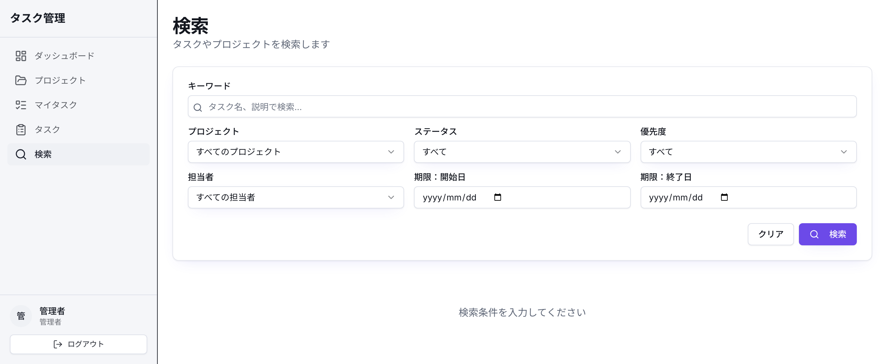
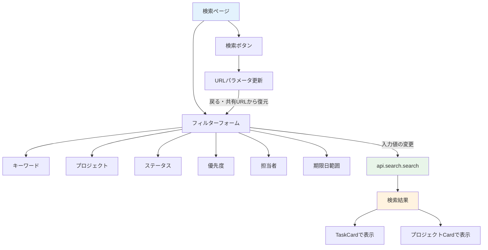
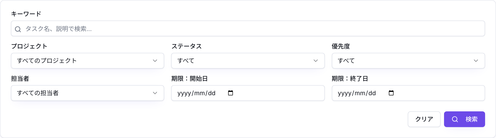
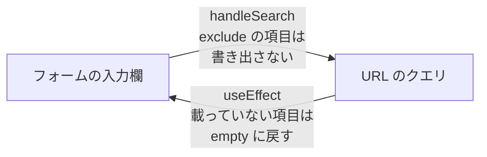
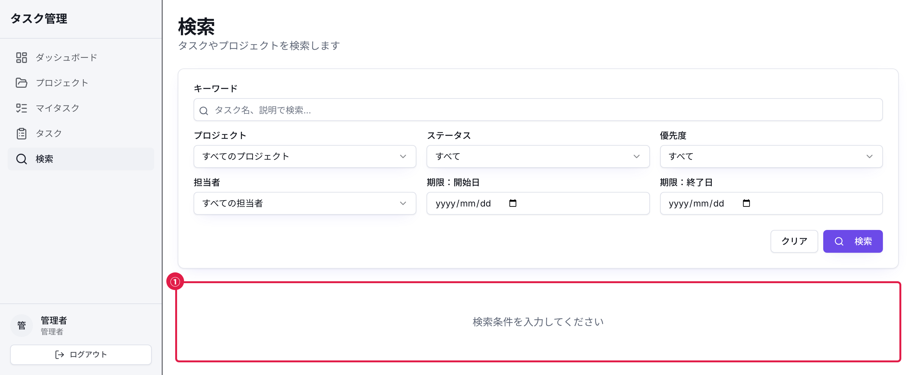
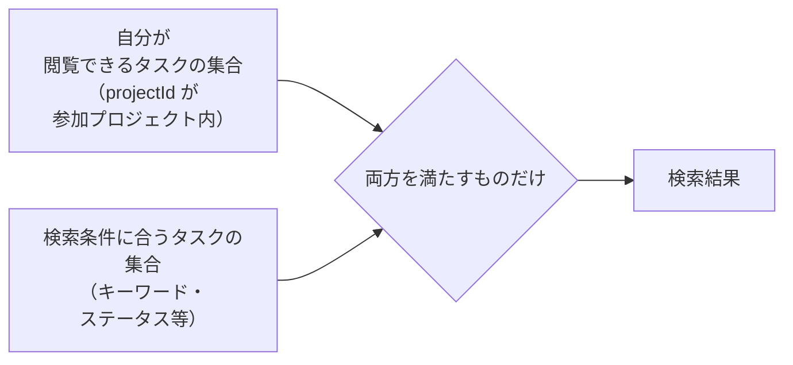

# Day 20: タスク検索機能を実装しよう

## 前回の振り返り

Day 19 ではコメントの編集・削除機能を実装し、自分が書いたコメントだけを操作できる権限チェックも加えました。今日はキーワードとフィルターでタスクを検索する機能に取り組みます。

---

## 今日のゴール

キーワードや複数のフィルター条件でタスクを検索できるページを作ります。検索条件はURLパラメータに保存し、共有可能にします。

この日はまずサーバー側の search ルーターの残り3手続きを自分で書きます。そのあと画面をつなぎます。



条件を入れる前は画面の下側に案内文が出るだけです。
結果のカードが並ぶのは条件を入れて検索したあとです。

> **今日のゴールライン**: 検索フォームの条件をURLに反映し、絞り込んだタスクとプロジェクト結果を共有できる形で表示できれば完了です。

## なぜこれを作るのか

タスクが増えると目的のものが見つけにくくなります。たとえばプロジェクトに50件のタスクがあるとき「優先度：高」で絞り込むと数件だけ表示されます。

> **例え話**: 検索機能は「図書館の検索端末」です。タイトル・ジャンル・著者といった複数の条件を組み合わせて膨大な蔵書から目的の本をすぐに見つけられます。

### 検索機能の構成


フォームの入力値を `watch` で監視し、条件が変わるたびに検索します。検索ボタンは現在の条件を URL に保存するためのものです。共有 URL を開いたときや「戻る」を押したときはURL からフォームを復元します。同じ URL でも検索結果は開いた人の権限に応じて変わります。サーバーが参加中のプロジェクトを調べ、見てよいタスクとプロジェクトだけを返すためです。

### やること / やらないこと

| やること | やらないこと |
|---------|-------------|
| 入力変更に応じた複数条件の検索 | 入力待ち時間による通信の間引き |
| URLパラメータ保存 | 検索結果の並び替え |
| TaskCard で結果表示 | ページネーション |
| プロジェクト結果表示 | 検索履歴 |

### 今日作成・編集するファイル

| ファイル | 役割 |
|---------|------|
| `src/server/api/routers/search.ts` | search ルーターの残り3手続きを追記し、完成版の並びに揃える |
| `src/app/search/page.tsx` | 検索ページ本体（新規作成） |
| `src/app/search/loading.tsx` | ローディング画面（新規作成） |
| `src/component/layout/app-layout.tsx` | サイドバーへ検索の導線を足す |
| `src/app/task/page.tsx` | 検索からの編集リンクを受け取る |

### 新しく学ぶ概念

| 概念 | 読み方 | 役割 | 例え |
|------|--------|------|------|
| search.search | — | 検索API | 図書館の蔵書検索 |
| URLSearchParams | ユーアールエルサーチパラムズ | URLの検索条件を操作するブラウザ標準API | 検索条件の付箋 |
| shouldSearch | シュッドサーチ | 1つでも条件があるか判定するフラグ | APIを呼び出すかの判定 |
| useForm（復習） | ユーズフォーム | フォーム状態管理（Day 14 参照） | 検索条件の管理係 |
| watch | ウォッチ | フォームの値をリアクティブに監視 | 入力が変わるたびに条件を更新 |

## 実装ステップ一覧

| ステップ | 作業内容 | 所要時間 |
|---------|---------|---------|
| Step 0 | search の残り3手続きと読み込み画面を作る | 22分 |
| Step 1 | 検索画面から使うAPIを確認する | 3分 |
| Step 2 | ページの土台を作る | 5分 |
| Step 3 | zodスキーマとuseFormを設定する | 5分 |
| Step 4 | キーワード入力とプロジェクトフィルター | 5分 |
| Step 5 | ステータス・優先度・担当者・期限フィルター | 7分 |
| Step 6 | handleSearchとhandleClearを定義する | 5分 |
| Step 7 | URL同期と検索API呼び出し | 5分 |
| Step 8 | タスク検索結果を表示する | 10分 |
| Step 9 | プロジェクト結果と削除機能を追加する | 7分 |
| Step 10 | 動作確認 | 3分 |

**合計時間**: 約77分です。

表と Step 見出しの分数は説明とコードを読んで中身をつかむまでの目安です。コードを打ち込む Step では打ち込む時間と詰まって調べる時間がこの分数に加わります。

開発サーバーは前の Day から動かしたまま使います。止めてあるときは `npm run dev` で起動してから `http://localhost:3000` を開きます。

---

### Step 0: search の残り3手続きと読み込み画面を作る（22分）

**ゴール**: Day 14 で作った `src/server/api/routers/search.ts` に、
残っている `search`・`quickSearch`・`getUserProjects` を追記します。
読み込み中に表示する `src/app/search/loading.tsx` も作成します。
最後にこの Step で示す5手続きの順序と確認ポイントを使って自己点検します。

Day 14 では担当者候補を取る 2 手続きだけを先に作りました。今日はその続きです。検索画面は `api.search.search` と `api.search.getUserProjects` を使います。さらに `quickSearch` は画面から直接は呼ばれませんが完成版のコードとテストでは使うのでここで一緒に仕上げます。

大事なのは**今日の作業で `search.ts` を完成版のコードと同じ並びに揃える**ことです。Day 14 の時点では `getProjectMembers` と `getMembersByProject` だけを先に書きましたが完成版ではその前に `search`・`quickSearch`・`getUserProjects` が入ります。ここで順番を整えておくと以降の Day と差分を見比べやすくなります。

#### 0-1. まず足りない import と定数を追加する

Day 14 で書いた import に、今日初めて必要になるものだけを足します。
`Prisma` は検索条件の型に使います。
`taskStatusSchema` と `taskPrioritySchema` は検索フォーム入力の検証に使います。
`getUserProjectIds` は「自分が参加しているプロジェクトだけを検索対象にする」ために使います。

```typescript
// filepath: src/server/api/routers/search.ts（既存 import に追記）
import type { Prisma } from '@prisma/client';
import { taskPrioritySchema, taskStatusSchema } from '@/lib/constant/query';
import { getUserProjectIds } from './_helpers/permission';
```
3つとも、今日の検索処理でしか使いません。`Prisma` は型だけを取り込んでいて`Prisma.TaskWhereInput` のような検索条件の型注釈に使います。`taskStatusSchema` と `taskPrioritySchema` は Day 13 で決めたステータスと優先度の値をそのまま持っているので画面から届いた文字列が正しい値かどうかを入口で確かめられます。`getUserProjectIds` はそのユーザーが参加しているプロジェクトの id だけを返す関数です。これを取り込んでおかないとあとで検索範囲を自分のプロジェクトへ絞れません。

続けてDay 14 の `import` 群の下に検索件数の上限を置きます。

```typescript
// filepath: src/server/api/routers/search.ts（import の下に追加）
const SEARCH_TASK_LIMIT = 100;
const SEARCH_PROJECT_LIMIT = 20;
const QUICK_SEARCH_TASK_LIMIT = 20;
const QUICK_SEARCH_PROJECT_LIMIT = 10;
```
`LIMIT` を定数にしておくとあとから「検索結果を20件までにしよう」と変えたいときも、数字を探し回らずに済みます。最初に名前を付けておくと処理本体を読むときも「これは検索件数の上限だな」と一目で分かります。

上限そのものが要る理由も押さえておきましょう。検索は条件しだいで何千件でも一致します。上限を付けずに `findMany` を呼ぶとその全部を DB から運び、ブラウザは全部を描画しようとして固まります。ここで100件と20件に切っておけばいちばん重いときでも読み込む量が決まります。

#### 0-2. 検索入力スキーマを追加する

次に`search` と `quickSearch` が受け取る入力を zod で定義します。Day 14 の `searchRouter` 宣言の前に、次の 2 つを追加してください。

```typescript
// filepath: src/server/api/routers/search.ts（searchRouter の前に追加）
const searchInputSchema = z.object({
  keyword: z.string().optional(),
  projectId: z.string().cuid().optional(),
  status: z
    .union([z.literal('all'), taskStatusSchema])
    .optional()
    .default('all'),
  priority: z
    .union([z.literal('all'), taskPrioritySchema])
    .optional()
    .default('all'),
  assignedTo: z.string().cuid().optional(),
  dateFrom: z.string().datetime().optional(),
  dateTo: z.string().datetime().optional(),
});
```
`status` と `priority` が `z.union([z.literal('all'), ...])` になっているのは「特定の値で絞り込む」だけでなく「絞り込みなし」も受け取りたいからです。検索フォーム側では「すべて」を `'all'` で送るのでサーバー側もその値を受け取れる形にしておきます。

`projectId` と `assignedTo` に `.cuid()` が付いています。id の形をした文字列しか通さないためです。選択肢から外れた値が混ざってもDB へ問い合わせる前に弾けます。`.default('all')` があるので画面が `status` を送らなかったときもサーバー側では「絞り込みなし」として扱われます。7つのうち必須はひとつもありません。キーワードだけ、ステータスだけ、という検索も成り立たせたいからです。

```typescript
// filepath: src/server/api/routers/search.ts（続き）
const quickSearchInputSchema = z.object({
  keyword: z.string().trim().min(1, 'キーワードは必須です'),
});
```
`quickSearch` は検索窓に文字を入れてすぐ使う用途なので空文字は受け付けません。ここで `.min(1, ...)` を付けておくと「検索語なしで呼ばれる」事故を入口で止められます。

順番にも意味があります。`.trim()` が先に来るので空白を落としてから長さを数えます。スペースだけを入れて呼ばれた場合も `.min(1)` に引っかかって止まります。この一行が無いとキーワード無しの `quickSearch` が参加プロジェクトのタスクを丸ごと引いてしまいます。

#### 0-3. 動的な検索条件を組み立てる部品を作る

複数条件検索は最初から `.findMany({ where: ... })` を一気に書くと見通しが悪くなります。そこで完成版のコードでは「条件を小さな部品に分けてから最後に合体する」形にしています。Day 14 の `searchRouter` の前へ、次を上から順に追加します。

```typescript
// filepath: src/server/api/routers/search.ts（続き）
type FilterConfig = {
  key: keyof Prisma.TaskWhereInput;
  value: string | undefined;
  transform?: (value: string) => Prisma.TaskWhereInput[keyof Prisma.TaskWhereInput];
};
```
`FilterConfig` は「どの列に」「どの値を」「必要ならどう変換して」入れるかを表す設計図です。後で `projectId`・`status`・`priority`・`assigneeId` を同じパターンで処理できるようにこの形を先に決めています。

`transform` にだけ `?` が付いているのはほとんどの列が値をそのまま入れるだけで済むからです。今日の `baseFilters` では変換の関数は使いません。日付は別の `buildDateRangeFilter` で扱います。`transform` は今後、値の変換が必要な列を追加する場合に使う項目です。`key` の型を `keyof Prisma.TaskWhereInput` にしてあるので`Task` に存在しない列名を書いた時点で型エラーになります。

```typescript
// filepath: src/server/api/routers/search.ts（続き）
const buildDynamicWhere = (filters: FilterConfig[]): Partial<Prisma.TaskWhereInput> => {
  const result: Partial<Prisma.TaskWhereInput> = {};
  for (const f of filters) {
    if (f.value !== undefined && f.value !== 'all') {
      Object.assign(result, { [f.key]: f.transform ? f.transform(f.value) : f.value });
    }
  }
  return result;
};
```
ここで大事なのは `f.value !== 'all'` の判定です。検索フォームでは「すべて」を `'all'` で送りますがそのまま `where` に入れると `status = 'all'` のような存在しない条件になってしまいます。だから `'all'` は「条件を足さない」という意味で捨てます。

`Object.assign` で1件ずつ足していくので指定されなかった列は `result` に現れません。Prisma は `where` に書かれていない列を条件として扱わないため未指定はそのまま「絞り込まない」になります。この判定を外すとステータスで「すべて」を選んだとたん検索が失敗します。`status` は `TODO` や `DONE` だけを取る列なので`'all'` を条件として渡された Prisma は検索せずにエラーを投げます。0件が返るのではなく、画面にエラーが出ます。

```typescript
// filepath: src/server/api/routers/search.ts（続き）
const buildKeywordFilter = (keyword: string, fields: string[]) =>
  fields.map((field) => ({
    [field]: { contains: keyword, mode: 'insensitive' satisfies Prisma.QueryMode },
  }));
```
`mode: 'insensitive'` は大文字・小文字を区別しない検索です。`Task` と `task` を別物扱いしないのでユーザーが入力の細かい表記を意識せずに済みます。

返しているのは配列で、`fields` に `['title', 'description']` を渡せば2件並びます。これを呼び出し側で `OR` に入れるためタイトルか説明のどちらかが一致すればヒットします。`contains` は部分一致なので「ログ」と入れれば「ログイン画面の修正」も拾えます。検索する列を引数で受け取る形にしてあるのはタスクとプロジェクトで対象の列名が違うからです。

```typescript
// filepath: src/server/api/routers/search.ts（続き）
const buildDateRangeFilter = (dateFrom?: string, dateTo?: string) => {
  const dateFilter: Partial<{ gte: Date; lte: Date }> = {};
  if (dateFrom) {
    dateFilter.gte = new Date(dateFrom);
  }
  if (dateTo) {
    dateFilter.lte = new Date(dateTo);
  }
  return Object.keys(dateFilter).length > 0 ? dateFilter : undefined;
};
```
`gte` は「この日以降」、`lte` は「この日以前」です。両方そろっていなくても動くように開始日だけ・終了日だけでも条件を作れる形にしています。

最後の行で、キーが1つも入らなかったときに `undefined` を返しているところが要点です。期限を指定しない場合は、日付の条件自体を加える必要がありません。`undefined` を返しておけば呼び出し側は返り値があるかどうかだけを見て条件を足すかどうかを決められます。

#### 0-4. 既存の 2 手続きを下へ移し、search を先頭に入れる

ここからが本体です。Day 14 で書いた `getProjectMembers` と
`getMembersByProject` はいったんそのまま残してよいです。
ただし最終的にはその前に `search`・`quickSearch`・`getUserProjects`
が並ぶ形にしてください。
完成形の `export const searchRouter = createTRPCRouter({ ... })` の先頭は
まず `search:` から始まります。

まず `search` を追加します。`export const searchRouter = createTRPCRouter({` の直後へ、次のブロックを順に入れてください。

```typescript
// filepath: src/server/api/routers/search.ts（searchRouter の先頭に追加）
  search: protectedProcedure.input(searchInputSchema).query(async ({ input, ctx }) => {
    const userId = ctx.session.userId;
    const keyword = input.keyword?.trim();

    const baseFilters: FilterConfig[] = [
      { key: 'projectId', value: input.projectId },
      { key: 'status', value: input.status },
      { key: 'priority', value: input.priority },
      { key: 'assigneeId', value: input.assignedTo },
    ];
```
`keyword?.trim()` の `?.` は「値があるときだけ `.trim()` する」です。
前後の空白だけで検索したときに空白を条件として持ち込まないためです。
そのため最初に整えています。

`baseFilters` に4件並べたのはプロジェクト・ステータス・優先度・担当者が「列に値を1つ入れるだけ」で表せる条件だからです。同じ形なのであとから絞り込み項目が増えても配列に1行足すだけで済みます。キーワードと期限だけは複数の列をまたいだり範囲を持ったりするのでこの配列には入れずに別で組み立てます。

```typescript
// filepath: src/server/api/routers/search.ts（続き）
    const dueDateFilter = buildDateRangeFilter(input.dateFrom, input.dateTo);

    const projectIds = await getUserProjectIds(userId);

    const andConditions: Prisma.TaskWhereInput[] = [
      { projectId: { in: projectIds } },
      buildDynamicWhere(baseFilters),
    ];
    if (dueDateFilter) {
      andConditions.push({ dueDate: dueDateFilter });
    }
```
`getUserProjectIds(userId)` が重要です。これで「自分が所属しているプロジェクト id の一覧」を先に取り、`projectId: { in: projectIds }` で検索対象を絞ります。これを入れないとキーワードさえ合えば他人のプロジェクトのタスクまで検索できてしまいます。

この1行は検索機能でいちばん壊してはいけない場所です。試すなら自分が参加していないプロジェクトのタスク名で検索してみてください。この条件があるうちは0件になり、外すと他人のタスクが並びます。しかも画面側で隠しても手遅れです。サーバーが返した時点で、通信の中身には残っています。だから絞り込みは必ずここで済ませます。`andConditions` の配列の先頭へ置いてあるのも、あとから条件を足す人がいちばん先に目を通す場所だからです。

```typescript
// filepath: src/server/api/routers/search.ts（続き）
    if (keyword) {
      andConditions.push({ OR: buildKeywordFilter(keyword, ['title', 'description']) });
    }

    const taskWhere: Prisma.TaskWhereInput = { AND: andConditions };

    const tasks = await prisma.task.findMany({
      where: taskWhere,
      include: {
        project: true,
        createdBy: {
          select: USER_SELECT,
        },
```
検索条件を `AND` の配列で積み上げているのは「参加中プロジェクトであること」「指定したフィルターに合うこと」「キーワードが合うこと」を全部同時に満たさせたいからです。条件が増えても配列に 1 個ずつ足していけば読みやすさを保てます。

`buildDynamicWhere` の返り値をそのまま配列へ入れられます。返す形が `where` と同じだからです。キーワードだけ `push` で後から足しているのは入力が空のときに `OR` ごと省きたいからです。空の配列を `OR` に渡すとどの行も一致しなくなり、他の条件が合っていても結果は0件になります。

```typescript
// filepath: src/server/api/routers/search.ts（続き）
        assignee: {
          select: USER_SELECT,
        },
      },
      orderBy: { updatedAt: 'desc' },
      take: SEARCH_TASK_LIMIT,
    });

    const projects = !keyword
      ? []
      : await prisma.project.findMany({
          where: {
            members: {
              some: { userId },
            },
```
プロジェクト検索は `!keyword ? []` で分岐しています。プロジェクト名検索はキーワードがあって初めて意味があるので空検索のときは無理に DB を読まず空配列を返します。

プロジェクト側の見える範囲は `members: { some: { userId } }` で守ります。タスク側の `projectId: { in: projectIds }` と役割は同じで、「自分がメンバーのものだけ」という条件です。名前が一致しても参加していないプロジェクトはここで落ちます。手続きの中に検索が2本ある以上、絞り込みも2本とも書きます。

```typescript
// filepath: src/server/api/routers/search.ts（続き）
            OR: buildKeywordFilter(keyword, ['name', 'description']),
          },
          include: {
            members: {
              include: {
                user: {
                  select: USER_SELECT,
                },
              },
            },
            _count: {
              select: { tasks: true },
            },
```
`include` でメンバーとその先のユーザーまで取得しています。今日のプロジェクトカードは名前と説明だけを表示するので、このメンバー情報は使いません。ここでは本体と取得するデータの形をそろえています。`_count: { select: { tasks: true } }` はタスクの中身ではなく件数だけを数えて返す書き方です。タスクを全部取ってから `length` で数えると表示に使わないデータまで運ぶことになります。数えるのは DB に任せたほうが軽く済みます。

```typescript
// filepath: src/server/api/routers/search.ts（続き）
          },
          orderBy: { updatedAt: 'desc' },
          take: SEARCH_PROJECT_LIMIT,
        });

    return {
      tasks,
      projects,
      totalCount: tasks.length + projects.length,
    };
  }),
```
`totalCount` をサーバー側で返しておくとフロントエンドは `tasks.length + projects.length` を毎回書かずに済みます。ただしここで数えているのは `take` で切ったあとに返した行数です。条件に一致した全体の件数ではありません。タスクが上限の100件に達したら実際にもっとあっても `totalCount` は100のままです。画面には「いま表示している件数」として出します。

`take: SEARCH_PROJECT_LIMIT` で20件に切ってあるので名前が広く一致しても返る量は決まります。

#### 0-5. quickSearch をその次に追加する

続けて `search` の直後に `quickSearch` を追加します。これは検索ページ本体ではまだ使いませんが完成版のコードとテストで必要です。

```typescript
// filepath: src/server/api/routers/search.ts（search の直後に追加）
  quickSearch: protectedProcedure.input(quickSearchInputSchema).query(async ({ input, ctx }) => {
    const userId = ctx.session.userId;
    const keyword = input.keyword.trim();

    const projectIds = await getUserProjectIds(userId);

    const [tasks, projects] = await Promise.all([
      prisma.task.findMany({
        where: {
          projectId: { in: projectIds },
          OR: buildKeywordFilter(keyword, ['title', 'description']),
        },
```
`Promise.all([...])` にしているのはタスク検索とプロジェクト検索に
互いを待つ必要がないからです。
順番に 2 回待つより同時実行のほうが検索体験は軽くなります。

`Promise.all` は渡した処理を同時に始めて全部が終わったところで結果を配列で返します。`[tasks, projects]` と書いて受け取ると渡した順番のまま値が入ります。片方が失敗したときは全体が失敗になるのでタスクだけ届いた中途半端な結果が画面に出る心配もありません。ここでも `projectIds` を先に取り、`search` と同じ絞り込みを掛けています。

```typescript
// filepath: src/server/api/routers/search.ts（続き）
        include: {
          project: true,
          createdBy: { select: USER_SELECT },
          assignee: { select: USER_SELECT },
        },
        orderBy: { updatedAt: 'desc' },
        take: QUICK_SEARCH_TASK_LIMIT,
      }),
      prisma.project.findMany({
        where: {
          members: { some: { userId } },
          OR: buildKeywordFilter(keyword, ['name', 'description']),
        },
```
ここでも `projectId: { in: projectIds }` と `members: { some: { userId } }` が並んでいます。`quickSearch` は入力がキーワード1つだけで条件は薄いのですが見える範囲の制限だけは `search` と同じに保ちます。手続きごとに書く決まりなので忘れやすく、1か所抜けるとそこだけが抜け道になります。新しい検索の手続きを足すときはまずこの2つを書いてから中身を考えると安全です。

```typescript
// filepath: src/server/api/routers/search.ts（続き）
        include: {
          members: {
            include: { user: { select: USER_SELECT } },
          },
          _count: { select: { tasks: true } },
        },
        orderBy: { updatedAt: 'desc' },
        take: QUICK_SEARCH_PROJECT_LIMIT,
      }),
    ]);
```
上限を `QUICK_SEARCH_TASK_LIMIT`（20件）と `QUICK_SEARCH_PROJECT_LIMIT`（10件）まで下げているのは`quickSearch` が入力しながら候補を出す用途だからです。待たせないことを優先し、絞り込みもキーワード1つに限っています。

```typescript
// filepath: src/server/api/routers/search.ts（続き）
    return {
      tasks,
      projects,
      totalCount: tasks.length + projects.length,
    };
  }),
```
#### 0-6. getUserProjects を追加する

検索フォームのプロジェクト Select では参加中のプロジェクト一覧が必要です。そのための `getUserProjects` を、`quickSearch` の直後に追加します。

```typescript
// filepath: src/server/api/routers/search.ts（quickSearch の直後に追加）
  getUserProjects: protectedProcedure.query(async ({ ctx }) => {
    const userId = ctx.session.userId;

    const projects = await prisma.project.findMany({
      where: {
        members: {
          some: {
            userId,
          },
        },
      },
```
この手続きに `.input(...)` が無いのは画面から受け取るものが何も無いからです。誰のプロジェクトを返すかは `ctx.session.userId` だけで決まります。もし「見たいユーザーの id」を引数で受け取る形にすると他人の id を書き込んで呼ばれる余地が生まれます。送らせない作りにしておけばその心配は最初から起きません。

```typescript
// filepath: src/server/api/routers/search.ts（続き）
      include: {
        _count: {
          select: { tasks: true },
        },
      },
      orderBy: { name: 'asc' },
    });

    return projects;
  }),
```
ここでは `members.some.userId` で「自分が入っているプロジェクトだけ」を取り、`orderBy: { name: 'asc' }` で名前順に並べています。検索フォームの Select は毎回同じ順で並んだほうが探しやすいので更新順ではなく名前順にしています。

`_count` でタスク件数も一緒に返しているのは選択肢の横に件数を出したくなったときに通信を増やさずに済ませるためです。この一覧はそのまま検索フォームの選択肢になります。ここに他人のプロジェクトが混ざらない点は画面の安全へ直結します。

#### 0-7. 既存の 2 手続きはそのまま下へ続ける

この時点で `search.ts` の並びは上から次の順になります。

1. `search`
2. `quickSearch`
3. `getUserProjects`
4. `getProjectMembers`
5. `getMembersByProject`

Day 14 で書いた `getProjectMembers` と `getMembersByProject` のコード自体は変えません。位置だけが後ろへ下がるイメージです。`root.ts` は Day 18 までに `auth → project → task → search → comment` の時系列順で登録済みなので今日は追加で触らなくて大丈夫です。`report` と `user` はそれぞれ Day 21 と Day 24 で初めて追加します。

#### 0-8. 最後に完成形を自己点検する

`src/server/api/routers/search.ts` を先頭から読み直し、次の確認ポイントと照らし合わせてください。販売用 ZIP には完成済み router を入れていないためこの教材内のコードと順序が正本です。

**確認ポイント**:
- `search.ts` の手続き順が `search → quickSearch → getUserProjects → getProjectMembers → getMembersByProject` になっている
- `searchInputSchema` / `quickSearchInputSchema` / `FilterConfig` / 3つの helper が `searchRouter` の前にある
- `root.ts` は Day 18 のまま、`search: searchRouter` が `task` と `comment` の間にある
- `npx tsc --noEmit` を実行し、型エラーが出ていない

---

#### 0-9. 検索ページの読み込み表示を作る

`src/app/search/loading.tsx` を新規作成します。ページと同じフォルダに `loading.tsx` を置くとNext.js はそのページの読み込み中に自動でこれを表示します。

```tsx
// filepath: src/app/search/loading.tsx
import { PageSkeleton }
  from '@/component/ui/page-skeleton';

export default function Loading() {
  return <PageSkeleton />;
}
```
これが出るのはページへ移動したときだけです。検索結果そのものの読み込み表示はStep 8 で `isLoading` を見て切り替えます。役割が分かれている点に注意してください。中身は配布済みの `PageSkeleton` をそのまま返すだけです。この部品を使うのは今日がはじめてです。完成版は同じ4行を dashboard・my-task・project・report・task の各フォルダにも置いています。今日は検索ページの1枚だけ作ります。ほかの画面にも同じ表示を出したくなったら同じ内容のファイルをそのフォルダへ置いてください。

### Step 1: 検索画面から使うAPIを確認する（3分）

**ゴール**: 今書いた `search` ルーターのうち、検索画面がどの手続きを呼ぶのかを整理します。

Day 20 の画面が直接使うのは主に `search.search` と `search.getUserProjects` です。担当者フィルターには Day 14 で作った `search.getProjectMembers` も使います。まず `src/server/api/routers/search.ts` を開き、`searchInputSchema` と `getUserProjects` を確認しましょう。

```typescript
// filepath: src/server/api/routers/search.ts
// 検索パラメータのバリデーション定義
const searchInputSchema = z.object({
  keyword: z.string().optional(),
  projectId: z.string().cuid().optional(),
  status: z.union([
    z.literal('all'),
    taskStatusSchema,
  ]).optional().default('all'),
  priority: z.union([
    z.literal('all'),
    taskPrioritySchema,
  ]).optional().default('all'),
  assignedTo:
    z.string().cuid().optional(),
  dateFrom:
    z.string().datetime().optional(),
  dateTo:
    z.string().datetime().optional(),
});
```
同じ定義をもう一度載せたのはこれから作る画面のフォームがこの7項目とそのまま1対1で対応するからです。キーワード欄が `keyword`、プロジェクトの選択が `projectId`、というように入力欄を1つ足すたびにこのスキーマへ戻ってくることになります。逆に言うとここに無い項目は画面から送っても届きません。zod は定義に無いキーを黙って捨てます。絞り込みが効かないときはまずこのスキーマを疑ってください。

**確認ポイント**:
- 7つのフィルターパラメータを把握した
- `status` と `priority` が union 型である

#### search ルーターの全メソッド

| メソッド | 種別 | 説明 |
|---------|------|------|
| `search` | query | 検索実行（メイン） |
| `quickSearch` | query | クイック検索。呼び出す画面はこのカリキュラムでは作りません |
| `getUserProjects` | query | ユーザーのプロジェクト取得 |
| `getProjectMembers` | query | 参加中プロジェクトを横断した、担当者候補の取得 |
| `getMembersByProject` | query | 選択中プロジェクトだけの、担当者候補の取得 |

#### search メソッドのパラメータ

| パラメータ | 型 | 必須 | 説明 |
|-----------|-----|------|------|
| `keyword` | `string?` | — | キーワード |
| `projectId` | `string (cuid)?` | — | プロジェクト |
| `status` | `'all'` \| TaskStatus | — | ステータス（デフォルト `'all'`） |
| `priority` | `'all'` \| TaskPriority | — | 優先度（デフォルト `'all'`） |
| `assignedTo` | `string (cuid)?` | — | 担当者 |
| `dateFrom` | `string (ISO日付)?` | — | 期限開始 |
| `dateTo` | `string (ISO日付)?` | — | 期限終了 |

> `search` は「複数条件検索」、`quickSearch` は「キーワードだけの軽い検索」、`getUserProjects` は「検索フォームの選択肢取得」と役割が分かれています。使い道が違うので似た名前でも1本に詰め込まず分けています。

> **`dateFrom` / `dateTo` は date-only 入力です。**
> 完成版のコードでは生の Date 変換をそのまま使わず、
> `dateOnlyToUtcStartIso` /
> `dateOnlyToUtcEndIso` で日付境界を UTC に変換してから
> API に渡します。これを省くとタイムゾーンによって
> 「4/17 のつもりが 4/16 扱いになる」ずれが起きます。

---

### Step 2: ページの土台を作る（5分）

**ゴール**: 検索ページの基本構造と export default を完成させます。

Day 13 までのサイドバーへ検索導線を追加します。
`lucide-react` の既存 import に `Search` を
加えてください。

```typescript
// filepath: src/component/layout/app-layout.tsx
import {
  ClipboardList,
  FolderOpen,
  LayoutDashboard,
  ListTodo,
  LogOut,
  Search,
} from 'lucide-react';
```
足すのは `Search` の1行だけです。`lucide-react` からアイコンをまとめて取り込んでいるので既存のアイコンを消さずに並びへ追加します。アルファベット順に入れてあるのはimport の並べ替えを Biome に任せているからで、順番を崩すと保存のたびに差分が出ます。

`menuItems` の閉じかっこ直前へ
検索項目を追加します。

```typescript
// filepath: src/component/layout/app-layout.tsx
{
  text: '検索',
  icon: <Search className="h-5 w-5" />,
  path: '/search',
},
```
`path: '/search'` がこのあと作る `src/app/search/page.tsx` と対応します。Next.js はフォルダの位置がそのままURLになるのでリンク先を別に登録する作業は要りません。ページを作る前でも項目は追加できますがその状態で押すと404の画面になります。順番としては先にサイドバーへ入口を作り、次にページ本体を作ります。

**確認ポイント**:
- 既存の4項目を残した
- サイドバーの「検索」から `/search` を開ける

`src/app/search/page.tsx` を新規作成します。まずインポートを記述します。

```typescript
// filepath: src/app/search/page.tsx
'use client';

import { zodResolver }
  from '@hookform/resolvers/zod';
import { Search } from 'lucide-react';
import {
  useRouter, useSearchParams,
} from 'next/navigation';
import {
  Suspense, useCallback, useEffect,
  useMemo, useState,
} from 'react';
import { useForm } from 'react-hook-form';
import toast from 'react-hot-toast';
import { z } from 'zod';
```
今日の主役は `useSearchParams` と `useRouter` です。前者はURLに付いた検索条件を読み、後者は条件をURLへ書き戻します。`useForm` と `zodResolver` は Day 14 のタスクフォームと同じ組み合わせで、`Suspense` は Day 09 のプロジェクト一覧で使ったものと同じ役割です。新しく覚えるのは実質2つだけで、残りは今まで書いてきた道具の組み替えになります。

**確認ポイント**:
- `useForm`, `zodResolver`, `z` がインポートされている

続いてローカルモジュールのインポートです。

```typescript
// filepath: src/app/search/page.tsx
import { AppLayout }
  from '@/component/layout/app-layout';
import { TaskCard }
  from '@/component/task/task-card';
import { Button }
  from '@/component/ui/button';
import {
  Card, CardContent,
} from '@/component/ui/card';
import { DeleteConfirmDialog }
  from '@/component/ui/delete-confirm-dialog';
import { Input }
  from '@/component/ui/input';
import { Label }
  from '@/component/ui/label';
```
ここで取り込む部品はすべて Day 09 から Day 19 までに使ってきたものです。`TaskCard` は Day 13 のタスク一覧で、`DeleteConfirmDialog` は Day 11 の削除確認で初めて呼び出した、用意済みの共通部品です。`TaskCard` は Day 16 で時間記録のボタンを足しただけです。どちらも一から書いたものではありません。検索画面でも表示用の部品を新しく作らず、すでにあるカードとダイアログを並べ替えて使います。見た目がタスク一覧とそろうので読者にとっても「検索したあとの操作は今まで通り」になります。

**確認ポイント**:
- レイアウト・UIコンポーネントが揃っている

```typescript
// filepath: src/app/search/page.tsx
import { PageLoadingSpinner }
  from '@/component/ui/loading-spinner';
import {
  Select, SelectContent, SelectItem,
  SelectTrigger, SelectValue,
} from '@/component/ui/select';
import { Separator }
  from '@/component/ui/separator';
import {
  isTaskPriority,
  TASK_PRIORITY_LABELS,
} from '@/lib/constant/priority';
```
`Select` は shadcn/ui の部品で、4つがそろって1つのプルダウンになります。`SelectTrigger` が閉じているときのボタン、`SelectContent` が開いたときの一覧、`SelectItem` が選択肢1つ分、`SelectValue` が今選ばれている値の表示です。`TASK_PRIORITY_LABELS` は `HIGH` のような内部の値を「高」という日本語へ変える対応表で、Day 14 のタスク作成ダイアログで読み込んだ scaffold 配布の定数を使い回します。`isTaskPriority` は受け取った文字列がその4つのどれかに当たるかを確かめる関数です。

続けてロール判定用と検索条件用のインポートを追加します。

```typescript
// filepath: src/app/search/page.tsx
import {
  hasPermission, isProjectMemberRole,
  type ProjectMemberRole,
} from '@/lib/constant/roles';
import {
  isTaskStatus,
  TASK_STATUS_LABELS,
} from '@/lib/constant/status';
import {
  dateOnlyToUtcEndIso,
  dateOnlyToUtcStartIso,
} from '@/lib/date';
import {
  isAuthError, isForbiddenError, isUnknownResult,
  shouldRetryQuery,
} from '@/lib/query-error';
import { api } from '@/trpc/react';
```
`dateOnlyToUtcStartIso` と `dateOnlyToUtcEndIso` は日付だけの文字列を時刻付きに直す関数です。`type="date"` の入力欄からは `2026-04-17` のような値が届くので、その日の始まりと終わりへ直してからサーバーへ渡します。`hasPermission` と `isProjectMemberRole` は Day 13 で使ったロール判定の道具で、検索結果のカードに編集ボタンを出してよいかを決めます。`query-error` は Day 11 で作ったファイルです。取得の状態に加えて削除の結果不明も分けるため、`isUnknownResult` を取り込みます。

**確認ポイント**:
- `PageLoadingSpinner` のパスが `@/component/ui/loading-spinner`
- 型ガード `isTaskStatus` / `isTaskPriority` がインポートされている

`SearchPageContent` の外枠と `export default` を書きます。`useSearchParams` は Suspense 境界が必要です。

```typescript
// filepath: src/app/search/page.tsx
// コンポーネント本体の外枠
function SearchPageContent() {
  const router = useRouter();
  const searchParams = useSearchParams();
  const utils = api.useUtils();

  return (
    <AppLayout>
      <div className="space-y-6">
        <div>
          <h1 className="text-3xl font-bold
            tracking-tight">検索</h1>
          <p className="text-muted-foreground">
            タスクやプロジェクトを検索します
          </p>
        </div>
        {/* Step 4-5: フィルターフォーム */}
        {/* Step 8-9: 検索結果 */}
      </div>
    </AppLayout>
  );
}
```
中身はまだ見出しと説明文だけで、フォームと結果はコメントの位置へ順に足していきます。先に外枠を置いておくと次のステップから貼り付ける場所に迷いません。`utils` は `api.useUtils()` で取り出す道具で、タスクを削除したあとに検索結果を取り直させるために使います。今の時点では使い道が見えませんがStep 9 の削除処理でここへ戻ってきます。

**確認ポイント**:
- `utils` は検索結果の再取得（削除後）に使う
- コメントでフォームと結果の挿入位置を示している

> `useSearchParams` はURL のクエリ文字列を読み取る Next.js のフックです。`useRouter` はプログラムからURL遷移するために使います。

```typescript
// filepath: src/app/search/page.tsx
// Suspenseでラップしてexport
export default function SearchPage() {
  return (
    <Suspense
      fallback={<PageLoadingSpinner />}>
      <SearchPageContent />
    </Suspense>
  );
}
```
ページを `SearchPageContent` と `SearchPage` の2つに分けたのは`Suspense` の外側に本体を置けないからです。外側の `SearchPage` が待ち受け役、内側が本体という分担で、Day 09 のプロジェクト一覧ページと同じ形になっています。`fallback` に渡した `PageLoadingSpinner` はURLが決まるまでの間だけ表示されます。

**確認ポイント**:
- `/search` にアクセスして画面が表示される
- `PageLoadingSpinner` で読み込み中が表示される

> Next.js App Router では `useSearchParams` を使うコンポーネントを `Suspense` で囲む必要があります。囲まないとビルド時にエラーになります。

---

### Step 3: zodスキーマとuseFormを設定する（5分）

**ゴール**: 7つのフィルター条件を zod スキーマと useForm で一括管理します。

`SearchPageContent` の外側（関数の上）にスキーマを定義します。サーバー側の `searchInputSchema` と型を合わせます。

```typescript
// filepath: src/app/search/page.tsx
// ステータス・優先度の値定義
const TASK_STATUS_VALUES = [
  'TODO', 'IN_PROGRESS', 'IN_REVIEW',
  'DONE', 'CANCELLED',
] as const;
const TASK_PRIORITY_VALUES = [
  'LOW', 'MEDIUM', 'HIGH', 'URGENT',
] as const;
```
`as const` を付けると配列を要素数と順番が決まった読み取り専用の型として扱えます。次の `z.enum([...])` はこの値の一覧から選択肢を作ります。サーバー側の `taskStatusSchema` と値をそろえておきましょう。片方だけ増やすと画面では選べるのにサーバーで弾かれる項目ができます。

**確認ポイント**:
- サーバー側の `taskStatusSchema` / `taskPrioritySchema` と値が一致している

```typescript
// filepath: src/app/search/page.tsx
// 検索フォームの zodスキーマ
const searchFormSchema = z.object({
  keyword: z.string(),
  projectId: z.string(),
  status: z.enum([
    'all', ...TASK_STATUS_VALUES,
  ]),
  priority: z.enum([
    'all', ...TASK_PRIORITY_VALUES,
  ]),
  assignedTo: z.string(),
  dateFrom: z.string(),
  dateTo: z.string(),
});
type SearchFormValues =
  z.infer<typeof searchFormSchema>;
```
`'all'` を配列の先頭へ置いたのは絞り込みなしもフォームの正式な値として扱うためです。サーバー側の `searchInputSchema` が `z.union([z.literal('all'), taskStatusSchema])` だったのと同じ考え方で、画面とサーバーで受け取れる値をそろえています。最後の `z.infer` は書いたスキーマから型を組み立てる書き方です。型を別に手で書かないのでスキーマを直せば型も一緒に変わります。この `SearchFormValues` が次に `useForm` へ渡す型になります。

**確認ポイント**:
- `status` / `priority` が `'all'` + 実際の値の union になっている
- サーバー側と型が合っている（`z.string()` ではなく `z.enum`）

URLのプロジェクトID・担当者ID・日付はフォームへ入れる前に確かめます。`SearchPageContent` の外に次の関数を追加してください。

```typescript
// filepath: src/app/search/page.tsx
const normalizeId = (value: string): string =>
  z.string().cuid().safeParse(value).success ? value : 'all';

const normalizeDate = (value: string): string => {
  if (!/^\d{4}-\d{2}-\d{2}$/.test(value)) return '';
  const date = new Date(`${value}T00:00:00.000Z`);
  return !Number.isNaN(date.getTime()) &&
    date.toISOString().slice(0, 10) === value
    ? value : '';
};
```
IDはサーバーと同じ `cuid()` で検査し、不正なら絞り込みなしの `all` に戻します。日付は形式と実在する日付の両方を検査します。`2026-02-30` は Date が3月へ補正するため変換後の日付とも比較します。不正な値は空文字に戻します。こうしておけば`?dateFrom=bad` を開いても検索前の日付変換で画面がエラーになりません。

`SearchPageContent` 内に `useForm` を追加します。URLパラメータから初期値を型安全に設定します。

```typescript
// filepath: src/app/search/page.tsx
// SearchPageContent内: 初期値の準備
const initialStatus =
  searchParams.get('status') ?? 'all';
const initialPriority =
  searchParams.get('priority') ?? 'all';

const form = useForm<SearchFormValues>({
  resolver: zodResolver(searchFormSchema),
  defaultValues: {
    keyword:
      searchParams.get('keyword') ?? '',
    projectId:
      normalizeId(searchParams.get('projectId') ?? ''),
    status: isTaskStatus(initialStatus)
      ? initialStatus : 'all',
```

`initialStatus` をいったん変数に取り出しているのは`isTaskStatus()` の判定と代入で同じ値を2回読まないためです。

`defaultValues` を URL から組み立てているのがこの画面の性格を決めています。検索条件を含んだリンクを開いた人が同じ条件を復元できます。結果はその人の権限と保存済みデータによって変わります。ここを固定値にするとリンクを共有しても相手には空のフォームが出ます。
初期値をURLから読んでいるところが今日いちばん大事な設計です。`searchParams.get('keyword')` は`/search?keyword=修正` というURLで開かれたときに「修正」を返します。パラメータが無ければ `null` なので`?? ''` で空文字に置き換えます。条件を `useState` の初期値として書いてしまうと共有されたURLで開いても入力欄は空のままになり、URLと画面が食い違います。

`status` だけ `isTaskStatus` を通してから入れているのはURLが誰でも手で書き換えられるからです。`?status=ABC` のような値をそのままフォームへ入れるとSelect に無い値が選ばれた状態になり、表示が空欄のまま固まります。

**確認ポイント**:
- `??` を使って初期値を設定している（`||` ではない）

```typescript
// filepath: src/app/search/page.tsx
// defaultValues の続き
    priority:
      isTaskPriority(initialPriority)
        ? initialPriority : 'all',
    assignedTo:
      normalizeId(searchParams.get('assignedTo') ?? ''),
    dateFrom:
      normalizeDate(searchParams.get('dateFrom') ?? ''),
    dateTo:
      normalizeDate(searchParams.get('dateTo') ?? ''),
  },
});
```
未指定のときの値が項目ごとに違う点を見てください。`assignedTo` は `'all'`、日付は空文字です。Select は必ず何かが選ばれている状態なので「すべて」を表す `'all'` が必要で、日付欄は空欄のままを許すので空文字になります。ここで型がそろっていないと`useForm` に渡した時点で型エラーになります。7つの条件を1つの `useForm` にまとめているのであとで値をまとめて読むのもまとめて消すのも1行で済みます。

**確認ポイント**:
- `isTaskStatus` / `isTaskPriority` で型安全にバリデーションしている
- 7つのフィールドが1つの `useForm` で管理されている

`watch` でフォームの現在値を取得し、プルダウン用データを取得します。

```typescript
// filepath: src/app/search/page.tsx
// フォームの現在値を監視
const formValues = form.watch();

const { data: projects } =
  api.search.getUserProjects.useQuery();
const { data: users } =
  api.search.getProjectMembers.useQuery();
```
**確認ポイント**:
- `watch()` でフォームの値をリアクティブに取得している

> Day 14 では `register` と `Controller` で各入力を管理しました。検索フォームでは `setValue` と `watch` の組み合わせで Select コンポーネントの値も管理できます。

検索結果の TaskCard にも編集・削除ボタンの表示可否が必要です。Day 13 と同じロール判定を、ログインユーザーとメンバー所属プロジェクトから求めます。`projects`（Selectの選択肢用）とは別に、ロール情報つきのプロジェクト一覧を取得します。

```typescript
// filepath: src/app/search/page.tsx
// ログインユーザーの情報とロール判定用のプロジェクト一覧
const { data: session } =
  api.auth.getSession.useQuery();
const { data: memberProjects } =
  api.project.getAll.useQuery();

// プロジェクトごとのログインユーザー自身のロールを引けるようにする
const myRoleByProject = useMemo(() => {
  const map = new Map<string, ProjectMemberRole>();
  const userId = session?.user?.id;
  if (!userId || !memberProjects) {
    return map;
  }
  for (const project of memberProjects) {
    const me = project.members?.find(
      (member) => member.userId === userId,
    );
    if (me && isProjectMemberRole(me.role)) {
      map.set(project.id, me.role);
    }
  }
  return map;
}, [memberProjects, session?.user?.id]);
```
`useMemo`（計算した結果を覚えておいてもとにした値が変わるまで作り直さないReactの機能）で包んでいます。この対応表を作り直したいのは`memberProjects` かログインユーザーが変わったときだけだからです。検索結果には複数のプロジェクトのタスクが混ざるのでカードを1枚描くたびに配列を端から探し直すと件数の分だけ同じ処理が走ります。`Map` に一度まとめておけばあとは id で1回引くだけで済みます。

> `projects`（`getUserProjects`）はSelectの選択肢専用で、メンバーのロール情報を含みません。ロール判定には `api.project.getAll` が返す `memberProjects`（`members` 配列つき）を使います。

続けてそのロールから編集・削除の権限を判定する関数を追加します。

```typescript
// filepath: src/app/search/page.tsx
// ロールから編集・削除の権限を判定する
const canEditProject = useCallback(
  (projectId: string) => {
    const role = myRoleByProject.get(projectId);
    return role ? hasPermission(role, 'canEdit') : false;
  },
  [myRoleByProject],
);

const canDeleteProject = useCallback(
  (projectId: string) => {
    const role = myRoleByProject.get(projectId);
    return role ? hasPermission(role, 'canDelete') : false;
  },
  [myRoleByProject],
);
```
ロールが見つからないときに `false` を返しているのが安全側に倒した作りです。プロジェクト一覧がまだ届いていない一瞬の間も、`myRoleByProject` は空なので `false` になります。ここを `true` にしてしまうと権限のない人にも編集ボタンや削除ボタンが一瞬だけ見える時間ができます。判断がつかないうちは出さない、というのが権限まわりの基本です。

> `canEditProject` / `canDeleteProject` の考え方はDay 13のタスク一覧ページと同じです。

**確認ポイント**:
- `myRoleByProject` / `canEditProject` / `canDeleteProject` が定義できた
- `npm run dev` でエラーが出ていない

---

### Step 4: キーワード入力とプロジェクトフィルター（5分）

**ゴール**: Card 内にキーワード入力とプロジェクトSelectを配置します。

Step 2 の `{/* Step 4-5: フィルターフォーム */}` を以下のコードに置き換えます。

```typescript
{/* filepath: src/app/search/page.tsx */}
{/* フィルターフォーム開始 */}
<Card>
  <CardContent className="pt-6 sm:pt-6">
    <div className="grid gap-4">
      <div className="grid gap-2">
        <Label htmlFor="keyword">
          キーワード
        </Label>
        <div className="relative">
          <Search className="absolute
            left-2 top-3 h-4 w-4
            text-muted-foreground" />
          <Input id="keyword"
            placeholder=
              "タスク名、説明で検索..."
            className="pl-8"
            {...form.register('keyword')}
            onKeyDown={(e) => {
              if (e.key === 'Enter' && !e.nativeEvent.isComposing)
                handleSearch();
            }} />
        </div>
      </div>
```
`{...form.register('keyword')}` はこの入力欄をフォームの `keyword` へ結び付ける書き方です。Day 14 と同じで、入力された値の保持も変更の受け取りも react-hook-form の側が引き受けます。`onKeyDown` を別に足したのはEnter を押したときにボタンと同じ `handleSearch` を呼びたいからです。この行が無いとキーワードを打ってEnterを押しても何も起きず、読者は「検索が壊れている」と感じます。

`CardContent` の `pt-6 sm:pt-6` は上の余白を足す指定です。この部品には最初から `sm:pt-0` が入っていて `pt-6` だけを書くと幅が640px以上の画面ではその `sm:pt-0` が勝って余白が消えます。`sm:` 付きでも指定してどの幅でも余白を残します。

ここで呼んでいる `handleSearch` はあとの Step 6 で定義します。
定義するまでこの画面は表示できないのでEnter キーの動きを確かめるのは Step 6 のあとです。

**確認ポイント**:
- `register('keyword')` でフォームに登録している
- `onKeyDown` の中で `handleSearch()` を呼ぶ行を書けた

> `Search` アイコンを `absolute` で左に配置し、Input の `pl-8` で左パディングを確保します。これでアイコン付き入力欄になります。

6つのフィルターを Grid レイアウトで配置します。まずプロジェクトです。

```typescript
{/* filepath: src/app/search/page.tsx */}
{/* 6列グリッド開始 + プロジェクトSelect */}
<div className="grid grid-cols-1
  md:grid-cols-2 lg:grid-cols-3 gap-4">
  <div className="grid gap-2">
    <Label htmlFor="project">プロジェクト</Label>
    <Select
      value={formValues.projectId}
      onValueChange={(v) =>
        form.setValue('projectId', v)}>
      <SelectTrigger id="project">
        <SelectValue
          placeholder="すべて" />
      </SelectTrigger>
```
`Label` の `htmlFor` と `SelectTrigger` の `id` に同じ文字を入れているのはラベルとプルダウンを結び付けるためです。こうするとラベルの文字を押しても開き、読み上げソフトも「何の絞り込みか」を伝えられます。

Select は `<input>` と違って `register` では結び付けられません。値の表示は `value={formValues.projectId}`、変更の受け取りは `onValueChange` から `form.setValue` を呼ぶ、という2本立てにして自分の手でつなぎます。`formValues` は `form.watch()` の結果なので`setValue` で書き込むと表示側もすぐ追いつきます。この2つのどちらかを書き忘れると選んだ項目が画面に反映されない、あるいは選んでも検索条件に入らない、という食い違いが起きます。

**確認ポイント**:
- `form.setValue` で Select の値をフォームに反映している

```typescript
{/* filepath: src/app/search/page.tsx */}
{/* プロジェクト SelectContent */}
      <SelectContent>
        <SelectItem value="all">
          すべてのプロジェクト
        </SelectItem>
        {projects?.map((p) => (
          <SelectItem key={p.id}
            value={p.id}>
            {p.name}
          </SelectItem>))}
      </SelectContent>
    </Select>
  </div>
```
この `projects` は Step 0 で書いた `getUserProjects` の結果なのでここに他人のプロジェクトは現れません。選択肢の時点で範囲が閉じているからフォーム側で改めて確かめる必要もありません。

**確認ポイント**:
- `value="all"` が初期選択肢になっている

---

### Step 5: ステータス・優先度・担当者・期限フィルター（7分）

**ゴール**: 残り5つのフィルターを Grid 内に追加します。

ステータスフィルターです。型ガードで不正な値を防ぎます。

```typescript
{/* filepath: src/app/search/page.tsx */}
{/* ステータスフィルター（型ガード付き） */}
  <div className="grid gap-2">
    <Label htmlFor="status">ステータス</Label>
    <Select value={formValues.status}
      onValueChange={(v) => {
        if (isTaskStatus(v)
          || v === 'all')
          form.setValue('status', v);
      }}>
      <SelectTrigger id="status">
        <SelectValue /></SelectTrigger>
      <SelectContent>
        <SelectItem value="all">
          すべて</SelectItem>
        {Object.entries(
          TASK_STATUS_LABELS
        ).map(([v, label]) => (
          <SelectItem key={v}
            value={v}>{label}
          </SelectItem>))}
      </SelectContent>
    </Select>
  </div>
```
`onValueChange` の中で `isTaskStatus(v) || v === 'all'` を確かめてから `setValue` しているのはフォームが受け取れる値だけを通すためです。選択肢を自分で並べているので普段なら外れた値は来ません。ただし `v` の型が `string` である以上、型の上では何でも渡せてしまいます。ここで一段はさむと`SearchFormValues` の型と実際に入る値がずれません。`Object.entries(TASK_STATUS_LABELS)` は`['TODO', '未対応']` のような値とラベルの組を一度に取り出す書き方です。選択肢を手で5行書かずに済むうえ、ステータスが増えたときも定数を直すだけで画面に出ます。

**確認ポイント**:
- `isTaskStatus(v)` で値をバリデーションしている
- `TASK_STATUS_LABELS` から日本語ラベルを取得している

優先度もステータスと同じパターンです。

```typescript
{/* filepath: src/app/search/page.tsx */}
{/* 優先度フィルター（型ガード付き） */}
  <div className="grid gap-2">
    <Label htmlFor="priority">優先度</Label>
    <Select value={formValues.priority}
      onValueChange={(v) => {
        if (isTaskPriority(v)
          || v === 'all')
          form.setValue('priority', v);
      }}>
      <SelectTrigger id="priority">
        <SelectValue /></SelectTrigger>
      <SelectContent>
        <SelectItem value="all">
          すべて</SelectItem>
        {Object.entries(
          TASK_PRIORITY_LABELS
        ).map(([v, label]) => (
          <SelectItem key={v}
            value={v}>{label}
          </SelectItem>))}
      </SelectContent>
    </Select>
  </div>
```
似た形の絞り込みを1つの部品にまとめる手もありますがここでは並べたままにしています。選択肢の作り方が項目ごとに変わりやすく、まとめると分岐だらけの部品になるからです。書き写す量は増えますがあとで1項目だけ直したいときに他の項目を壊さずに済みます。

**確認ポイント**:
- 優先度もステータスと同じパターンで動作する

担当者フィルターを追加します。

```typescript
{/* filepath: src/app/search/page.tsx */}
{/* 担当者フィルター */}
  <div className="grid gap-2">
    <Label htmlFor="assignedTo">
      担当者
    </Label>
    <Select
      value={formValues.assignedTo}
      onValueChange={(v) =>
        form.setValue('assignedTo', v)}>
      <SelectTrigger id="assignedTo">
        <SelectValue
          placeholder="すべての担当者" />
      </SelectTrigger>
```
担当者は値が id なのでステータスのような型ガードは使いません。選択肢が `getProjectMembers` の返す一覧から作られていてそこに無い id はそもそも選べないからです。サーバー側でも `assignedTo` に `.cuid()` が付いているので形の違う値は入口で落ちます。`SelectTrigger` に `id="assignedTo"` を付けたのは上の `<Label htmlFor="assignedTo">` と結び付けるためです。ラベルの文字を押してもプルダウンが開くようになり、押せる範囲が広がります。

**確認ポイント**:
- 担当者も `form.setValue` で管理している

```typescript
{/* filepath: src/app/search/page.tsx */}
{/* 担当者 SelectContent */}
      <SelectContent>
        <SelectItem value="all">
          すべての担当者
        </SelectItem>
        {users?.map((user) => (
          <SelectItem key={user.id}
            value={user.id}>
            {user.name ?? user.email}
          </SelectItem>))}
      </SelectContent>
    </Select>
  </div>
```
`users` は Day 14 で作った `getProjectMembers` の結果で、自分が参加しているプロジェクトのメンバーだけが入ります。関係のない利用者の名前は候補に出てこないので担当者で絞り込んでも見える範囲は広がりません。`user.name ?? user.email` は名前を登録していないメンバーを空欄で並べないための書き分けです。空欄の選択肢が並ぶとどれを選んだのか分からなくなります。

**確認ポイント**:
- `user.name ?? user.email` で名前がない場合はメールを表示

期限範囲フィルターと検索ボタンを追加します。

```typescript
{/* filepath: src/app/search/page.tsx */}
{/* 期限範囲 + 検索ボタン */}
  <div className="grid gap-2">
    <Label htmlFor="dateFrom">
      期限：開始日</Label>
    <Input id="dateFrom" type="date"
      {...form.register('dateFrom')} />
  </div>
  <div className="grid gap-2">
    <Label htmlFor="dateTo">
      期限：終了日</Label>
    <Input id="dateTo" type="date"
      {...form.register('dateTo')} />
  </div>
</div>{/* grid終了 */}
```
日付の2つは Select と違うので `register` で結び付けられます。`type="date"` にするとブラウザが用意しているカレンダーの入力欄になり、値は `2026-04-17` のような文字列で届きます。この形のまま送ると時刻が付いていないのでStep 7 で `dateOnlyToUtcStartIso` を通してから API へ渡します。開始日と終了日を分けているのはサーバー側の `buildDateRangeFilter` が `gte` と `lte` を別々に受け取る作りだからです。片方だけ入れた検索も成り立ちます。

**確認ポイント**:
- 日付入力欄が `type="date"` で表示される

```typescript
{/* filepath: src/app/search/page.tsx */}
{/* 検索・クリアボタン */}
      <div className="flex
        justify-end gap-2 pt-2">
        <Button variant="outline"
          onClick={handleClear}>
          クリア
        </Button>
        <Button onClick={handleSearch}>
          <Search className="mr-2
            h-4 w-4" />
          検索
        </Button>
      </div>
    </div>{/* grid gap-4終了 */}
  </CardContent>
</Card>
```
2つのボタンは `<form>` の送信ではなく `onClick` で動かします。この画面が値を送る先はサーバーではなくURLだからです。フォームの送信を使うとページ全体が読み直され、せっかく持っている入力の状態が消えます。`variant="outline"` のクリアボタンは押しても検索を走らせず、条件だけを初期状態へ戻します。ここまでで入力欄が7つそろい、フォーム全体が1枚の `Card` に収まりました。

2つのボタンが呼んでいる `handleSearch` と `handleClear` は次の Step 6 で定義します。
定義するまでこの画面は表示できないので見た目の確認は Step 6 のあとに行います。

**確認ポイント**:
- ボタンを2つ書けた
- フォーム全体が Card 内にまとまっている

下の画像は Step 6 まで書き終えた完成後の画面です。入力欄が7つそろい、右下に「クリア」と「検索」の2つのボタンが並びます。押したときの処理は Step 6 で書きます。まだ関数が未定義なので画面の確認も Step 6 の後に行います。



---

### Step 6: handleSearch と handleClear を定義する（5分）

**ゴール**: 検索実行とクリアのハンドラーを定義します。フォームの値をURLパラメータに変換します。

`SearchPageContent` 内、return 文より前に追加します。

```typescript
// filepath: src/app/search/page.tsx
// 検索実行ハンドラー
const handleSearch = () => {
  const values = form.getValues();
  const paramList = [
    { key: 'keyword',
      value: values.keyword },
    { key: 'projectId',
      value: values.projectId,
      exclude: 'all' },
    { key: 'status',
      value: values.status,
      exclude: 'all' },
    { key: 'priority',
      value: values.priority,
      exclude: 'all' },
    { key: 'assignedTo',
      value: values.assignedTo,
      exclude: 'all' },
    { key: 'dateFrom',
      value: values.dateFrom },
    { key: 'dateTo',
      value: values.dateTo },
  ];
```
`paramList` を配列にしたのは7つの項目を同じ手順で処理したいからです。項目ごとに `if` を7個並べる書き方もできますが条件を1つ足すたびに書き足す場所が増えて漏れやすくなります。`exclude: 'all'` が付いている4つは「すべて」を選んだときにURLへ書かないという指定です。キーワードと日付に付いていないのはこの2つの未入力が空文字で、次のブロックの `p.value` の判定だけで落ちるからです。

**確認ポイント**:
- `form.getValues()` で全フィールドの値を一括取得している
- `exclude: 'all'` で「すべて」選択時はURLに含めない

```typescript
// filepath: src/app/search/page.tsx
// URLパラメータを構築して遷移
  const params = new URLSearchParams();
  const filtered = paramList.filter(
    (p) =>
      p.value && p.value !== p.exclude,
  );
  for (const p of filtered) {
    params.set(p.key, p.value);
  }
  router.push(
    `/search?${params.toString()}`);
};
```
**確認ポイント**:
- `URLSearchParams` で条件をURL文字列に変換している
- `router.push` でURLを更新している

未入力の条件をURLから外しています。共有したときのURLを読める長さに保つためです。7項目を全部書くと `?keyword=&projectId=all&status=all...` という並びになり、何で絞り込んだのかが見て分かりません。`router.push` を使うとブラウザの履歴に1件積まれるので条件を変えて検索したあとに「戻る」を押すと前の条件へ戻ります。

> `URLSearchParams` はブラウザ標準のAPIです。`params.set('key', 'value')` でキーと値を追加し、`params.toString()` で `key=value&key2=value2` 形式の文字列を生成します。

```typescript
// filepath: src/app/search/page.tsx
// クリアハンドラー（form.reset版）
const handleClear = () => {
  form.reset({
    keyword: '',
    projectId: 'all',
    status: 'all',
    priority: 'all',
    assignedTo: 'all',
    dateFrom: '',
    dateTo: '',
  });
  router.push('/search');
};
```
`form.reset` でフォームを空にするだけでは足りません。URLには前の条件が残ったままだからです。残っているとこのあと Step 7 で書くURL同期がすぐに値を書き戻し、クリアしたはずの条件が復活します。だから `router.push('/search')` でURLも同時に空へ戻します。フォームとURLのどちらか片方だけを直すと必ず食い違うのでこの2行は必ずセットで書きます。

**確認ポイント**:
- `form.reset()` で7つのフィールドを一括クリアしている
- `router.push('/search')` でURLもリセットしている

> `form.getValues()` で全フィールドの値を一括取得し、`form.reset()` で一括クリアできます。`useState` を7個並べるより管理しやすくなります。

---

### Step 7: URL同期と検索API呼び出し（5分）

**ゴール**: URLパラメータの変更をフォームに同期し、条件付きで検索APIを呼びます。

ブラウザの「戻る」ボタンや共有リンクに対応するためURLパラメータが変わったときにフォームの値を同期します。

```typescript
// filepath: src/app/search/page.tsx
// URL→form 同期（useEffect）
useEffect(() => {
  const paramMap: Array<{
    key: keyof SearchFormValues;
    empty: string;
    transform?: (v: string) => string;
  }> = [
    { key: 'keyword', empty: '' },
    { key: 'projectId', empty: 'all', transform: normalizeId },
    { key: 'status', empty: 'all',
      transform: (v) =>
        isTaskStatus(v) ? v : 'all' },
    { key: 'priority', empty: 'all',
      transform: (v) =>
        isTaskPriority(v) ? v : 'all' },
    { key: 'assignedTo', empty: 'all', transform: normalizeId },
    { key: 'dateFrom', empty: '', transform: normalizeDate },
    { key: 'dateTo', empty: '', transform: normalizeDate },
  ];
```
ここが「条件をURLに置く」設計の見返りです。ブラウザの戻る、リンクの共有、再読み込みのどれで来てもフォームの値はURLから組み直されます。条件を `useState` だけで持っていると戻るを押してもURLが変わるだけで画面の入力欄はそのまま、という食い違いが起きます。URLを正、フォームを写しと決めておけばどちらを見て直せばよいのかで迷いません。

`empty` はそのパラメータがURLに載っていなかったときに入れる値です。キーワードと日付は空文字、4つの Select は `'all'` が「絞り込みなし」を表します。

`transform` は URL の値を検査してからフォームへ入れるための関数です。不正なID・ステータス・優先度は `'all'` に、不正な日付は空文字に戻します。

**確認ポイント**:
- `status` / `priority` は型ガードで不正な値を防いでいる

```typescript
// filepath: src/app/search/page.tsx
// paramMap ループ処理
  for (const { key, empty, transform }
    of paramMap) {
    const value =
      searchParams.get(key);
    const next = value
      ? transform
        ? transform(value)
        : value
      : empty;
    form.setValue(key, next);
  }
}, [searchParams, form]);
```
7つの項目すべてを毎回書き込みます。URLに載っていない項目は `empty` に戻るので`?status=TODO` の画面から `status` の付いていないURLへ戻ればフォームの `status` も `'all'` に戻ります。URLに書いてあることが画面のすべてと言い切れる状態です。書き込む項目をURLに載っているものだけに絞ると消えた条件が画面に残り、表示と検索結果が食い違います。

依存配列に `searchParams` を入れてあるためこの処理はURLが変わるたびに走ります。`handleSearch` でURLを書き換えるとその変化を受けてここが動き、フォームの値がURLに追いつく、という一方向の流れになります。


書き出しと読み戻しは同じ輪の上にあり、`exclude` と `empty` が対になっています。`status` を「すべて」にすると `exclude` でURLから消え、次に読み戻すときは載っていないので `empty` の `'all'` が入ります。片方だけ直すと消したはずの条件が画面に残ります。

**確認ポイント**:
- 依存配列に `searchParams` と `form` を指定している
- 7つの項目すべてに `form.setValue` を呼んでいる

検索条件が1つでもあるか判定するフラグを定義します。

```typescript
// filepath: src/app/search/page.tsx
// 検索実行フラグ
const shouldSearch =
  !!formValues.keyword
  || formValues.projectId !== 'all'
  || formValues.status !== 'all'
  || formValues.priority !== 'all'
  || formValues.assignedTo !== 'all'
  || !!formValues.dateFrom
  || !!formValues.dateTo;
```
`!!` は値が入っているかどうかを true と false に変える書き方です。キーワードは空文字なら false、4つの Select は `'all'` なら false になり、7つ全部が false のときだけ `shouldSearch` が false になります。この判定が無いと`/search` を開いた瞬間に条件なしの検索が走ります。参加しているプロジェクトのタスクを上限の100件まで読み込むのでまだ何も入力していない読者に大量の結果が並びます。条件がそろうまで待たせるための、たった1つの変数です。

**確認ポイント**:
- すべてのフィルター条件を OR で評価している
- 条件が1つもなければ API を呼ばない

検索APIを呼び出します。`enabled: shouldSearch` で条件が空のときはリクエストを送りません。

```typescript
// filepath: src/app/search/page.tsx
// 検索API呼び出し
const {
  data: searchResults,
  isLoading,
  isError: searchErrorPresent,
  isFetching: searchFetching,
  error: searchError,
  refetch: refetchSearch,
} = api.search.search.useQuery(
  {
    keyword:
      formValues.keyword || undefined,
    projectId:
      formValues.projectId !== 'all'
        ? formValues.projectId
        : undefined,
    status: formValues.status,
    priority: formValues.priority,
    assignedTo:
      formValues.assignedTo !== 'all'
        ? formValues.assignedTo
        : undefined,
```
`projectId` と `assignedTo` で `'all'` を `undefined` に置き換えているのはサーバーへ渡す前に条件を落としておくためです。`status` と `priority` は `'all'` のまま送っています。サーバー側の `buildDynamicWhere` が `'all'` を捨てる作りだったのでどちらの形でも同じ結果になります。渡す値が `formValues` から作られているところにも注目してください。`form.watch()` の結果なので入力が変わるたびに新しい条件で `useQuery` が走ります。

**確認ポイント**:
- `formValues.keyword || undefined` で空文字を undefined に変換している

> ここで `|| undefined` を使うのは「空文字なら検索条件なしとして扱いたい」からです。今回は **空文字も未入力扱いにしたい** ので `??` ではなく `||` を使っています。

```typescript
// filepath: src/app/search/page.tsx
// useQuery パラメータ続き
    dateFrom: formValues.dateFrom
      ? dateOnlyToUtcStartIso(
          formValues.dateFrom
        )
      : undefined,
    dateTo: formValues.dateTo
      ? dateOnlyToUtcEndIso(
          formValues.dateTo
        )
      : undefined,
  },
  {
    enabled: shouldSearch,
    refetchOnWindowFocus: false,
    retry: shouldRetryQuery,
  },
);
```
日付を変換関数に通してから渡しています。`2026-04-17` のような日付だけの文字列をそのまま `new Date()` に渡すと動かす環境のタイムゾーンによって前日として扱われる場合があるからです。開始日はその日の始まり、終了日はその日の終わりに合わせてから送ると「4月17日まで」で17日のタスクが漏れる事故を防げます。`refetchOnWindowFocus: false` は別のタブから戻ってきたときに検索をやり直さない指定です。`retry` は一時的な失敗だけを再試行し、同じ要求では解決しない401と403を繰り返しません。

取得エラーの種類を表示用の値へ変えます。

```typescript
// filepath: src/app/search/page.tsx
const authFailed = isAuthError(searchError);
const forbidden = isForbiddenError(searchError);
const protectedSearchError =
  searchErrorPresent && (authFailed || forbidden);

const handleSearchErrorAction = () => {
  if (authFailed) {
    router.push('/login');
    return;
  }
  if (forbidden) {
    handleClear();
    return;
  }
  void refetchSearch();
};
```
401はログインし直す必要があり、403はその検索結果を見る権限がありません。どちらも以前取得したデータを残すと、現在は見てはいけない情報が画面へ出続けます。一時的な通信失敗では以前の結果を残し、警告と再試行ボタンを添えます。

**確認ポイント**:
- `enabled: shouldSearch` で条件なしのときはAPIを呼ばない
- 日付を ISO 文字列に変換している

> `enabled: shouldSearch` は Day 12 で学んだ `enabled` 制御と同じパターンです。条件が揃うまで API リクエストを送りません。

---

### Step 8: タスク検索結果を表示する（10分）

この Step で書くコードは `handleTaskDelete` を参照しますがその中身を書くのは Step 9 です。
それまでは「`handleTaskDelete` が見つからない」という型エラーが出たままになります。

**ゴール**: 検索結果を TaskCard で表示し、タスクの操作（クリック・編集・削除）に対応します。

ナビゲーションのハンドラーを追加します。

```typescript
// filepath: src/app/search/page.tsx
// ナビゲーションハンドラー
const handleTaskClick =
  (taskId: string) => {
    router.push(
      `/task?taskId=${taskId}`);
  };
const handleTaskEdit =
  (taskId: string) => {
    router.push(
      `/task?taskId=${taskId}&edit=true`);
  };
const handleProjectClick =
  (projectId: string) => {
    router.push(
      `/project?projectId=${projectId}`);
  };
```
3つとも `router.push` でURLを組み立てるだけで、遷移先の画面が何を表示するかまでは決めていません。タスク一覧のページが `taskId` を読んで詳細を開き、`edit=true` が付いていれば編集ダイアログを開きます。検索画面から渡すのはURLだけ、という分担にしておくと遷移先の作りが変わってもこちらは触らずに済みます。ここでもURLが画面どうしの受け渡し役になっています。

**確認ポイント**:
- 3つのハンドラーを `search/page.tsx` へ書いた
- どれも `router.push` を呼ぶだけの中身になっている

実際の動きを確かめるのはこのあとです。検索結果が画面に出てStep 9 で `handleTaskDelete` を書き終えてから押します。

検索画面の編集ボタンは `edit=true` を付けるため
タスク一覧ページ側でもこの値を受け取ります。
`src/app/task/page.tsx` にある既存の
`taskIdParam` と詳細ダイアログ用 `useEffect` を、
次の形へ置き換えてください。

```typescript
// filepath: src/app/task/page.tsx
const taskIdParam = searchParams.get('taskId');
const isEditLink =
  searchParams.get('edit') === 'true';
const { data: linkedTask } =
  api.task.getById.useQuery(
    { id: taskIdParam ?? '' },
    { enabled: !!taskIdParam && isEditLink },
  );

useEffect(() => {
  if (taskIdParam && !isEditLink) {
    setSelectedTask(taskIdParam);
    setDetailOpen(true);
  }
}, [isEditLink, taskIdParam]);
```
置き換えるのは Day 13 で書いた `taskIdParam` のまわりです。`edit=true` が付いているときだけ詳細を取りたいので`enabled` に `!!taskIdParam && isEditLink` を渡します。下の `useEffect` へ `!isEditLink` を足したのは編集リンクで来たときに詳細ダイアログまで開くとダイアログが2枚重なってしまうからです。編集で来たときは詳細を飛ばして編集画面へ、という振り分けをこの1行で決めています。

検索から編集用データを取得できたら
Day 15 の `TaskDialog` を編集モードで開きます。

```typescript
// filepath: src/app/task/page.tsx（続き）
useEffect(() => {
  if (!isEditLink || !linkedTask) return;
  setEditingTask(
    taskToFormData(linkedTask),
  );
  setDetailOpen(false);
  setDialogOpen(true);
}, [isEditLink, linkedTask]);
```
`linkedTask` が届くまでこの処理は何もしません。先頭の `if` で `linkedTask` が無いときに戻しているからです。取得が終わってから `taskToFormData` で入力用の形へ変え、詳細ダイアログを閉じてから編集ダイアログを開きます。`setDetailOpen` と `setDialogOpen` は別々の値なのでこの2行は順番を入れ替えても結果は変わりません。

まず `task/page.tsx` の import を書き換えます。Day 13 で
`useSearchParams` だけを読み込んだ行を、次の形にします。

```typescript
// filepath: src/app/task/page.tsx
import { useRouter, useSearchParams }
  from 'next/navigation';
```
`useRouter` はプログラムから URL を書き換えるための
フックです。Day 13 では URL を読むだけだったので
`useSearchParams` しか要りませんでしたが今日は閉じるときに
URL から編集指定を消すので書き込む側も必要になります。

そのうえで、`const searchParams = useSearchParams();` の
下に1行足します。

```typescript
// filepath: src/app/task/page.tsx（同じファイルの続き）
const router = useRouter();
```
この2つが無いと次の `router.replace` で
`router is not defined` というエラーで止まります。

ダイアログを閉じたあとに再び開かないよう、
URL の編集指定も取り除きます。次の関数を
`createMutation` / `updateMutation` より前へ追加します。

```typescript
// filepath: src/app/task/page.tsx（続き）
const closeTaskDialog = () => {
  setDialogOpen(false);
  setEditingTask(undefined);
  if (!isEditLink) return;

  const params = new URLSearchParams(
    searchParams.toString(),
  );
  params.delete('taskId');
  params.delete('edit');
  const query = params.toString();
  router.replace(
    query ? `/task?${query}` : '/task',
  );
};
```
`createMutation` と `updateMutation` の成功時にある
`setDialogOpen(false)` は`closeTaskDialog()` へ
置き換えます。`TaskDialog` の
`onClose={() => setDialogOpen(false)}` も、
`onClose={closeTaskDialog}` へ置き換えてください。

Day 14 の `notifyMutationError` と分類関数の import を残します。作成と更新の `onError` も残してください。成功時だけ閉じるため、通信結果が不明でも入力は残ります。削除は Day 15 の成功時だけ閉じる処理を引き継ぎます。

**確認ポイント**:
- `/task?taskId=...&edit=true` で編集ダイアログが開く
- ダイアログを閉じると URL から `taskId` と `edit` が消える

Step 2 の `{/* Step 8-9: 検索結果 */}` を以下に置き換えます。ローディング表示と結果件数です。

```typescript
{/* filepath: src/app/search/page.tsx */}
{/* ローディング・結果件数・タスク見出し */}
{isLoading ? (
  <PageLoadingSpinner />
) : shouldSearch && searchErrorPresent
  && (!searchResults || protectedSearchError) ? (
  <div className="space-y-4 rounded-lg border
    border-destructive/40 p-6 text-center">
    <p className="font-medium">
      {authFailed
        ? 'ログインの有効期限が切れました'
        : forbidden
          ? 'この検索結果を見る権限がありません'
          : '検索に失敗しました'}
    </p>
    <Button type="button" variant="outline"
      onClick={handleSearchErrorAction}
      disabled={searchFetching}>
      {authFailed ? 'ログイン画面へ'
        : forbidden ? '検索条件をクリア' : '再試行'}
    </Button>
  </div>
```
401と403は以前の結果も隠し、押すべきボタンを1つだけ表示します。続けて、一時的な失敗で以前の結果が残っている場合の警告を書きます。

```typescript
// filepath: src/app/search/page.tsx（同じファイルの続き）
) : shouldSearch && searchResults ? (
  <div className="space-y-6">
    {searchErrorPresent ? (
      <div role="alert" className="flex items-center
        justify-between gap-4 rounded-lg border
        border-amber-300/60 bg-amber-50 px-4 py-3">
        <span>最新の検索結果を取得できませんでした。前回取得時の内容です。</span>
        <Button type="button" variant="outline" size="sm"
          onClick={() => void refetchSearch()}
          disabled={searchFetching}>再試行</Button>
      </div>
    ) : null}
```
警告は結果一覧の先頭へ置きます。カードを見たあとでは古い結果だと気づくのが遅れるためです。その直後へ、取得できた件数を表示します。

```typescript
{/* filepath: src/app/search/page.tsx（同じファイルの続き） */}
    <h2 className="text-xl font-semibold
      flex items-center gap-2">
      検索結果:
      {searchResults.totalCount}件
      {searchResults.tasks.length > 0
        && (
        <span className="text-sm
          font-normal
          text-muted-foreground">
          （タスク:
          {searchResults.tasks.length}件
          {searchResults.projects
            .length > 0
            && `, プロジェクト: ${
              searchResults.projects
                .length}件`}）
        </span>)}
    </h2>
```
表示は読み込み、取得エラー、取得済み、未入力に分かれます。初回取得に失敗したときは未入力の案内へ戻さず、失敗したことと次の操作を示します。401ならログイン画面へ進み、403なら条件を消します。一時的な失敗で以前の結果が残っている場合は、結果と警告を一緒に表示します。件数はサーバーが返した `totalCount` をそのまま出し、タスクとプロジェクトの内訳だけを画面側で組み立てています。

**確認ポイント**:
- 件数がタスクとプロジェクト別に表示される

タスク結果をカード形式で表示します。

```typescript
{/* filepath: src/app/search/page.tsx */}
{/* タスク結果セクション */}
    {searchResults.tasks.length > 0
      && (
      <div className="space-y-4">
        <div className="flex
          items-center gap-2">
          <h3 className="text-lg
            font-semibold">
            タスク
            ({searchResults.tasks.length})
          </h3>
          <Separator
            className="flex-1" />
        </div>
```
`searchResults.tasks.length > 0 &&` で囲っているのでタスクが0件のときはこのかたまりごと消えます。見出しだけが残って中身が空、という見え方を避けられます。`Separator` に `flex-1` を付けたのは見出しの右側の余白いっぱいまで線を伸ばすためです。タスクとプロジェクトが両方並ぶときも、どこまでが同じ種類の結果かが線で分かれます。

**確認ポイント**:
- セクション見出しに件数が表示される

検索結果でも `TaskCard` をそのまま使い回します。タスク一覧と別のカードを作ると片方だけ表示が古いままになるためです。権限と作業時間の props もここで一度に渡します。次の2ブロックを上から続けて書いてください。

```typescript
{/* filepath: src/app/search/page.tsx */}
{/* タスクカード一覧 */}
        <div className="grid gap-6
          sm:grid-cols-2 lg:grid-cols-3
          xl:grid-cols-4">
          {searchResults.tasks
            .map((task) => (
            <TaskCard key={task.id}
              id={task.id}
              title={task.title}
              description={
                task.description}
              status={task.status}
              priority={task.priority}
              dueDate={task.dueDate}
              assignee={task.assignee}
```

ここまででカードの基本情報を渡しました。続けて作業時間・操作ハンドラー・権限を渡して map と外側のタグを閉じます。まだ開きタグが閉じていないため2ブロックをつなげ終えてから保存してください。

```typescript
{/* filepath: src/app/search/page.tsx */}
              timeSpentMinutes={
                task.timeSpentMinutes}
              onEdit={handleTaskEdit}
              onDelete={handleTaskDelete}
              onClick={handleTaskClick}
              onTimeLogSuccess={() =>
                utils.search.search
                  .invalidate()}
              canEdit={canEditProject(
                task.projectId)}
              canDelete={canDeleteProject(
                task.projectId)} />
          ))}
        </div>
      </div>
    )}
```

> `canEdit` / `canDelete` を渡さないとTaskCard側のデフォルト値（`true`）が使われ、閲覧者（VIEWER）にも編集・削除ボタンが見えてしまいます。検索結果は複数プロジェクトのタスクが混ざるため`task.projectId` ごとに個別に権限を判定します。

`timeSpentMinutes` と `onTimeLogSuccess` は Day 16 で `TaskCard` に足した2つです。前者を渡さないと既定値の 0 が使われ、すでに時間を記録したタスクでも `0m` と出ます。後者を渡さないとこの画面から時間を記録しても検索結果に古いという印が付きません。合計は前の数字のまま止まります。

**確認ポイント**:
- Day 13 から使っている `TaskCard` をそのまま再利用している
- `handleTaskDelete` が未定義という型エラーが出る（Step 9 で書くのでこの時点では正常）
- 3つの操作が動くかどうかは Step 9 を終えてから確かめる

キーワードを打つとその下に一致したタスクとプロジェクトがカードで並びます。
一致するものが無いときは「該当する結果が見つかりませんでした」に変わります。

---

### Step 9: プロジェクト結果と削除機能を追加する（7分）

**ゴール**: プロジェクト検索結果の表示と、タスク削除機能を完成させます。

プロジェクト検索結果を表示します。キーワード検索時にプロジェクト名もヒットします。

```typescript
{/* filepath: src/app/search/page.tsx */}
{/* プロジェクト結果セクション */}
    {searchResults.projects.length
      > 0 && (
      <div className="space-y-4">
        <div className="flex
          items-center gap-2">
          <h3 className="text-lg
            font-semibold">
            プロジェクト
            ({searchResults
              .projects.length})
          </h3>
          <Separator
            className="flex-1" />
        </div>
```
タスクと同じ形で、プロジェクト結果も0件のときは丸ごと非表示にします。ここが並ぶのはキーワードを入れて検索したときだけです。Step 0 で書いた `search` が `!keyword ? []` で分岐していたのでステータスだけで絞り込んだ検索ではプロジェクトの配列は常に空になります。サーバー側の分岐がそのまま画面の見え方につながっている例です。

**確認ポイント**:
- プロジェクト件数が見出しに表示される

```typescript
{/* filepath: src/app/search/page.tsx */}
{/* プロジェクトカード一覧（グリッド） */}
        <div className="grid gap-6
          sm:grid-cols-2 lg:grid-cols-3
          xl:grid-cols-4">
          {searchResults.projects
            .map((project) => (
            <Card key={project.id}
              className="cursor-pointer
                hover:shadow-md"
              onClick={() =>
                handleProjectClick(
                  project.id)}>
```
プロジェクトの結果には専用のカード部品を作らず、`Card` をそのまま並べています。ここで見せたいのは名前と説明の2つだけで、Day 09 の `ProjectCard` が持つ進捗やメンバー数までは要らないからです。押せる場所だと分かるようにカード全体を `onClick` の対象にしています。

**確認ポイント**:
- カードクリックで `handleProjectClick` が呼ばれる

```typescript
{/* filepath: src/app/search/page.tsx */}
{/* プロジェクトカード内容 */}
              <CardContent
                className="pt-6 sm:pt-6">
                <h4 className=
                  "font-semibold mb-2">
                  {project.name}</h4>
                <p className="text-sm
                  text-muted-foreground
                  line-clamp-2">
                  {project.description
                    ?? '説明なし'}</p>
              </CardContent>
            </Card>))}
        </div></div>)}
```
`line-clamp-2` は説明文を2行で切り、はみ出た部分を「…」にするクラスです。説明の長さがプロジェクトごとに違っても並んだカードの高さがそろいます。`?? '説明なし'` は説明が未入力のプロジェクトで下半分が空白のカードになるのを防ぎます。

**確認ポイント**:
- プロジェクトもカード形式で表示される
- クリックでプロジェクト詳細に遷移する

結果0件と条件未入力時の表示を追加します。

```typescript
{/* filepath: src/app/search/page.tsx */}
{/* 0件メッセージと未入力案内 */}
    {searchResults.totalCount === 0 && (
      <div className="text-center py-12
        text-muted-foreground">
        <p>検索結果が見つかりません</p>
      </div>)}
  </div>
) : (
  <div className="text-center py-12
    text-muted-foreground">
    <p>検索条件を入力してください</p>
  </div>
)}
```
メッセージを2つに分けたのは読者に伝えたいことが違うからです。「検索結果が見つかりません」は条件に合うものが無かったとき「検索条件を入力してください」はまだ何も入れていないときに出ます。両方を同じ文にすると何も入力していない人が「0件だった」と受け取ります。前者は条件を緩める合図、後者は入力を促す合図なので言葉を分けたほうが次の行動が決まります。

**確認ポイント**:
- 結果0件時と未入力時で異なるメッセージが表示される

タスク削除機能を追加します。通信が途切れたときは削除済みの可能性もあるため、結果不明を通知して検索結果を再取得します。`notifyDeleteError` は `deleteMutation` の直前へ置いてください。削除確認用の state と mutation は `handleTaskEdit` の直後へ追加します。

```typescript
// filepath: src/app/search/page.tsx
// 削除確認state
const [deleteTaskConfirm,
  setDeleteTaskConfirm] = useState<{
    open: boolean;
    taskId: string | null;
  }>({ open: false, taskId: null });

```

次に削除エラーを通知する関数を追加します。401と結果不明を分けて利用者へ伝えます。結果不明の場合は検索結果を取り直すため、削除済みかを一覧で確認できます。

```typescript
// filepath: src/app/search/page.tsx（同じファイルの続き）
const notifyDeleteError = (
  error: { message?: string }, fallback: string,
) => {
  if (isAuthError(error)) {
    toast.error('ログインの有効期限が切れました');
    return;
  }
  if (isUnknownResult(error)) {
    toast.error(
      '応答を確認できませんでした。'
      + '一覧を更新して結果を確認してください。',
    );
    void utils.search.search.invalidate();
    return;
  }
  toast.error(error.message || fallback);
};

```

次に削除の通信処理を追加します。成功時に検索結果を取り直して確認画面を閉じます。エラー時は通知関数を呼ぶだけなので、確認画面を残して結果を確かめられます。

```typescript
// filepath: src/app/search/page.tsx（同じファイルの続き）
const deleteMutation =
  api.task.delete.useMutation({
    onSuccess: () => {
      utils.search.search.invalidate();
      setDeleteTaskConfirm({ open: false, taskId: null });
    },
    onError: (error) => notifyDeleteError(
      error, 'タスクの削除に失敗しました',
    ),
  });

const handleTaskDelete =
  (taskId: string) => {
    setDeleteTaskConfirm(
      { open: true, taskId });
  };
```
401なら再ログインを案内します。応答の `data` が無い場合は結果不明として検索結果を取り直します。403などの応答が届いた場合は理由を表示します。理由が空なら削除失敗の文言を使います。確認画面は成功時だけ閉じるため、結果不明の通知が出たら検索結果で対象が消えたか確かめてください。

`utils.search.search.invalidate()` は覚えてある検索結果に古い印を付けて取り直させる呼び出しです。Step 2 で用意した `utils` をここで使います。この行が無いと削除したタスクのカードが画面へ残ったままになり、読者は削除できなかったと思います。`deleteTaskConfirm` を `{ open, taskId }` という1つの状態にまとめたのは開いているかどうかと対象の id が必ず一緒に変わるからです。2つの `useState` に分けると閉じたのに id だけが残る状態を作れてしまいます。

**確認ポイント**:
- 削除成功時に検索結果を再取得する（`invalidate`）
- 401は再ログインの案内、結果不明は検索結果の再取得になる
- 削除成功時だけ確認画面を閉じて対象IDを `null` へ戻す

削除確認ダイアログのJSXです。検索結果の下に配置します。

```typescript
{/* filepath: src/app/search/page.tsx */}
{/* 削除確認ダイアログ */}
<DeleteConfirmDialog
  open={deleteTaskConfirm.open}
  onOpenChange={(open) =>
    !open && setDeleteTaskConfirm(
      { open: false, taskId: null })}
  onConfirm={() => {
    if (deleteTaskConfirm.taskId) {
      deleteMutation.mutate({
        id: deleteTaskConfirm.taskId,
      });
    }
  }}
  isPending={
    deleteMutation.isPending} />
```
削除そのものは `handleTaskDelete` では走りません。あの関数がするのは確認ダイアログを開くところまでで、実際に消すのは `onConfirm` の中の `mutate` です。押し間違いで消える事故を防ぐためDay 11 の削除確認でも使った共通部品 `DeleteConfirmDialog` をここでも挟みます。`isPending` を渡しておくと通信中はボタンが押せない状態になり、二重に削除リクエストが飛びません。確認画面は `onSuccess` でだけ閉じます。応答が届かない場合は閉じたことを成功の合図にせず、検索結果を更新して対象の有無を確かめてください。

**確認ポイント**:
- 削除ボタンで確認ダイアログが表示される
- 確認後にAPIで削除が実行される

---

### Step 10: 動作確認（3分）

**ゴール**: 検索機能の全体を確認します。

開発サーバーが動いていればそのまま使います。止めてあるときだけ次のコマンドで起動します。

```bash
# filepath: ターミナル
# 停止している場合だけ起動する
npm run dev
```
**確認ポイント**:
- `http://localhost:3000/search` でアプリが表示される

以下の操作を順に試します。

| 操作 | 期待する動作 |
|------|-------------|
| `/search` にアクセス | フォームが表示される |
| キーワードに「設計」と入力して検索 | 「データベース設計」のカードが表示される（Day 15 でこのタスクを消していれば0件。その場合は残っているタスクの名前で試す） |
| プロジェクトで絞り込み | 対象プロジェクトのタスクだけ表示（初期データでは参加プロジェクトが1つなので件数は変わらない） |
| ステータスで絞り込み | 選択したステータスだけ表示 |
| 「クリア」ボタン | 条件リセット・URLが `/search` に戻る |
| カードをクリック | タスク詳細に遷移 |
| URLに検索条件が含まれる | ブラウザの戻るで復元される |

**確認ポイント**:
- 複数の条件で絞り込める
- URLをコピーして共有できる
- カードクリックで詳細に遷移する

下の画像は完成した検索ページです。条件を入れる前の状態が写っています。



キーワードを入れると赤枠の場所に結果のカードが並びます。

---

### Pro パターンで書こう（検索データの取得）

### Before（改善前のコード）

```typescript
// filepath: 読み比べ用サンプル（参考・実ファイルには対応しません）
const [results, setResults] = useState([]);
const [loading, setLoading] = useState(false);

useEffect(() => {
  if (!keyword) return;
  setLoading(true);
  fetch(`/api/tasks/search?q=${keyword}`)
    .then((res) => res.json())
    .then(setResults)
    .finally(() => setLoading(false));
}, [keyword]);
```
これは検索を `useEffect` と `fetch` で自作した形です。動くには動きますがキーワードを1文字打つたびに通信が飛びます。しかも通信が返る順番は決まっていないので「ログ」の結果が「ログイン」の結果より後に届くと新しい入力に古い結果が並びます。

**このコードの問題点**:

- `keyword` が変わるたびに fetch が発火し、入力中に大量リクエストが飛ぶ
- キャンセル処理がないので古いリクエストの結果が新しい結果を上書きする可能性
- エラーハンドリングが抜けている

### After（プロが書くコード）

```typescript
// filepath: 読み比べ用サンプル（参考・実ファイルには対応しません）
const { data: results, isLoading } = api.search.search.useQuery(
  { keyword, status, priority },
  { enabled: keyword.length > 0 }
);
```
同じ処理を `useQuery` に任せると書く量は数行に減ります。渡すのは検索条件と、走らせてよい条件の2つだけです。読み込み中かどうかも `isLoading` として一緒に返るので状態を表す変数を自分で並べる必要がありません。

**このコードの強み**:

- `enabled` で空検索を防止。条件が空のあいだは問い合わせが飛ばない
- TanStack Query が検索条件ごとに結果を管理し、同じ条件の通信をまとめる。通信のキャンセルには別途設定が必要
- キャッシュが効くので同じ検索語を入れ直しても即表示

**残っている弱点**: この形でも、キーワードは1文字打つたびにサーバーへ飛びます。`enabled` が止めるのは条件が空のときだけだからです。この教材の完成版はキーワードだけを 300 ミリ秒遅らせてから条件に渡し、打ち終わってから1回だけ問い合わせるようにしています。その値を `debouncedKeyword` と呼びます。今日書く `src/app/search/page.tsx` には入れないので自分のファイルを探しても見つかりません。この日のまとめで、完成版との違いをまとめて説明します。

#### 覚えておきたいエッセンス

検索のように「条件が変わるたびにデータ取得」するパターンは`useEffect` + `fetch` より `useQuery` + `enabled` のほうが安全で効率的です。

## 完成コード全体

今日は5つのファイルを触りました。貼り付ける位置が分からなくなった場合は対象ファイルの見出しまで進みます。その見出しの下で `filepath:` が同じパスを示すコードブロックを上から順につなげてください。説明文と囲みの記号はコピーせずコードだけをつなげます。最後のブロックまでそろえたコードで対象ファイルの内容を一度だけ置き換えて保存します。すべてのブロックを合わせると今日の終了時点の全文になります。上から順に読めばStep 0 から Step 9 で書いたものがどう1つのファイルになったかを確かめられます。

| ファイル | 役割 | 対応する Step |
|---------|------|--------------|
| `src/server/api/routers/search.ts` | 検索・簡易検索・プロジェクト一覧を返す手続き | Step 0 |
| `src/app/search/loading.tsx` | 検索ページへ移動している間の仮表示 | Step 0 |
| `src/app/search/page.tsx` | 検索フォームと検索結果の画面 | Step 2〜Step 9 |
| `src/component/layout/app-layout.tsx` | サイドバーの検索導線 | Step 2 |
| `src/app/task/page.tsx` | 検索からの編集リンクの受け取り | Step 8 |

`app-layout.tsx` と `task/page.tsx` の全文には前の日までに書いた部分もそのまま入っています。今日書き足したのはそのうち断片で示した箇所だけです。

### `src/server/api/routers/search.ts`

**インポートと件数の上限**:

```typescript
// filepath: src/server/api/routers/search.ts
// 完成版: インポートと件数の上限
import type { Prisma } from '@prisma/client';
import { TRPCError } from '@trpc/server';
import { z } from 'zod';
import { taskPrioritySchema, taskStatusSchema } from '@/lib/constant/query';
import { prisma } from '@/lib/prisma';
import { createTRPCRouter, protectedProcedure } from '../trpc';
import { getUserProjectIds } from './_helpers/permission';
import { USER_SELECT } from './_helpers/select';

const SEARCH_TASK_LIMIT = 100;
const SEARCH_PROJECT_LIMIT = 20;
const QUICK_SEARCH_TASK_LIMIT = 20;
const QUICK_SEARCH_PROJECT_LIMIT = 10;
```

**検索条件の入力スキーマ**:

```typescript
// filepath: src/server/api/routers/search.ts
// 完成版: 検索条件の入力スキーマ
const searchInputSchema = z.object({
  keyword: z.string().optional(),
  projectId: z.string().cuid().optional(),
  status: z
    .union([z.literal('all'), taskStatusSchema])
    .optional()
    .default('all'),
  priority: z
    .union([z.literal('all'), taskPrioritySchema])
    .optional()
    .default('all'),
  assignedTo: z.string().cuid().optional(),
  dateFrom: z.string().datetime().optional(),
  dateTo: z.string().datetime().optional(),
});
```

**簡易検索の入力と条件の型**:

```typescript
// filepath: src/server/api/routers/search.ts
// 完成版: 簡易検索の入力と条件の型
const quickSearchInputSchema = z.object({
  keyword: z.string().trim().min(1, 'キーワードは必須です'),
});

type FilterConfig = {
  key: keyof Prisma.TaskWhereInput;
  value: string | undefined;
  transform?: (value: string) => Prisma.TaskWhereInput[keyof Prisma.TaskWhereInput];
};
```

**条件を組み立てる部品**:

```typescript
// filepath: src/server/api/routers/search.ts
// 完成版: 条件を組み立てる部品
const buildDynamicWhere = (filters: FilterConfig[]): Partial<Prisma.TaskWhereInput> => {
  const result: Partial<Prisma.TaskWhereInput> = {};
  for (const f of filters) {
    if (f.value !== undefined && f.value !== 'all') {
      Object.assign(result, { [f.key]: f.transform ? f.transform(f.value) : f.value });
    }
  }
  return result;
};

const buildKeywordFilter = (keyword: string, fields: string[]) =>
  fields.map((field) => ({
    [field]: { contains: keyword, mode: 'insensitive' satisfies Prisma.QueryMode },
  }));
```

**期限の範囲を組み立てる部品**:

```typescript
// filepath: src/server/api/routers/search.ts
// 完成版: 期限の範囲を組み立てる部品
const buildDateRangeFilter = (dateFrom?: string, dateTo?: string) => {
  const dateFilter: Partial<{ gte: Date; lte: Date }> = {};
  if (dateFrom) {
    dateFilter.gte = new Date(dateFrom);
  }
  if (dateTo) {
    dateFilter.lte = new Date(dateTo);
  }
  return Object.keys(dateFilter).length > 0 ? dateFilter : undefined;
};
```

**search — 入口と条件の材料**:

```typescript
// filepath: src/server/api/routers/search.ts
// 完成版: search — 入口と条件の材料
export const searchRouter = createTRPCRouter({
  search: protectedProcedure.input(searchInputSchema).query(async ({ input, ctx }) => {
    const userId = ctx.session.userId;
    const keyword = input.keyword?.trim();

    const baseFilters: FilterConfig[] = [
      { key: 'projectId', value: input.projectId },
      { key: 'status', value: input.status },
      { key: 'priority', value: input.priority },
      { key: 'assigneeId', value: input.assignedTo },
    ];
```

**search — 検索条件の組み立て**:

```typescript
// filepath: src/server/api/routers/search.ts（同じファイルの続き）
// 完成版: search — 検索条件の組み立て
    const dueDateFilter = buildDateRangeFilter(input.dateFrom, input.dateTo);

    const projectIds = await getUserProjectIds(userId);

    const andConditions: Prisma.TaskWhereInput[] = [
      { projectId: { in: projectIds } },
      buildDynamicWhere(baseFilters),
    ];
    if (dueDateFilter) {
      andConditions.push({ dueDate: dueDateFilter });
    }
```

<!-- figure-caption: 閲覧できて検索条件にも合うタスクだけを返す -->


**search — キーワードとタスクの取得**:

```typescript
// filepath: src/server/api/routers/search.ts（同じファイルの続き）
// 完成版: search — キーワードとタスクの取得
    if (keyword) {
      andConditions.push({ OR: buildKeywordFilter(keyword, ['title', 'description']) });
    }

    const taskWhere: Prisma.TaskWhereInput = { AND: andConditions };

    const tasks = await prisma.task.findMany({
      where: taskWhere,
      include: {
        project: true,
        createdBy: {
          select: USER_SELECT,
        },
        assignee: {
          select: USER_SELECT,
        },
      },
      orderBy: { updatedAt: 'desc' },
      take: SEARCH_TASK_LIMIT,
    });
```

**search — プロジェクトの取得と戻り値**:

```typescript
// filepath: src/server/api/routers/search.ts（同じファイルの続き）
// 完成版: search — プロジェクトの検索条件
    const projects = !keyword
      ? []
      : await prisma.project.findMany({
          where: {
            members: {
              some: { userId },
            },
            OR: buildKeywordFilter(keyword, ['name', 'description']),
          },
```

```typescript
// filepath: src/server/api/routers/search.ts（同じファイルの続き）
// 完成版: search — プロジェクトの取得と戻り値
          include: {
            members: {
              include: {
                user: {
                  select: USER_SELECT,
                },
              },
            },
            _count: {
              select: { tasks: true },
            },
          },
          orderBy: { updatedAt: 'desc' },
          take: SEARCH_PROJECT_LIMIT,
        });

    return {
      tasks,
      projects,
      totalCount: tasks.length + projects.length,
    };
  }),
```

**quickSearch — タスク側**:

```typescript
// filepath: src/server/api/routers/search.ts（同じファイルの続き）
// 完成版: quickSearch — タスク側
  quickSearch: protectedProcedure.input(quickSearchInputSchema).query(async ({ input, ctx }) => {
    const userId = ctx.session.userId;
    const keyword = input.keyword.trim();

    const projectIds = await getUserProjectIds(userId);

    const [tasks, projects] = await Promise.all([
      prisma.task.findMany({
        where: {
          projectId: { in: projectIds },
          OR: buildKeywordFilter(keyword, ['title', 'description']),
        },
        include: {
          project: true,
          createdBy: { select: USER_SELECT },
          assignee: { select: USER_SELECT },
        },
        orderBy: { updatedAt: 'desc' },
        take: QUICK_SEARCH_TASK_LIMIT,
      }),
```

**quickSearch — プロジェクト側と戻り値**:

```typescript
// filepath: src/server/api/routers/search.ts（同じファイルの続き）
// 完成版: quickSearch — プロジェクト側と戻り値
      prisma.project.findMany({
        where: {
          members: { some: { userId } },
          OR: buildKeywordFilter(keyword, ['name', 'description']),
        },
        include: {
          members: {
            include: { user: { select: USER_SELECT } },
          },
          _count: { select: { tasks: true } },
        },
        orderBy: { updatedAt: 'desc' },
        take: QUICK_SEARCH_PROJECT_LIMIT,
      }),
    ]);

    return {
      tasks,
      projects,
      totalCount: tasks.length + projects.length,
    };
  }),
```

**getUserProjects**:

```typescript
// filepath: src/server/api/routers/search.ts（同じファイルの続き）
// 完成版: getUserProjects
  getUserProjects: protectedProcedure.query(async ({ ctx }) => {
    const userId = ctx.session.userId;

    const projects = await prisma.project.findMany({
      where: {
        members: {
          some: {
            userId,
          },
        },
      },
      include: {
        _count: {
          select: { tasks: true },
        },
      },
      orderBy: { name: 'asc' },
    });

    return projects;
  }),
```

**getProjectMembers — 検索条件**:

```typescript
// filepath: src/server/api/routers/search.ts（同じファイルの続き）
// 完成版: getProjectMembers — 検索条件
  getProjectMembers: protectedProcedure.query(async ({ ctx }) => {
    const userId = ctx.session.userId;

    const projectMembers = await prisma.projectMember.findMany({
      where: {
        project: {
          members: {
            some: {
              userId,
            },
          },
        },
      },
```

**getProjectMembers — 取得と戻り値**:

```typescript
// filepath: src/server/api/routers/search.ts（同じファイルの続き）
// 完成版: getProjectMembers — 取得と戻り値
      select: {
        user: {
          select: USER_SELECT,
        },
      },
      distinct: ['userId'],
      orderBy: {
        user: {
          name: 'asc',
        },
      },
    });

    return projectMembers.map((member) => member.user);
  }),
```

**getMembersByProject — 所属の確認**:

```typescript
// filepath: src/server/api/routers/search.ts（同じファイルの続き）
// 完成版: getMembersByProject — 所属の確認
  getMembersByProject: protectedProcedure
    .input(z.object({ projectId: z.string().cuid() }))
    .query(async ({ ctx, input }) => {
      const callerMembership = await prisma.projectMember.findUnique({
        where: {
          userId_projectId: {
            userId: ctx.session.userId,
            projectId: input.projectId,
          },
        },
        select: { id: true },
      });

      if (!callerMembership) {
        throw new TRPCError({
          code: 'FORBIDDEN',
          message: 'このプロジェクトのメンバーではありません',
        });
      }
```

**getMembersByProject — 取得と戻り値**:

```typescript
// filepath: src/server/api/routers/search.ts（同じファイルの続き）
// 完成版: getMembersByProject — 取得と戻り値
      const members = await prisma.projectMember.findMany({
        where: { projectId: input.projectId },
        select: {
          user: {
            select: USER_SELECT,
          },
        },
        orderBy: {
          user: {
            name: 'asc',
          },
        },
      });

      return members.map((member) => member.user);
    }),
});
```

### `src/app/search/loading.tsx`
このファイルの全文は Step 0 に順に載っています。


### `src/app/search/page.tsx`

**外部ライブラリの import**:

```typescript
// filepath: src/app/search/page.tsx
// 完成版: import部分（外部ライブラリ）
'use client';

import { zodResolver }
  from '@hookform/resolvers/zod';
import { Search } from 'lucide-react';
import {
  useRouter, useSearchParams,
} from 'next/navigation';
import {
  Suspense, useCallback, useEffect,
  useMemo, useState,
} from 'react';
import { useForm } from 'react-hook-form';
import toast from 'react-hot-toast';
import { z } from 'zod';
```

**画面の部品の import**:

```typescript
// filepath: src/app/search/page.tsx（同じファイルの続き）
// 完成版: import部分（画面の部品）
import { AppLayout }
  from '@/component/layout/app-layout';
import { TaskCard }
  from '@/component/task/task-card';
import { Button }
  from '@/component/ui/button';
import {
  Card, CardContent,
} from '@/component/ui/card';
import { DeleteConfirmDialog }
  from '@/component/ui/delete-confirm-dialog';
import { Input }
  from '@/component/ui/input';
import { Label }
  from '@/component/ui/label';
import { PageLoadingSpinner }
  from '@/component/ui/loading-spinner';
import {
  Select, SelectContent, SelectItem,
  SelectTrigger, SelectValue,
} from '@/component/ui/select';
import { Separator }
  from '@/component/ui/separator';
```

**定数と日付の道具の import**:

```typescript
// filepath: src/app/search/page.tsx（同じファイルの続き）
// 完成版: import部分（定数と日付の道具）
import {
  isTaskPriority,
  TASK_PRIORITY_LABELS,
} from '@/lib/constant/priority';
import {
  hasPermission, isProjectMemberRole,
  type ProjectMemberRole,
} from '@/lib/constant/roles';
import {
  isTaskStatus,
  TASK_STATUS_LABELS,
} from '@/lib/constant/status';
import {
  dateOnlyToUtcEndIso,
  dateOnlyToUtcStartIso,
} from '@/lib/date';
import {
  isAuthError, isForbiddenError, isUnknownResult,
  shouldRetryQuery,
} from '@/lib/query-error';
import { api } from '@/trpc/react';
```

**ステータス・優先度の値とフォームのスキーマ**:

```typescript
// filepath: src/app/search/page.tsx（同じファイルの続き）
// 完成版: 値の一覧とフォームのスキーマ
const TASK_STATUS_VALUES = [
  'TODO', 'IN_PROGRESS', 'IN_REVIEW',
  'DONE', 'CANCELLED',
] as const;
const TASK_PRIORITY_VALUES = [
  'LOW', 'MEDIUM', 'HIGH', 'URGENT',
] as const;

const searchFormSchema = z.object({
  keyword: z.string(),
  projectId: z.string(),
  status: z.enum([
    'all', ...TASK_STATUS_VALUES,
  ]),
  priority: z.enum([
    'all', ...TASK_PRIORITY_VALUES,
  ]),
  assignedTo: z.string(),
  dateFrom: z.string(),
  dateTo: z.string(),
});
type SearchFormValues =
  z.infer<typeof searchFormSchema>;
```

**URL の日付検査**:

```typescript
// filepath: src/app/search/page.tsx（同じファイルの続き）
const normalizeId = (value: string): string =>
  z.string().cuid().safeParse(value).success ? value : 'all';

const normalizeDate = (value: string): string => {
  if (!/^\d{4}-\d{2}-\d{2}$/.test(value)) return '';
  const date = new Date(`${value}T00:00:00.000Z`);
  return !Number.isNaN(date.getTime()) &&
    date.toISOString().slice(0, 10) === value
    ? value : '';
};
```

**関数の入口と useForm の初期値**:

```typescript
// filepath: src/app/search/page.tsx（同じファイルの続き）
// 完成版: 関数の入口と useForm の初期値
function SearchPageContent() {
  const router = useRouter();
  const searchParams = useSearchParams();
  const utils = api.useUtils();

  const initialStatus =
    searchParams.get('status') ?? 'all';
  const initialPriority =
    searchParams.get('priority') ?? 'all';

  const form = useForm<SearchFormValues>({
    resolver: zodResolver(searchFormSchema),
    defaultValues: {
      keyword:
        searchParams.get('keyword') ?? '',
      projectId:
        normalizeId(searchParams.get('projectId') ?? ''),
      status: isTaskStatus(initialStatus)
        ? initialStatus : 'all',
```

**useForm の初期値の残り**:

```typescript
// filepath: src/app/search/page.tsx（同じファイルの続き）
// 完成版: useForm の初期値の残り
      priority:
        isTaskPriority(initialPriority)
          ? initialPriority : 'all',
      assignedTo:
        normalizeId(searchParams.get('assignedTo') ?? ''),
      dateFrom:
        normalizeDate(searchParams.get('dateFrom') ?? ''),
      dateTo:
        normalizeDate(searchParams.get('dateTo') ?? ''),
    },
  });

  const formValues = form.watch();

  const { data: projects } =
    api.search.getUserProjects.useQuery();
  const { data: users } =
    api.search.getProjectMembers.useQuery();
```

**ロールの対応表**:

```typescript
// filepath: src/app/search/page.tsx（同じファイルの続き）
// 完成版: ロールの対応表を作る
  const { data: session } =
    api.auth.getSession.useQuery();
  const { data: memberProjects } =
    api.project.getAll.useQuery();

  const myRoleByProject = useMemo(() => {
    const map = new Map<string, ProjectMemberRole>();
    const userId = session?.user?.id;
    if (!userId || !memberProjects) {
      return map;
    }
    for (const project of memberProjects) {
      const me = project.members?.find(
        (member) => member.userId === userId,
      );
      if (me && isProjectMemberRole(me.role)) {
        map.set(project.id, me.role);
      }
    }
    return map;
  }, [memberProjects, session?.user?.id]);
```

**権限を判定する関数**:

```typescript
// filepath: src/app/search/page.tsx（同じファイルの続き）
// 完成版: 権限を判定する関数
  const canEditProject = useCallback(
    (projectId: string) => {
      const role = myRoleByProject.get(projectId);
      return role ? hasPermission(role, 'canEdit') : false;
    },
    [myRoleByProject],
  );

  const canDeleteProject = useCallback(
    (projectId: string) => {
      const role = myRoleByProject.get(projectId);
      return role ? hasPermission(role, 'canDelete') : false;
    },
    [myRoleByProject],
  );
```

**handleSearch — URL へ載せる条件の一覧**:

```typescript
// filepath: src/app/search/page.tsx（同じファイルの続き）
// 完成版: handleSearch — URL へ載せる条件を並べる
  const handleSearch = () => {
    const values = form.getValues();
    const paramList = [
      { key: 'keyword',
        value: values.keyword },
      { key: 'projectId',
        value: values.projectId,
        exclude: 'all' },
      { key: 'status',
        value: values.status,
        exclude: 'all' },
      { key: 'priority',
        value: values.priority,
        exclude: 'all' },
      { key: 'assignedTo',
        value: values.assignedTo,
        exclude: 'all' },
      { key: 'dateFrom',
        value: values.dateFrom },
      { key: 'dateTo',
        value: values.dateTo },
    ];
```

**handleSearch — URL の組み立てと移動**:

```typescript
// filepath: src/app/search/page.tsx（同じファイルの続き）
// 完成版: handleSearch — URL を組み立てて移動する
    const params = new URLSearchParams();
    const filtered = paramList.filter(
      (p) =>
        p.value && p.value !== p.exclude,
    );
    for (const p of filtered) {
      params.set(p.key, p.value);
    }
    router.push(
      `/search?${params.toString()}`);
  };
```

**handleClear**:

```typescript
// filepath: src/app/search/page.tsx（同じファイルの続き）
// 完成版: handleClear
  const handleClear = () => {
    form.reset({
      keyword: '',
      projectId: 'all',
      status: 'all',
      priority: 'all',
      assignedTo: 'all',
      dateFrom: '',
      dateTo: '',
    });
    router.push('/search');
  };
```

**URL からフォームへの復元・前半**:

```typescript
// filepath: src/app/search/page.tsx（同じファイルの続き）
// 完成版: URL からフォームへ戻す（前半）
  useEffect(() => {
    const paramMap: Array<{
      key: keyof SearchFormValues;
      empty: string;
      transform?: (v: string) => string;
    }> = [
      { key: 'keyword', empty: '' },
      { key: 'projectId', empty: 'all', transform: normalizeId },
      { key: 'status', empty: 'all',
        transform: (v) =>
          isTaskStatus(v) ? v : 'all' },
      { key: 'priority', empty: 'all',
        transform: (v) =>
          isTaskPriority(v) ? v : 'all' },
      { key: 'assignedTo', empty: 'all', transform: normalizeId },
      { key: 'dateFrom', empty: '', transform: normalizeDate },
      { key: 'dateTo', empty: '', transform: normalizeDate },
    ];
```

**URL からフォームへの復元・後半**:

```typescript
// filepath: src/app/search/page.tsx（同じファイルの続き）
// 完成版: URL からフォームへ戻す（後半）
    for (const { key, empty, transform }
      of paramMap) {
      const value =
        searchParams.get(key);
      const next = value
        ? transform
          ? transform(value)
          : value
        : empty;
      form.setValue(key, next);
    }
  }, [searchParams, form]);
```

**検索するかどうかの判定**:

```typescript
// filepath: src/app/search/page.tsx（同じファイルの続き）
// 完成版: 検索を実行するかどうかの判定
  const shouldSearch =
    !!formValues.keyword
    || formValues.projectId !== 'all'
    || formValues.status !== 'all'
    || formValues.priority !== 'all'
    || formValues.assignedTo !== 'all'
    || !!formValues.dateFrom
    || !!formValues.dateTo;
```

**検索 API の呼び出し・前半**:

```typescript
// filepath: src/app/search/page.tsx（同じファイルの続き）
// 完成版: 検索 API の呼び出し（前半）
const {
    data: searchResults,
    isLoading,
    isError: searchErrorPresent,
    isFetching: searchFetching,
    error: searchError,
    refetch: refetchSearch,
  } = api.search.search.useQuery(
    {
      keyword:
        formValues.keyword || undefined,
      projectId:
        formValues.projectId !== 'all'
          ? formValues.projectId
          : undefined,
      status: formValues.status,
      priority: formValues.priority,
      assignedTo:
        formValues.assignedTo !== 'all'
          ? formValues.assignedTo
          : undefined,
```

**検索 API の呼び出し・後半**:

```typescript
// filepath: src/app/search/page.tsx（同じファイルの続き）
// 完成版: 検索 API の呼び出し（後半）
      dateFrom: formValues.dateFrom
        ? dateOnlyToUtcStartIso(
            formValues.dateFrom
          )
        : undefined,
      dateTo: formValues.dateTo
        ? dateOnlyToUtcEndIso(
            formValues.dateTo
          )
        : undefined,
    },
    {
      enabled: shouldSearch,
      refetchOnWindowFocus: false,
      retry: shouldRetryQuery,
    },
  );
```

**取得エラーの分類**:

```typescript
// filepath: src/app/search/page.tsx（同じファイルの続き）
// 完成版: 取得エラーの分類
  const authFailed = isAuthError(searchError);
  const forbidden = isForbiddenError(searchError);
  const protectedSearchError =
    searchErrorPresent && (authFailed || forbidden);

  const handleSearchErrorAction = () => {
    if (authFailed) {
      router.push('/login');
      return;
    }
    if (forbidden) {
      handleClear();
      return;
    }
    void refetchSearch();
  };
```

**画面の移動を扱う関数**:

```typescript
// filepath: src/app/search/page.tsx（同じファイルの続き）
// 完成版: 画面の移動を扱う関数
  const handleTaskClick =
    (taskId: string) => {
      router.push(
        `/task?taskId=${taskId}`);
    };
  const handleTaskEdit =
    (taskId: string) => {
      router.push(
        `/task?taskId=${taskId}&edit=true`);
    };
  const handleProjectClick =
    (projectId: string) => {
      router.push(
        `/project?projectId=${projectId}`);
    };
```

**削除の状態と処理**:

```typescript
// filepath: src/app/search/page.tsx（同じファイルの続き）
// 完成版: 削除の状態と処理
  const [deleteTaskConfirm,
    setDeleteTaskConfirm] = useState<{
      open: boolean;
      taskId: string | null;
    }>({ open: false, taskId: null });

```

```typescript
// filepath: src/app/search/page.tsx（同じファイルの続き）
  const notifyDeleteError = (
    error: { message?: string }, fallback: string,
  ) => {
    if (isAuthError(error)) {
      toast.error('ログインの有効期限が切れました');
      return;
    }
    if (isUnknownResult(error)) {
      toast.error(
        '応答を確認できませんでした。'
        + '一覧を更新して結果を確認してください。',
      );
      void utils.search.search.invalidate();
      return;
    }
    toast.error(error.message || fallback);
  };

```

```typescript
// filepath: src/app/search/page.tsx（同じファイルの続き）
  const deleteMutation =
    api.task.delete.useMutation({
      onSuccess: () => {
        utils.search.search.invalidate();
        setDeleteTaskConfirm({ open: false, taskId: null });
      },
      onError: (error) => notifyDeleteError(
        error, 'タスクの削除に失敗しました',
      ),
    });

  const handleTaskDelete =
    (taskId: string) => {
      setDeleteTaskConfirm(
        { open: true, taskId });
    };
```

**JSX — 画面の外枠と見出し**:

```typescript
// filepath: src/app/search/page.tsx（同じファイルの続き）
// 完成版: JSX — 画面の外枠と見出し
  return (
    <AppLayout>
      <div className="space-y-6">
        <div>
          <h1 className="text-3xl font-bold
            tracking-tight">検索</h1>
          <p className="text-muted-foreground">
            タスクやプロジェクトを検索します
          </p>
        </div>
```

**JSX — キーワード入力**:

```typescript
        {/* filepath: src/app/search/page.tsx（同じファイルの続き） */}
        {/* 完成版: JSX — キーワード入力 */}
        <Card>
          <CardContent className="pt-6 sm:pt-6">
            <div className="grid gap-4">
              <div className="grid gap-2">
                <Label htmlFor="keyword">
                  キーワード
                </Label>
                <div className="relative">
                  <Search className="absolute
                    left-2 top-3 h-4 w-4
                    text-muted-foreground" />
                  <Input id="keyword"
                    placeholder=
                      "タスク名、説明で検索..."
                    className="pl-8"
                    {...form.register('keyword')}
                    onKeyDown={(e) => {
                      if (e.key === 'Enter' && !e.nativeEvent.isComposing)
                        handleSearch();
                    }} />
                </div>
              </div>
```

**JSX — プロジェクトの選択・前半**:

```typescript
              {/* filepath: src/app/search/page.tsx（同じファイルの続き） */}
              {/* 完成版: JSX — プロジェクトの選択（前半） */}
              <div className="grid grid-cols-1
                md:grid-cols-2 lg:grid-cols-3
                gap-4">
                <div className="grid gap-2">
                  <Label htmlFor="project">
                    プロジェクト</Label>
                  <Select
                    value={formValues.projectId}
                    onValueChange={(v) =>
                      form.setValue('projectId', v)}>
                    <SelectTrigger id="project">
                      <SelectValue
                        placeholder="すべて" />
                    </SelectTrigger>
```

**JSX — プロジェクトの選択・後半**:

```typescript
                    {/* filepath: src/app/search/page.tsx（同じファイルの続き） */}
                    {/* 完成版: JSX — プロジェクトの選択（後半） */}
                    <SelectContent>
                      <SelectItem value="all">
                        すべてのプロジェクト
                      </SelectItem>
                      {projects?.map((p) => (
                        <SelectItem key={p.id}
                          value={p.id}>
                          {p.name}
                        </SelectItem>))}
                    </SelectContent>
                  </Select>
                </div>
```

**JSX — ステータスの選択**:

```typescript
                {/* filepath: src/app/search/page.tsx（同じファイルの続き） */}
                {/* 完成版: JSX — ステータスの選択 */}
                <div className="grid gap-2">
                  <Label htmlFor="status">
                    ステータス</Label>
                  <Select value={formValues.status}
                    onValueChange={(v) => {
                      if (isTaskStatus(v)
                        || v === 'all')
                        form.setValue('status', v);
                    }}>
                    <SelectTrigger id="status">
                      <SelectValue /></SelectTrigger>
                    <SelectContent>
                      <SelectItem value="all">
                        すべて</SelectItem>
                      {Object.entries(
                        TASK_STATUS_LABELS
                      ).map(([v, label]) => (
                        <SelectItem key={v}
                          value={v}>{label}
                        </SelectItem>))}
                    </SelectContent>
                  </Select>
                </div>
```

**JSX — 優先度の選択**:

```typescript
                {/* filepath: src/app/search/page.tsx（同じファイルの続き） */}
                {/* 完成版: JSX — 優先度の選択 */}
                <div className="grid gap-2">
                  <Label htmlFor="priority">
                    優先度</Label>
                  <Select value={formValues.priority}
                    onValueChange={(v) => {
                      if (isTaskPriority(v)
                        || v === 'all')
                        form.setValue('priority', v);
                    }}>
                    <SelectTrigger id="priority">
                      <SelectValue /></SelectTrigger>
                    <SelectContent>
                      <SelectItem value="all">
                        すべて</SelectItem>
                      {Object.entries(
                        TASK_PRIORITY_LABELS
                      ).map(([v, label]) => (
                        <SelectItem key={v}
                          value={v}>{label}
                        </SelectItem>))}
                    </SelectContent>
                  </Select>
                </div>
```

**JSX — 担当者の選択・前半**:

```typescript
                {/* filepath: src/app/search/page.tsx（同じファイルの続き） */}
                {/* 完成版: JSX — 担当者の選択（前半） */}
                <div className="grid gap-2">
                  <Label htmlFor="assignedTo">
                    担当者
                  </Label>
                  <Select
                    value={formValues.assignedTo}
                    onValueChange={(v) =>
                      form.setValue('assignedTo', v)}>
                    <SelectTrigger id="assignedTo">
                      <SelectValue
                        placeholder="すべての担当者" />
                    </SelectTrigger>
```

**JSX — 担当者の選択・後半**:

```typescript
                    {/* filepath: src/app/search/page.tsx（同じファイルの続き） */}
                    {/* 完成版: JSX — 担当者の選択（後半） */}
                    <SelectContent>
                      <SelectItem value="all">
                        すべての担当者
                      </SelectItem>
                      {users?.map((user) => (
                        <SelectItem key={user.id}
                          value={user.id}>
                          {user.name ?? user.email}
                        </SelectItem>))}
                    </SelectContent>
                  </Select>
                </div>
```

**JSX — 期限の範囲**:

```typescript
                {/* filepath: src/app/search/page.tsx（同じファイルの続き） */}
                {/* 完成版: JSX — 期限の範囲 */}
                <div className="grid gap-2">
                  <Label htmlFor="dateFrom">
                    期限：開始日</Label>
                  <Input id="dateFrom" type="date"
                    {...form.register('dateFrom')} />
                </div>
                <div className="grid gap-2">
                  <Label htmlFor="dateTo">
                    期限：終了日</Label>
                  <Input id="dateTo" type="date"
                    {...form.register('dateTo')} />
                </div>
              </div>
```

**JSX — 検索とクリアのボタン**:

```typescript
              {/* filepath: src/app/search/page.tsx（同じファイルの続き） */}
              {/* 完成版: JSX — 検索とクリアのボタン */}
              <div className="flex
                justify-end gap-2 pt-2">
                <Button variant="outline"
                  onClick={handleClear}>
                  クリア
                </Button>
                <Button onClick={handleSearch}>
                  <Search className="mr-2
                    h-4 w-4" />
                  検索
                </Button>
              </div>
            </div>
          </CardContent>
        </Card>
```

**JSX — 結果の見出しと件数**:

```typescript
        {/* filepath: src/app/search/page.tsx（同じファイルの続き） */}
        {/* 完成版: JSX — 結果の見出しと件数 */}
        {isLoading ? (
          <PageLoadingSpinner />
        ) : shouldSearch && searchErrorPresent
          && (!searchResults || protectedSearchError) ? (
          <div className="space-y-4 rounded-lg border
            border-destructive/40 p-6 text-center">
            <p className="font-medium">
              {authFailed
                ? 'ログインの有効期限が切れました'
                : forbidden
                  ? 'この検索結果を見る権限がありません'
                  : '検索に失敗しました'}
            </p>
            <Button type="button" variant="outline"
              onClick={handleSearchErrorAction}
              disabled={searchFetching}>
              {authFailed ? 'ログイン画面へ'
                : forbidden ? '検索条件をクリア' : '再試行'}
            </Button>
          </div>
```

```typescript
        // filepath: src/app/search/page.tsx（同じファイルの続き）
        ) : shouldSearch && searchResults ? (
          <div className="space-y-6">
            {searchErrorPresent ? (
              <div role="alert" className="flex items-center
                justify-between gap-4 rounded-lg border
                border-amber-300/60 bg-amber-50 px-4 py-3">
                <span>最新の検索結果を取得できませんでした。前回取得時の内容です。</span>
                <Button type="button" variant="outline" size="sm"
                  onClick={() => void refetchSearch()}
                  disabled={searchFetching}>再試行</Button>
              </div>
            ) : null}
```

```typescript
            {/* filepath: src/app/search/page.tsx（同じファイルの続き） */}
            <h2 className="text-xl font-semibold
              flex items-center gap-2">
              検索結果:
              {searchResults.totalCount}件
              {searchResults.tasks.length > 0
                && (
                <span className="text-sm
                  font-normal
                  text-muted-foreground">
                  （タスク:
                  {searchResults.tasks.length}件
                  {searchResults.projects
                    .length > 0
                    && `, プロジェクト: ${
                      searchResults.projects
                        .length}件`}）
                </span>)}
            </h2>
```

**JSX — タスク結果の見出し**:

```typescript
            {/* filepath: src/app/search/page.tsx（同じファイルの続き） */}
            {/* 完成版: JSX — タスク結果の見出し */}
            {searchResults.tasks.length > 0
              && (
              <div className="space-y-4">
                <div className="flex
                  items-center gap-2">
                  <h3 className="text-lg
                    font-semibold">
                    タスク
                    ({searchResults.tasks.length})
                  </h3>
                  <Separator
                    className="flex-1" />
                </div>
```

**JSX — タスクカードの一覧**:

```typescript
                {/* filepath: src/app/search/page.tsx（同じファイルの続き） */}
                {/* 完成版: JSX — タスクカードの一覧（表示する値） */}
                <div className="grid gap-6
                  sm:grid-cols-2 lg:grid-cols-3
                  xl:grid-cols-4">
                  {searchResults.tasks.map((task) => (
                    <TaskCard key={task.id}
                      id={task.id}
                      title={task.title}
                      description={task.description}
                      status={task.status}
                      priority={task.priority}
                      dueDate={task.dueDate}
                      assignee={task.assignee}
                      timeSpentMinutes={task.timeSpentMinutes}
```

**JSX — タスクカードの操作と権限の props**:

```typescript
// filepath: src/app/search/page.tsx（同じファイルの続き）
// 完成版: JSX — タスクカードの操作と権限の props
                      onEdit={handleTaskEdit}
                      onDelete={handleTaskDelete}
                      onClick={handleTaskClick}
                      onTimeLogSuccess={() =>
                        utils.search.search.invalidate()}
                      canEdit={canEditProject(
                        task.projectId)}
                      canDelete={canDeleteProject(
                        task.projectId)} />
                  ))}
                </div>
              </div>
            )}
```

**JSX — プロジェクト結果の見出し**:

```typescript
            {/* filepath: src/app/search/page.tsx（同じファイルの続き） */}
            {/* 完成版: JSX — プロジェクト結果の見出し */}
            {searchResults.projects.length
              > 0 && (
              <div className="space-y-4">
                <div className="flex
                  items-center gap-2">
                  <h3 className="text-lg
                    font-semibold">
                    プロジェクト
                    ({searchResults
                      .projects.length})
                  </h3>
                  <Separator
                    className="flex-1" />
                </div>
```

**JSX — プロジェクトカードの一覧**:

```typescript
                {/* filepath: src/app/search/page.tsx（同じファイルの続き） */}
                {/* 完成版: JSX — プロジェクトカードの一覧 */}
                <div className="grid gap-6
                  sm:grid-cols-2 lg:grid-cols-3
                  xl:grid-cols-4">
                  {searchResults.projects
                    .map((project) => (
                    <Card key={project.id}
                      className="cursor-pointer
                        hover:shadow-md"
                      onClick={() =>
                        handleProjectClick(
                          project.id)}>
                      <CardContent className="pt-6 sm:pt-6">
                        <h4 className=
                          "font-semibold mb-2">
                          {project.name}</h4>
                        <p className="text-sm
                          text-muted-foreground
                          line-clamp-2">
                          {project.description
                            ?? '説明なし'}</p>
                      </CardContent>
                    </Card>))}
                </div></div>)}
```

**JSX — 0件と未入力の案内**:

```typescript
            {/* filepath: src/app/search/page.tsx（同じファイルの続き） */}
            {/* 完成版: JSX — 0件と未入力の案内 */}
            {searchResults.totalCount === 0 && (
              <div className="text-center py-12
                text-muted-foreground">
                <p>検索結果が見つかりません</p>
              </div>)}
          </div>
        ) : (
          <div className="text-center py-12
            text-muted-foreground">
            <p>検索条件を入力してください</p>
          </div>
        )}
```

**JSX — 削除の確認画面と閉じタグ**:

```typescript
        {/* filepath: src/app/search/page.tsx（同じファイルの続き） */}
        {/* 完成版: JSX — 削除の確認画面と閉じタグ */}
        <DeleteConfirmDialog
          open={deleteTaskConfirm.open}
          onOpenChange={(open) =>
            !open && setDeleteTaskConfirm(
              { open: false, taskId: null })}
          onConfirm={() => {
            if (deleteTaskConfirm.taskId) {
              deleteMutation.mutate({
                id: deleteTaskConfirm.taskId,
              });
            }
          }}
          isPending={
            deleteMutation.isPending} />
      </div>
    </AppLayout>
  );
}
```

**Suspense で包む形**:

```typescript
// filepath: src/app/search/page.tsx（同じファイルの続き）
// 完成版: Suspense で包んで公開する
export default function SearchPage() {
  return (
    <Suspense
      fallback={<PageLoadingSpinner />}>
      <SearchPageContent />
    </Suspense>
  );
}
```


### `src/component/layout/app-layout.tsx`

```typescript
// filepath: src/component/layout/app-layout.tsx
// 完成版: インポートとページ本体
'use client';

import { useQueryClient } from '@tanstack/react-query';
import {
  FolderOpen,
  LayoutDashboard,
  ListTodo,
  LogOut,
  ClipboardList,
  Search
} from 'lucide-react';
import Link from 'next/link';
import { usePathname, useRouter } from 'next/navigation';
import { useEffect, useState } from 'react';
import {
  AlertDialog,
  AlertDialogAction,
  AlertDialogCancel,
  AlertDialogContent,
  AlertDialogDescription,
  AlertDialogFooter,
  AlertDialogHeader,
  AlertDialogTitle,
```

```typescript
// filepath: src/component/layout/app-layout.tsx（同じファイルの続き）
  AlertDialogTrigger,
} from '@/component/ui/alert-dialog';
import { Button } from '@/component/ui/button';
import { cn } from '@/lib/utils';
import { api } from '@/trpc/react';

interface MenuItem {
  text: string;
  icon: React.ReactNode;
  path: string;
}

const menuItems: MenuItem[] = [
  {
    text: 'ダッシュボード',
    icon: <LayoutDashboard className="h-5 w-5" />,
    path: '/dashboard',
  },
  {
    text: 'プロジェクト',
    icon: <FolderOpen className="h-5 w-5" />,
    path: '/project',
  },
  {
```

```typescript
// filepath: src/component/layout/app-layout.tsx（同じファイルの続き）
    text: 'マイタスク',
    icon: <ListTodo className="h-5 w-5" />,
    path: '/my-task',
  },
  {
    text: 'タスク',
    icon: <ClipboardList className="h-5 w-5" />,
    path: '/task',
  },
  {
    text: '検索',
    icon: <Search className="h-5 w-5" />,
    path: '/search',
  },
];

export function AppLayout({
  children,
}: {
  children: React.ReactNode;
}) {
  const [hasMounted, setHasMounted] = useState(false);
  const queryClient = useQueryClient();
  const pathname = usePathname();
```

```typescript
// filepath: src/component/layout/app-layout.tsx（同じファイルの続き）
  const router = useRouter();

  const { data: session, isLoading } =
    api.auth.getSession.useQuery();

  const logoutMutation = api.auth.logout.useMutation({
    onSuccess: async () => {
      await queryClient.cancelQueries();
      queryClient.clear();
      router.push('/login');
      router.refresh();
    },
  });
  useEffect(() => {
    setHasMounted(true);
  }, []);

  useEffect(() => {
    if (hasMounted && !isLoading && !session) {
      router.push('/login');
    }
  }, [hasMounted, isLoading, session, router]);

  if (!hasMounted || isLoading) {
```

```typescript
// filepath: src/component/layout/app-layout.tsx（同じファイルの続き）
    return (
      <div className="flex h-screen items-center justify-center">
        <p className="text-muted-foreground">読み込み中...</p>
      </div>
    );
  }

  if (!session?.user) {
    return null;
  }
  return (
    <div className="flex h-screen bg-background">
      {/* サイドバー */}
      <aside className="hidden w-64 flex-col border-r bg-sidebar md:flex">
        {/* ロゴ */}
        <div className="border-b border-sidebar-border p-4">
          <h1 className="text-lg font-bold text-sidebar-foreground">
            タスク管理
          </h1>
        </div>
        {/* ナビゲーション */}
        <nav className="flex-1 p-3">
          <ul className="space-y-1">
```

```typescript
            {/* filepath: src/component/layout/app-layout.tsx（同じファイルの続き） */}
            {menuItems.map((item) => (
              <li key={item.path}>
                <Link href={item.path}
                  className={cn(
                    'flex items-center gap-3 rounded-md px-3 py-2 text-sm ' +
                      'transition-colors',
                    pathname === item.path
                      ? 'bg-sidebar-accent text-sidebar-accent-foreground' +
                        ' font-medium'
                      : 'text-sidebar-foreground/70 hover:bg-sidebar-accent/50' +
                        ' hover:text-sidebar-foreground',
                  )}
                >
                  {item.icon}
                  {item.text}
                </Link>
              </li>
            ))}
          </ul>
        </nav>
        {/* ユーザー情報 + ログアウト */}
        <div className="border-t border-sidebar-border p-4">
          <div className="mb-3 flex items-center gap-3">
            <div className="flex h-9 w-9 items-center justify-center rounded-full bg-sidebar-accent text-sm font-medium text-sidebar-accent-foreground">
```

```typescript
{/* filepath: src/component/layout/app-layout.tsx（同じファイルの続き） */}
              {session.user.name?.[0] || 'U'}
            </div>
            <div className="flex flex-col">
              <span className="text-sm font-medium text-sidebar-foreground">
                {session.user.name}
              </span>
              <span className="text-xs text-sidebar-foreground/60">
                {session.user.role === 'ADMIN'
                  ? '管理者'
                  : 'ユーザー'}
              </span>
            </div>
          </div>
          {/* ログアウトボタン（確認ダイアログ付き） */}
          <AlertDialog>
            <AlertDialogTrigger asChild>
              <Button
                variant="outline"
                size="sm"
                className="w-full gap-2 border-sidebar-border text-sidebar-foreground/80 hover:bg-sidebar-accent hover:text-sidebar-foreground"
              >
                <LogOut className="h-4 w-4" />
                ログアウト
              </Button>
```

```typescript
{/* filepath: src/component/layout/app-layout.tsx（同じファイルの続き） */}
            </AlertDialogTrigger>
            <AlertDialogContent>
              <AlertDialogHeader>
                <AlertDialogTitle>
                  ログアウトしますか？
                </AlertDialogTitle>
                <AlertDialogDescription>
                  ログアウトすると、再度ログインが必要になります。
                </AlertDialogDescription>
              </AlertDialogHeader>
              <AlertDialogFooter>
                <AlertDialogCancel>キャンセル</AlertDialogCancel>
                <AlertDialogAction
                  onClick={() => logoutMutation.mutate()}
                >
                  ログアウト
                </AlertDialogAction>
              </AlertDialogFooter>
            </AlertDialogContent>
          </AlertDialog>
        </div>
      </aside>
      {/* 画面に main は1つだけ置くため、各ページ側では書かない */}
      <main className="flex-1 overflow-y-auto p-6">
```

```typescript
{/* filepath: src/component/layout/app-layout.tsx（同じファイルの続き） */}
        {children}
      </main>
    </div>
  );
}
```

### `src/app/task/page.tsx`

```typescript
// filepath: src/app/task/page.tsx
// 完成版: インポートとページ本体
'use client';

import { Plus } from 'lucide-react';
import { useRouter, useSearchParams }
  from 'next/navigation';
import {
  Suspense, useCallback,
  useEffect, useMemo, useState,
} from 'react';
import toast from 'react-hot-toast';
import { AppLayout }
  from '@/component/layout/app-layout';
import { TaskCard }
  from '@/component/task/task-card';
import { TaskDetailDialog }
  from '@/component/task/task-detail-dialog';
import {
  TaskDialog, type TaskFormData,
} from '@/component/task/task-dialog';
import { Button }
  from '@/component/ui/button';
import { DeleteConfirmDialog } from
  '@/component/ui/delete-confirm-dialog';
```

```typescript
// filepath: src/app/task/page.tsx（同じファイルの続き）
import { PageLoadingSpinner }
  from '@/component/ui/loading-spinner';
import {
  Select, SelectContent, SelectItem,
  SelectTrigger, SelectValue,
} from '@/component/ui/select';
import {
  hasPermission, isProjectMemberRole,
  type ProjectMemberRole,
} from '@/lib/constant/roles';
import {
  isTaskStatus,
  TASK_STATUS_LABELS,
  type TaskStatus,
} from '@/lib/constant/status';
import { dateOnlyToUtcStartIso }
  from '@/lib/date';
import { isAuthError, isUnknownResult }
  from '@/lib/query-error';
import { taskToFormData }
  from '@/lib/task-form';
import { api } from '@/trpc/react';

function TaskPageContent() {
```

```typescript
// filepath: src/app/task/page.tsx（同じファイルの続き）
  const [filterProject, setFilterProject] =
    useState<string>('all');
  const [filterStatus, setFilterStatus] =
    useState<TaskStatus | 'all'>('all');
  const [selectedTask, setSelectedTask] =
    useState<string | null>(null);
  const [detailOpen, setDetailOpen] =
    useState(false);
  const [dialogOpen, setDialogOpen] =
    useState(false);
  const [editingTask, setEditingTask] =
    useState<TaskFormData | undefined>();
  const [deleteDialogOpen, setDeleteDialogOpen]
    = useState(false);
  const [deleteTargetId, setDeleteTargetId]
    = useState<string | null>(null);
  const searchParams = useSearchParams();
  const router = useRouter();
  const taskIdParam = searchParams.get('taskId');
  const isEditLink =
    searchParams.get('edit') === 'true';
```

```typescript
// filepath: src/app/task/page.tsx（同じファイルの続き）
  const { data: linkedTask } =
    api.task.getById.useQuery(
      { id: taskIdParam ?? '' },
      { enabled: !!taskIdParam && isEditLink },
    );

  const { data: tasks, isLoading: tasksLoading } = api.task.getAll.useQuery(
    {
      projectId: filterProject === 'all'
        ? undefined : filterProject,
      status: filterStatus === 'all'
        ? undefined : filterStatus,
    },
    { refetchOnWindowFocus: false },
  );
  const { data: projects } =
    api.project.getAll.useQuery();
  const { data: session } =
    api.auth.getSession.useQuery();
  const utils = api.useUtils();
  // 時間記録の成功後に一覧を取り直す
  const handleTimeLogSuccess = useCallback(() => {
    void utils.task.getAll.invalidate();
  }, [utils.task.getAll]);
```

```typescript
// filepath: src/app/task/page.tsx（同じファイルの続き）
  const myRoleByProject = useMemo(() => {
    const map = new Map<string, ProjectMemberRole>();
    const userId = session?.user?.id;
    if (!userId || !projects) {
      return map;
    }
    for (const project of projects) {
      const me = project.members?.find(
        (member) => member.userId === userId,
      );
      if (me && isProjectMemberRole(me.role)) {
        map.set(project.id, me.role);
      }
    }
    return map;
  }, [projects, session?.user?.id]);
  const canEditProject = useCallback(
    (projectId: string) => {
      const role = myRoleByProject.get(projectId);
      return role ? hasPermission(role, 'canEdit') : false;
    },
    [myRoleByProject],
  );

```

```typescript
// filepath: src/app/task/page.tsx（同じファイルの続き）
  const canDeleteProject = useCallback(
    (projectId: string) => {
      const role = myRoleByProject.get(projectId);
      return role ? hasPermission(role, 'canDelete') : false;
    },
    [myRoleByProject],
  );
  useEffect(() => {
    if (taskIdParam && !isEditLink) {
      setSelectedTask(taskIdParam);
      setDetailOpen(true);
    }
  }, [isEditLink, taskIdParam]);

  useEffect(() => {
    if (!isEditLink || !linkedTask) return;
    setEditingTask(
      taskToFormData(linkedTask),
    );
    setDetailOpen(false);
    setDialogOpen(true);
  }, [isEditLink, linkedTask]);

  const closeTaskDialog = () => {
```

```typescript
// filepath: src/app/task/page.tsx（同じファイルの続き）
    setDialogOpen(false);
    setEditingTask(undefined);
    if (!isEditLink) return;

    const params = new URLSearchParams(
      searchParams.toString(),
    );
    params.delete('taskId');
    params.delete('edit');
    const query = params.toString();
    router.replace(
      query ? `/task?${query}` : '/task',
    );
  };

  const notifyMutationError = (
    error: { message?: string }, fallback: string,
  ) => {
    if (isAuthError(error)) {
      toast.error('ログインの有効期限が切れました');
      return;
    }
    if (isUnknownResult(error)) {
      toast.error(
```

```typescript
// filepath: src/app/task/page.tsx（同じファイルの続き）
        '応答を確認できませんでした。'
        + '一覧を更新して結果を確認してください。',
      );
      void utils.task.getAll.invalidate();
      return;
    }
    toast.error(error.message || fallback);
  };

  const createMutation =
    api.task.create.useMutation({
      onSuccess: () => {
        utils.task.getAll.invalidate();
        closeTaskDialog();
      },
      onError: (error) => notifyMutationError(
        error, 'タスクの作成に失敗しました',
      ),
    });

  const updateMutation =
    api.task.update.useMutation({
      onSuccess: () => {
        utils.task.getAll.invalidate();
```

```typescript
// filepath: src/app/task/page.tsx（同じファイルの続き）
        if (selectedTask) {
          utils.task.getById.invalidate(
            { id: selectedTask }
          );
        }
        closeTaskDialog();
      },
      onError: (error) => notifyMutationError(
        error, 'タスクの更新に失敗しました',
      ),
    });
  const deleteMutation =
    api.task.delete.useMutation({
      onSuccess: () => {
        utils.task.getAll.invalidate();
        setDeleteDialogOpen(false);
        setDeleteTargetId(null);
      },
      onError: (error) => notifyMutationError(
        error, 'タスクの削除に失敗しました',
      ),
    });
  const handleCreate = () => {
    setEditingTask(undefined);
```

```typescript
// filepath: src/app/task/page.tsx（同じファイルの続き）
    setDialogOpen(true);
  };

  const handleEdit = (taskId: string) => {
    const task =
      tasks?.find((t) => t.id === taskId);
    if (task) {
      setEditingTask(taskToFormData(task));
      setDialogOpen(true);
    }
  };

  const handleDelete = (taskId: string) => {
    setDeleteTargetId(taskId);
    setDeleteDialogOpen(true);
  };
  const handleSubmit =
    (data: TaskFormData) => {
      if (data.id) {
        updateMutation.mutate({
          id: data.id,
          title: data.title,
          description:
            data.description || null,
```

```typescript
// filepath: src/app/task/page.tsx（同じファイルの続き）
          status: data.status,
          priority: data.priority,
          dueDate: data.dueDate
            ? dateOnlyToUtcStartIso(data.dueDate)
            : null,
          estimatedHours:
            data.estimatedHours ?? null,
          projectId: data.projectId,
          assigneeId:
            data.assigneeId || null,
          expectedUpdatedAt:
            data.expectedUpdatedAt,
        });
        return;
      }
      if (!session?.user?.id) return;
      createMutation.mutate({
        title: data.title,
        description: data.description,
        status: data.status,
        priority: data.priority,
        projectId: data.projectId,
        dueDate: data.dueDate
          ? dateOnlyToUtcStartIso(
```

```typescript
// filepath: src/app/task/page.tsx（同じファイルの続き）
              data.dueDate
            )
          : undefined,
        estimatedHours:
          data.estimatedHours ?? undefined,
        assigneeId:
          data.assigneeId || undefined,
      });
    };
  const handleTaskClick =
    (taskId: string) => {
      setSelectedTask(taskId);
      setDetailOpen(true);
    };
  const handleDetailClose = () => {
    setDetailOpen(false);
    setSelectedTask(null);
  };

  if (tasksLoading) {
    return (
      <AppLayout>
        <PageLoadingSpinner />
      </AppLayout>
```

```typescript
// filepath: src/app/task/page.tsx（同じファイルの続き）
    );
  }
  return (
    <AppLayout>
      <div className="flex flex-col gap-6">
        <h1 className="text-3xl font-bold
          tracking-tight">
          タスク
        </h1>
        <Button size="sm"
          className="w-full sm:w-auto"
          onClick={handleCreate}>
          <Plus className="mr-2 h-4 w-4" />
          新規タスク
        </Button>
        <div className="flex gap-2 w-full
          sm:w-auto ml-auto">
          <div className="w-[200px]">
            <Select value={filterProject}
              onValueChange={setFilterProject}>
              <SelectTrigger
                aria-label="プロジェクトで絞り込み">
                <SelectValue placeholder=
                  "すべてのプロジェクト" />
```

```typescript
{/* filepath: src/app/task/page.tsx（同じファイルの続き） */}
              </SelectTrigger>
              <SelectContent>
                <SelectItem value="all">
                  すべてのプロジェクト
                </SelectItem>
                {projects?.map((p) => (
                  <SelectItem key={p.id} value={p.id}>
                    {p.name}
                  </SelectItem>
                ))}
              </SelectContent>
            </Select>
          </div>
          <div className="w-[200px]">
            <Select value={filterStatus}
              onValueChange={(value) => {
                if (value === 'all'
                  || isTaskStatus(value))
                  setFilterStatus(value);
              }}>
              <SelectTrigger>
                <SelectValue placeholder=
                  "すべてのステータス" />
              </SelectTrigger>
```

```typescript
{/* filepath: src/app/task/page.tsx（同じファイルの続き） */}
              <SelectContent>
                <SelectItem value="all">
                  すべてのステータス
                </SelectItem>
                {Object.entries(
                  TASK_STATUS_LABELS
                ).map(([value, label]) => (
                  <SelectItem key={value} value={value}>
                    {label}
                  </SelectItem>
                ))}
              </SelectContent>
            </Select>
          </div>
        </div>
        <div className="grid gap-6
          sm:grid-cols-2 lg:grid-cols-3
          xl:grid-cols-4">
```

```typescript
          {/* filepath: src/app/task/page.tsx（同じファイルの続き） */}
          {tasks && tasks.length > 0 ? (
            tasks.map((task) => (
              <TaskCard key={task.id}
                id={task.id}
                title={task.title}
                description={task.description}
                status={task.status}
                priority={task.priority}
                dueDate={task.dueDate}
                assignee={task.assignee}
                timeSpentMinutes={task.timeSpentMinutes}
                onEdit={handleEdit}
                onDelete={handleDelete}
                onClick={handleTaskClick}
                onTimeLogSuccess={handleTimeLogSuccess}
                canEdit={canEditProject(task.projectId)} canDelete={canDeleteProject(task.projectId)}
              />
            ))
          ) : (
            <div className="col-span-full flex
              flex-col items-center
              justify-center py-12
              text-center
              text-muted-foreground">
```

```typescript
{/* filepath: src/app/task/page.tsx（同じファイルの続き） */}
              <p>タスクが見つかりません。</p>
              {filterProject === 'all' && filterStatus === 'all' && (
                <p>最初のタスクを作成しましょう！</p>
              )}
            </div>
          )}
        </div>
        <TaskDetailDialog
          open={detailOpen}
          taskId={selectedTask}
          onClose={handleDetailClose}
          canEditProject={canEditProject}
        />

        <TaskDialog
          open={dialogOpen}
          onClose={closeTaskDialog}
          onSubmit={handleSubmit}
          initialData={editingTask}
          projects={projects ?? []}
        />
```

```typescript
{/* filepath: src/app/task/page.tsx（同じファイルの続き） */}
        <DeleteConfirmDialog
          open={deleteDialogOpen}
          onOpenChange={setDeleteDialogOpen}
          onConfirm={() => {
            if (deleteTargetId) {
              deleteMutation.mutate(
                { id: deleteTargetId }
              );
            }
          }}
          isPending={deleteMutation.isPending}
        />
      </div>
    </AppLayout>
  );
}

export default function TaskPage() {
  return (
    <Suspense
      fallback={<PageLoadingSpinner />}>
      <TaskPageContent />
    </Suspense>
  );
```

```typescript
// filepath: src/app/task/page.tsx（同じファイルの続き）
}
```

## 今日のまとめ

- [ ] 検索フォームを作成できた
- [ ] `api.search.search` で検索できた
- [ ] URLパラメータと連動させた
- [ ] 検索結果をTaskCardで表示できた

## つまずきポイント
| エラー / 問題 | 原因 | 解決方法 |
|--------------|------|---------|
| 文字を打つたびに API が走る | `enabled` の条件が不適切 | Network タブで `search.search` が連続で呼ばれるのを見る。`src/app/search/page.tsx` の `useQuery` の `enabled` を `shouldSearch` でガードする |
| 検索しても URL が変わらない | `router.push` を呼んでいない | 画面で検索後のアドレスバーを見る。`src/app/search/page.tsx` の `handleSearch` に `router.push` を足す |
| 結果が0件のまま | `projectId` の初期値が間違っている | エディタで `src/app/search/page.tsx` の `projectId` の `useState` を見る。`'all'` で初期化する |
| Enter を押しても検索が走らない | `onKeyDown` を設定していない | エディタで検索欄の `<Input>` を見る。Enter で `handleSearch` を呼ぶ `onKeyDown` を足す |
| クリアしても条件が残る | `handleClear` で戻す項目が漏れている | 画面でクリア後の各欄を見る。`handleClear` で全 state を `'all'` か `''` に戻す |

## 今日学んだ用語

| 用語 | 意味 |
|------|------|
| URLSearchParams | URLのクエリパラメータを操作するブラウザ標準API |
| shouldSearch | 検索実行の判定フラグ（全条件をORで評価） |
| enabled | useQueryの実行条件制御 |
| refetchOnWindowFocus | ウィンドウ復帰時の再取得設定 |
| form.watch() | フォームの値をリアクティブに監視する関数 |
| form.setValue() | フォームの値をプログラムから更新する関数 |
| form.getValues() | フォームの全フィールドの値を一括取得する関数 |

## 理解チェック

今日書いたコードを見ながら答えてみてください。答えは各問のすぐ下にあります。

**Q1. `useQuery` に渡している `enabled: shouldSearch` は何を止めていますか。**

A. 検索条件が1つも入っていないあいだ、検索の問い合わせを送らせません。止めないと `/search` を開いただけで全件が返り、待たされたうえに探していない結果が並びます。条件が1つでも入った時点で `shouldSearch` が真になり、そこから問い合わせが始まります。

**Q2. URL からフォームへ書き戻すループを、URL に載っている項目だけに絞ると何が起きますか。**

A. 消したはずの条件が画面に残ります。`?status=TODO` の画面から `status` の付いていない URL へ戻ったときフォームの `status` が `'TODO'` のままになるためです。7つ全部を毎回書き込み、載っていない項目を `empty` へ戻す形にするとURL に書いてあることが画面のすべてになります。

**Q3. `projectId` や `status` には `exclude: 'all'` を付け、キーワードと日付には付けていないのはなぜですか。**

A. 未入力を表す値が違うためです。Select は「すべて」を選んだときに `'all'` という文字列を持つのでそのままだと `?status=all` が URL へ載ります。キーワードと日付は未入力が空文字なので値があるかどうかの判定だけで落ちます。`exclude` は「この値なら書かない」という指定です。

## 追加課題：検索条件を別のタブで再現する

理解チェック Q2 の URL 同期を応用します。検索したタブを閉じてもURL から同じ条件を再現できることを確かめましょう。

前提は今日の検索画面が使えることです。自分が見られるタスクを1件選び、タイトルの一部とステータスを控えてください。

検索画面で、控えたキーワードとステータスを指定して検索します。対象タスクが結果に出たらアドレス欄の URL をコピーします。

同じブラウザの新しいタブへ URL を貼り付けて開きます。キーワードとステータスがフォームへ戻り、対象タスクも出れば成功です。

新しいタブで「クリア」を押し、URL が `/search` に戻ったことを確認します。ブラウザの戻るボタンで、先ほどの2条件が再び表示されるか確かめてください。

条件が残る場合は`src/app/search/page.tsx` の URL 同期処理が未指定の項目も初期値へ戻しているか確認します。確認後は両方のタブで「クリア」を押してください。DB とコードは変更しません。

## 次回予告

Day 21 ではレポートページに統計カードを表示します。集計はサーバー側の `getOverview` に任せ、画面は受け取った数値を並べるだけにします。

---

## 次に読むもの

- 前の日: [Day 19](./day19_コメント編集・削除.md)
- 次の日: [Day 21](./day21_統計カードを表示.md)
- 全体の地図: [学びのロードマップ](./00-1_学びのロードマップ.md)
- 目次: [カリキュラム目次](./00_カリキュラム目次.md)
- 詰まったとき: [トラブルシューティング](./appendix_トラブルシューティング.md)
- 言葉の意味: [用語集](./appendix_用語集.md)

<!-- textlint-disable ja-technical-writing/ja-no-mixed-period, ja-technical-writing/no-doubled-conjunction, ja-technical-writing/no-exclamation-question-mark -->

---

## 奥付

| | |
|---|---|
| タイトル | Day 20: タスク検索機能を実装しよう |
| 著者 | 磯貝光佑 |
| 版 | 第1版（2026年9月19日） |

© 2026 磯貝光佑

本書は購入者個人の利用に限ります。本書に掲載されたコードの写経、および自分のプロジェクトへの転用・改変は自由です。本書（PDF・Markdown）および付属コードの再配布・転売・第三者との共有は形態を問わず禁止します。

<!-- textlint-enable ja-technical-writing/ja-no-mixed-period, ja-technical-writing/no-doubled-conjunction, ja-technical-writing/no-exclamation-question-mark -->
