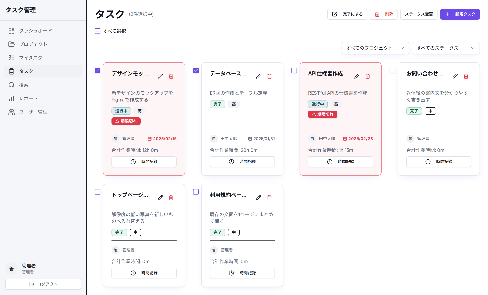
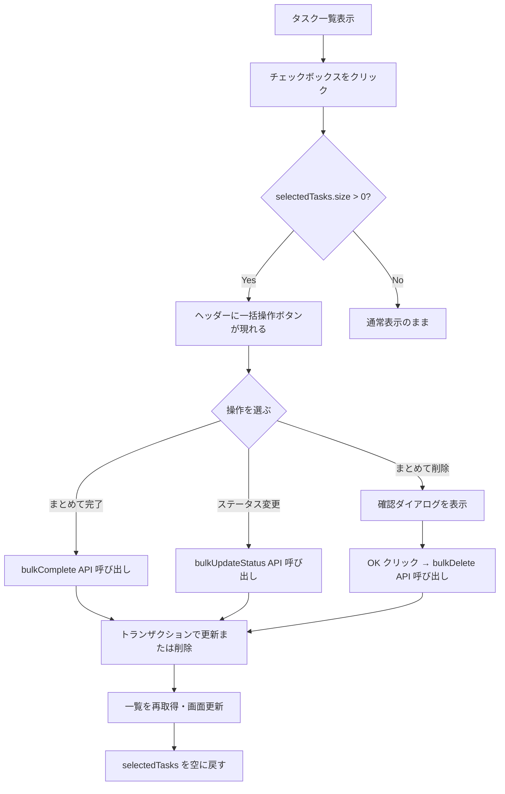
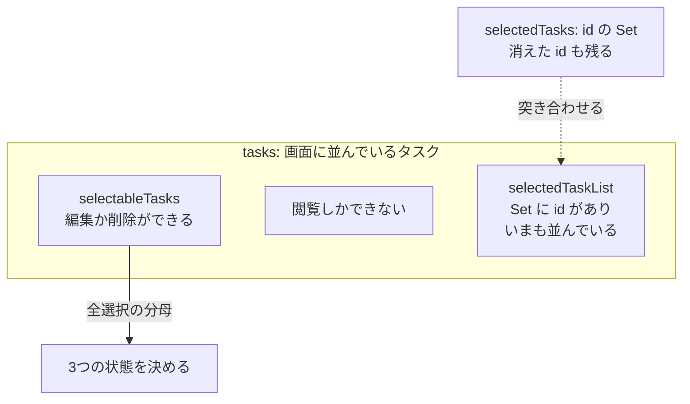
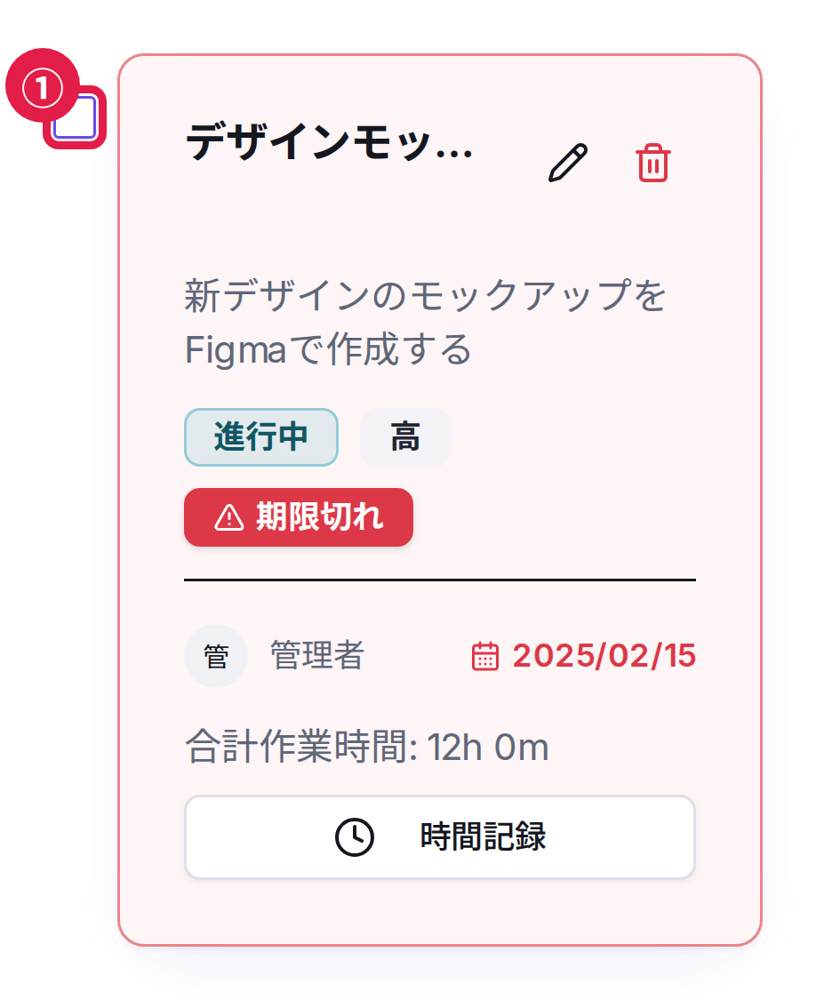
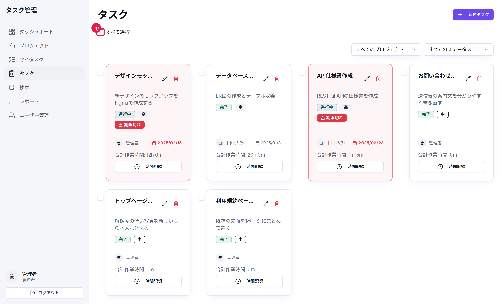
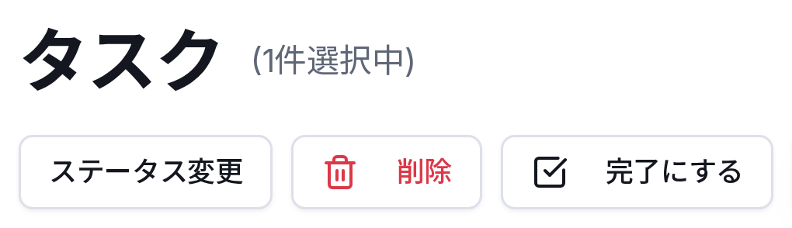
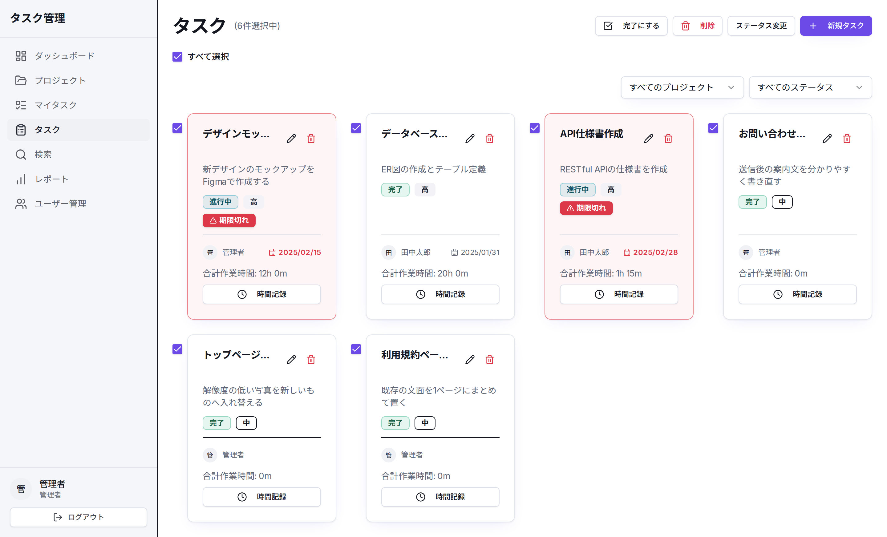

# Day 28: タスク一括操作を実装しよう

## 前回の振り返り

Day 27 では`/project?projectId=...` で
一覧と詳細を切り替え、`isArchived` フラグによる
アーカイブ機能を確認しました。

今日はそこで学んだ「状態管理」の応用としてタスク一覧での **一括操作** に挑戦します。

---

## 今日のゴール

チェックボックスで複数のタスクを選択し、「まとめて完了」「ステータス一括変更」「まとめて削除（確認ダイアログあり）」ができる機能を実装します。

この日はまずサーバー側の一括操作 API（3種類）を自分で書きます。そのあと画面をつなぎます。

スクリーンショット: タスク一括操作の完成画面の表示を確認してください。



> **今日のゴールライン**: Setで選択中タスクを管理し、完了・削除・ステータス変更をまとめて動かせれば大丈夫です。

---

## 始める前の前提

- Day 27 のプロジェクト詳細とアーカイブ機能が動いている
- `/task` に複数のタスクが表示されている
- 一括削除を試すため消えてもよい練習用タスクを 7 件以上用意している

> 7 件という数には理由があります。Step 9 の動作確認は「3 件を完了」「2 件を削除」
> 「5 件のステータスを変更」の順に進めます。削除で 2 件減ったあとに 5 件を選ぶので
> 始める時点で 7 件が同じ画面に並んでいる必要があります。初期データは 3 件しか見えないので
> `/task` から練習用のタスクを足してから始めてください。
- `src/server/api/routers/task.ts` と `src/app/task/page.tsx` を編集できる

> Day 13〜16 で作った import、`TaskCard`、
> `DeleteConfirmDialog`、時間記録機能は残します。
> 同じ import やコンポーネントを追加し直さず、
> 既存コードへ一括操作だけを統合してください。

---

## なぜこれを作るのか

タスクが 100 件あるとき1 件ずつ「完了」ボタンを押すのは苦痛です。スーパーのセルフレジで商品を 1 個ずつ別々に会計するようなものです。まとめてカゴに入れて一度に精算できれば操作は一気に減ります。

> **例え話**: 一括操作は「まとめ買い」と同じです。スーパーで 1 個ずつレジに持っていくよりカゴにまとめてから一度に精算する方が速いです。データベースも同じで、100 回の更新コマンドより「この 100 件を一度にまとめて更新して」と伝える方が圧倒的に速いです。

---

### 一括操作の全体像



この図で目を留めてほしいのはG・H・J の3本が K に合流するところです。どの操作も、トランザクションで選択したタスクを処理し、一覧を取り直して選択を空に戻します。更新には `updateMany`、削除には `deleteMany` を使います。ステータスを完了へ変える処理は、すでに完了したタスクの日時を保つため、対象を分けて2回更新します。だから Step 6 以降で操作を増やすときに新しく考えるのは呼ぶ API の名前だけになります。

逆に L と M を落とすと何が起きるかも押さえてください。削除したはずのタスクが画面に残り、チェックも入ったままになります。サーバー側は正しく変わっているのに画面だけが古い、という一番気付きにくいずれ方です。

---

### やること / やらないこと

| やること | やらないこと |
|---------|-------------|
| チェックボックスで複数選択 | ドラッグ選択（範囲選択） |
| 全選択・一部選択・全解除の 3 状態チェックボックス | キーボードショートカット |
| まとめて完了（`completedAt` も記録） | 一括アサイン変更 |
| まとめて削除（確認ダイアログあり） | 優先度をまとめて変更 |
| DropdownMenu によるステータス一括変更 | ページをまたいだ選択 |

---

### 新しく学ぶ概念

| 概念 | 読み方 | 役割 | 例え |
|------|--------|------|------|
| `Set<string>` | セット | 重複なし集合。チェック済み ID を管理 | 出席簿（同じ人は 2 回書かない） |
| `indeterminate` | インデターミネイト | チェックボックスの「部分選択」状態 | 全部チェックでも空でもない、一部だけ選ばれた中間の状態 |
| `updateMany` | アップデートメニー | 複数レコードを一度に更新 | 授業で「全員起立」と言うのと同じ |
| `isTaskStatus` | イズタスクステータス | 型ガード。不明な値が `TaskStatus` か確認する | 身分証明書のチェック |
| `completedAt` | コンプリーテッドアット | 完了した日時を記録するフィールド | タイムカードの退勤打刻 |

---

## 実装ステップ一覧

| ステップ | 作業内容 | 所要時間 | 触るファイル | 成功状態 |
|---------|---------|---------|-------------|---------|
| Step 0 | タスク一括操作 API（bulk 3種）を自分で書く | 25 分 | `task.ts` | 3 つの bulk API を写経して登録できる |
| Step 1 | 選択状態を管理する state を作る | 7 分 | `src/app/task/page.tsx` | state が正しく動作する |
| Step 2 | チェックボックス付きタスクカードを作る | 8 分 | `src/app/task/page.tsx` | 各カードにチェックボックスが表示される |
| Step 3 | まず「全選択 / 全解除」チェックボックスを作る | 4 分 | `src/app/task/page.tsx` | 全選択・全解除が切り替わる |
| Step 4 | 部分選択を `indeterminate` で表現する | 4 分 | `src/app/task/page.tsx` | 全選択・部分選択・全解除が切り替わる |
| Step 5 | ヘッダーに一括操作ボタンを追加する | 7 分 | `src/app/task/page.tsx` | 選択時にボタンが現れる |
| Step 6 | 一括完了を実装する | 5 分 | `src/app/task/page.tsx` | まとめて完了できる |
| Step 7 | 確認ダイアログ付き一括削除を実装する | 7 分 | `src/app/task/page.tsx` | 確認後にまとめて削除できる |
| Step 8 | DropdownMenu でステータス一括変更を実装する | 7 分 | `src/app/task/page.tsx` | ステータス変更が動作する |
| Step 9 | 動作確認と仕上げ | 4 分 | — | 一括操作が一通り動く |

**合計時間**: 約 78 分です。

この時間はコードを読んで理解する目安です。写経して打ち込む時間、詰まって調べる時間は別に見てください。

開発サーバーは前の Day から動かしたまま使います。止めてあるときは `npm run dev` で起動してから `http://localhost:3000` を開きます。

---

### Step 0: タスク一括操作 API（bulk 3種）を自分で書く（25 分）

**ゴール**: 複数のタスクをまとめて処理する `bulkComplete`・`bulkDelete`・`bulkUpdateStatus` を自分で書き、`api.task.bulkComplete` などを呼べる状態にします。この3つはこのあと Step 6〜8 で画面のボタンから呼び出します。

Day 13〜16 で `task.ts` に、1件ずつ扱う手続きを積み上げてきました。今日はそこへ、複数のタスクを一度に処理する3つの手続きを足します。骨組みはこれまでと同じ入力・処理・戻り値の3部品です。ちがうのは入力が「タスク id の配列」になり、処理が「まとめて更新する」`updateMany` や「まとめて削除する」`deleteMany` になるところです。

#### 0-1. import に一括操作で使う道具を足す

3つの手続きは渡された id の配列をまとめて権限つきで取る共有ヘルパー `findTasksWithPermission`（複数形）を使います。Day 15 までに書いた `_helpers/permission` の import 文に、この1行を足して次の形にします。

```typescript
// filepath: src/server/api/routers/task.ts
// （permission の import に
// findTasksWithPermission を足した完成形）
import {
  assertMemberPermission,
  findTasksWithPermission,
  findTaskWithPermission,
  getUserProjectIds,
} from './_helpers/permission';
```

`findTasksWithPermission`（複数形）はid の配列を受け取り、その全部のタスクを権限つきで取ってくるヘルパーです。Day 15 で使った `findTaskWithPermission`（単数形）の複数版と考えてください。名前が `s` の1文字だけ違うので取り違えに注意します。`assertMemberPermission` などは前の Day で足したものなので新しく行を増やさず同じ import 文の中に並べます。

Day 13 で書いた `import { Prisma } from '@prisma/client';` は次の行へ置き換えます。`ProjectMemberRole` は書き込み直前にも権限を確認するために使います。

```typescript
// filepath: src/server/api/routers/task.ts（既存の Prisma import を置き換える）
import { Prisma, ProjectMemberRole } from '@prisma/client';
import { hasPermission, type PermissionKey } from '@/lib/constant/roles';
```

`ProjectMemberRole` はPrisma がスキーマの enum（決まった値だけを許す型）から自動で作ってくれる型です。`'OWNER'` のような文字列を自分で打ち込まずに済むので綴り違いが型エラーとして先に見つかります。`hasPermission` はロールと権限名を受け取って可否を返す関数、`PermissionKey` は `'canEdit'` のような権限名だけを許す型です。

この3つがそろうと次の 0-2 で「編集できるロールはどれか」を権限マップから計算できます。ここを `['OWNER', 'ADMIN']` と手書きしてしまうとあとで権限の決まりを直したときに一括操作だけが古い判定のまま取り残されます。

#### 0-2. 件数上限と書き込み条件を作る

一度に受け付ける件数と、重複を拒否する ID 配列スキーマを作ります。編集・削除できるロールは権限マップから導出し、権限定義を二重管理しません。`taskTimeUpdateSchema` の直後へ追加してください。

```typescript
// filepath: src/server/api/routers/task.ts（taskTimeUpdateSchema の直後に追加）
const MAX_BULK_TASKS = 100;
const bulkTaskIdsSchema = z
  .array(z.string().cuid())
  .min(1)
  .max(MAX_BULK_TASKS)
  .refine(
    (ids) => new Set(ids).size === ids.length,
    'タスクIDを重複して指定できません',
  );
const getRolesWithPermission = (
  permission: PermissionKey,
): ProjectMemberRole[] =>
  Object.values(ProjectMemberRole).filter(
    (role) => hasPermission(role, permission),
  );
const TASK_EDIT_ROLES =
  getRolesWithPermission('canEdit');
const TASK_DELETE_ROLES =
  getRolesWithPermission('canDelete');
```

`MAX_BULK_TASKS` は巨大な id 配列による DB 負荷を防ぎ、`bulkTaskIdsSchema` は同じ id の二重指定を入力段階で拒否します。ロール配列は `hasPermission` が参照する権限マップから作るため権限設定を変更しても読み取り側と書き込み側がずれません。

続けてタスク id と現在の権限を同じ `where` にまとめる部品を書きます。

```typescript
// filepath: src/server/api/routers/task.ts（続き）
const buildBulkPermissionWhere = (
  ids: string[],
  userId: string,
  roles: ProjectMemberRole[],
): Prisma.TaskWhereInput => ({
  id: { in: ids },
  project: {
    members: {
      some: { userId, role: { in: roles } },
    },
  },
});
```

この関数が返すのは`updateMany` や `deleteMany` の `where` にそのまま渡せる条件です。`id: { in: ids }` で対象のタスクを選び、`project.members.some` で「そのプロジェクトに、必要なロールを持った自分が入っていること」も同時に要求します。

2つの条件を1つの `where` にまとめるのが肝心なところです。id だけで絞ると他人のプロジェクトのタスク id を混ぜて送りつけられたときそのまま書き換わってしまいます。条件をこの関数1か所に置いておけばこれから書く3つの手続きが同じ守り方を共有できます。

最後に書き込めた件数が入力件数と違った場合に処理を止める部品を追加します。

```typescript
// filepath: src/server/api/routers/task.ts（続き）
const assertBulkWriteCount = (count: number, expected: number) => {
  if (count !== expected) {
    throw new TRPCError({
      code: 'FORBIDDEN',
      message: '一括操作の途中で権限が変更されました。もう一度お試しください',
    });
  }
};
```

一括操作は最初の権限確認と DB への書き込みの間にロールが変わる可能性も考えます。書き込み側の `where` でも現在のロールを確認し、件数がずれたらトランザクション（途中で失敗した場合に変更全体を取り消すまとまり）を失敗させます。

続けて、一括操作どうしが行の取り合いで止まらないようにする部品を追加します。

```typescript
// filepath: src/server/api/routers/task.ts（続き）
const lockTaskRows = async (
  tx: Prisma.TransactionClient,
  ids: string[]
): Promise<void> => {
  await tx.$queryRaw(
    Prisma.sql`SELECT "id" FROM "tasks" WHERE "id" IN (${Prisma.join(ids)}) ORDER BY "id" FOR NO KEY UPDATE`
  );
};
```

`updateMany` や `deleteMany` が行に触る順番は実行計画しだいで、呼び出しごとに変わります。2つの一括操作が同じタスクを逆の順番で取り合うと、互いに相手の解放を待って止まり、PostgreSQL が片方を取り消します。そこで書き込みの前に、対象のタスク行を `ORDER BY "id"` の順でまとめてロックします。全員が id の順に取れば待ち合いは輪になりません。

ロックの種類を `FOR NO KEY UPDATE` にしているのには理由があります。Day 12・14・15 で使った `FOR UPDATE` は一番強いロックで、コメントを足す操作まで待たせます。コメントを足すとき、PostgreSQL は紐づくタスクが消えていないことを確かめるために、親にあたるタスク行へ一番弱い共有ロック（`KEY SHARE`）を掛けます。`FOR UPDATE` はこれと両立しないため、一括操作の最中はコメントが入りません。`FOR NO KEY UPDATE` はキーを書き換えない更新と同じ強さで、`KEY SHARE` とは両立します。一括操作どうしの取り合いは今まで通り起きるので、順序を固定する役目は変わりません。

続けて、対象のタスクが属するプロジェクトをすべてロックする関数を書きます。置き場所は `lockTaskRows` の直後です。

```typescript
// filepath: src/server/api/routers/task.ts（lockTaskRows の直後に追加）
const lockProjectsOfTasks = async (
  tx: Prisma.TransactionClient,
  where: Prisma.TaskWhereInput,
): Promise<void> => {
  const locked = new Set<string>();
  let highest = '';
  for (;;) {
    const rows = await tx.task.findMany({
      where,
      select: { projectId: true },
      distinct: ['projectId'],
    });
    const pending = rows
      .map((row) => row.projectId)
      .filter((id) => !locked.has(id));
    if (pending.length === 0) {
      return;
    }
    if (pending.some((id) => id < highest)) {
      throw new TRPCError({
        code: 'CONFLICT',
        message: '他の操作と重なりました。もう一度お試しください',
      });
    }
```

ここまでで、まだロックしていないプロジェクトを見つけ、取り済みより小さい id が混ざっていれば `CONFLICT` で戻します。問題が無ければ、見つけたプロジェクトを id の順に取ります。

```typescript
// filepath: src/server/api/routers/task.ts（続き）
    for (const projectId of pending.sort()) {
      await lockProject(tx, projectId);
      locked.add(projectId);
      highest = projectId;
    }
  }
};
```

`removeMember` も同じプロジェクトの行をロックします。確かめる前に対象のプロジェクトをすべてロックしておけば、確かめている途中でメンバーが外されることはありません。ロックを取る前に読んだ一覧は、ロックを待つ間に古くなります。そのため読む側は必ずロックの後で読みます。

ロックを待つ間に `update` がタスクを別のプロジェクトへ移すことがあります。そこで一覧を読み直し、ロックしていないプロジェクトが出てきたら足してロックします。ロック済みの集合に収まったところで終わります。読み直しで、すでに取ったより小さい id のプロジェクトが現れたときは、ロックの順序が逆になってデッドロックし得ます。その場合はロックを取らずに `CONFLICT` を返し、利用者にもう一度操作してもらいます。ロックを取り終えた後にタスクが別のプロジェクトへ抜け出せないのは、Day 15 の `update` が移動元と移動先の両方をロックするからです。移動元を握っている間、移動は待たされます。

ロックの前に `sort()` で id の順に並べるのはデッドロック（2つの処理が互いに相手のロックの解放を待って止まる状態）を避けるためです。一括操作 A がプロジェクト P1 から P2 の順にロックするとします。同時に一括操作 B は P2 から P1 の順にロックします。A は P1 を取って P2 を待ちます。B は P2 を取って P1 を待ちます。

この状態になると PostgreSQL は片方のトランザクションをエラーで取り消します。全員が id の順に取れば先に P1 を取った側だけが進むので待ち合いが輪になりません。

#### 0-3. bulkComplete を書く（まとめて完了にする）

まず選んだタスクをまとめて完了にする `bulkComplete` を、Day 16 で書いた `addTime` の直後に足します。

```typescript
// filepath: src/server/api/routers/task.ts（addTime の直後に追加）
  bulkComplete: protectedProcedure
    .input(z.object({ ids: bulkTaskIdsSchema }))
    .mutation(async ({ ctx, input }) => {
      const tasks = await findTasksWithPermission(input.ids, ctx.session.userId);
      for (const task of tasks) {
        assertMemberPermission(task.project.members, 'canEdit');
      }

      const completedAt = new Date();
      return await prisma.$transaction(async (tx) => {
        const where = buildBulkPermissionWhere(input.ids, ctx.session.userId, TASK_EDIT_ROLES);
        await lockProjectsOfTasks(tx, where);
        await lockTaskRows(tx, input.ids);
```

入力の `ids` は「1件以上、100件以下のタスク id の配列」に絞ります。まず入力全体の編集権限を確認します。書き込み時にも `where` で id と現在の編集権限を同時に絞ります。トランザクションに入ったら、書き込みの前に `lockProjectsOfTasks` で対象のプロジェクトをロックし、続けて `lockTaskRows` で対象の行を id の順にロックします。後で書く `bulkDelete` と `bulkUpdateStatus` も同じ「プロジェクト、タスク行」の順で取ります。Day 12 の `removeMember` もプロジェクトから取るので、どの組み合わせで重なっても待ち合いが輪になりません。

続けて完了済みと未完了のタスクを分けて更新します。

```typescript
// filepath: src/server/api/routers/task.ts（続き）
        const unchanged = await tx.task.updateMany({
          where: { ...where, status: TASK_STATUS.DONE },
          data: { status: TASK_STATUS.DONE },
        });
        const changed = await tx.task.updateMany({
          where: { ...where, status: { not: TASK_STATUS.DONE } },
          data: { status: TASK_STATUS.DONE, completedAt },
        });
        const count = unchanged.count + changed.count;
        assertBulkWriteCount(count, input.ids.length);
        return { count };
      });
    }),
```

最初の更新は完了済みの日時を変えずに対象行をロックします。次の更新だけで新しい完了日時を入れるため完了済みのタスクを再選択しても Day 23 の週次集計が変わりません。件数は2回の更新を合計します。権限の変更で入力件数と合わなくなった場合はトランザクション全体を取り消します。

| 方法 | 更新用のクエリ数（権限確認を除く） |
|------|---------------------|
| `for` ループ + `update` | タスク数と同じ（100件なら100回） |
| 今回の `updateMany` | 完了済みと未完了に分けて2回 |

#### 0-4. bulkDelete を書く（まとめて削除する）

次に選んだタスクをまとめて消す `bulkDelete` を、`bulkComplete` の直後に足します。

```typescript
// filepath: src/server/api/routers/task.ts（bulkComplete の直後に追加）
  bulkDelete: protectedProcedure
    .input(z.object({ ids: bulkTaskIdsSchema }))
    .mutation(async ({ ctx, input }) => {
      const tasks = await findTasksWithPermission(input.ids, ctx.session.userId);
      for (const task of tasks) {
        assertMemberPermission(task.project.members, 'canDelete');
      }

      return await prisma.$transaction(async (tx) => {
        const where = buildBulkPermissionWhere(input.ids, ctx.session.userId, TASK_DELETE_ROLES);
        await lockProjectsOfTasks(tx, where);
        await lockTaskRows(tx, input.ids);
        const result = await tx.task.deleteMany({ where });
        assertBulkWriteCount(result.count, input.ids.length);
        return result;
      });
    }),
```

流れは `bulkComplete` とよく似ていますが権限の確認と書き込み条件が削除用になっています。`TASK_DELETE_ROLES` を使うため編集はできても削除はできない MEMBER を書き込み直前にも除外できます。件数がずれた場合は削除全体を取り消します。

#### 0-5. 未完了へ戻すタスクの担当者を確かめる部品を作る

3つ目の `bulkUpdateStatus` は完了したタスクを `TODO` へ戻すこともできます。ここで Day 12 の `removeMember` を思い出してください。メンバーを外すと未完了タスクの担当は外れます。完了と中止のタスクの担当は実績として残しました。

なので完了済みのタスクの担当者欄には、もうプロジェクトにいない人が残っていることがあります。そのまま一括で `TODO` へ戻すと外れた人が未完了タスクの担当に戻ります。1件ずつ戻す Day 15 の `update` でも同じことが起きます。一括操作も戻す前に担当者の所属を確かめる必要があります。

「完了と中止」を表す定数 `CLOSED_STATUSES` と判定の `isClosedStatus` は、Day 15 の `update` で `lockProject` の直後に作りました。ここではそれを使い回します。

`CLOSED_STATUSES` は Day 12 の `removeMember` が担当を残す2つの状態と同じ組です。`DONE` と `CANCELLED` を使う場所ごとに書くと、片方で `CANCELLED` を書き忘れたときに中止のタスクだけ確かめずに戻ります。1か所に置いてあるので、`update` と `bulkUpdateStatus` で判定がずれません。Day 15 を飛ばした場合は、同じ2行を `lockProject` の直後に足してから進めてください。

次に、担当者がまだメンバーかを確かめる関数の前半を書きます。置き場所は `lockProjectsOfTasks` の直後です。

```typescript
// filepath: src/server/api/routers/task.ts（lockProjectsOfTasks の直後に追加）
const releaseNonMemberAssignees = async (
  tx: Prisma.TransactionClient,
  where: Prisma.TaskWhereInput,
): Promise<void> => {
  const candidates = await tx.task.findMany({
    where: {
      ...where,
      status: { in: [...CLOSED_STATUSES] },
      assigneeId: { not: null },
    },
    select: { id: true, projectId: true, assigneeId: true },
  });
  if (candidates.length === 0) {
    return;
  }

```

引数の `where` には一括操作が作った権限つきの条件をそのまま受け取ります。そこへ「完了か中止」と「担当者がいる」を足して確かめる候補を絞ります。未完了のタスクは候補に入れません。メンバーを外した時点で Day 12 の `removeMember` が担当を外しているからです。この関数はプロジェクトのロックを取った後で呼ぶ前提なので、読んだ一覧は他の処理が確定させた結果です。

後半では候補の担当者がまだメンバーかをまとめて調べます。

```typescript
// filepath: src/server/api/routers/task.ts（続き）
  const projectIds = [
    ...new Set(candidates.map((task) => task.projectId))
  ];
  const assigneeIds = [
    ...new Set(candidates.map((task) => task.assigneeId as string))
  ];
  const members = await tx.projectMember.findMany({
    where: {
      projectId: { in: projectIds },
      userId: { in: assigneeIds }
    },
    select: { projectId: true, userId: true },
  });
  const memberKeys = new Set(
    members.map((member) => `${member.projectId}:${member.userId}`)
  );
```

`memberKeys` は「プロジェクトと担当者の組」の一覧です。この一覧に無い組が、外れた人の担当です。プロジェクトごとに別々の一覧を持つと、他のプロジェクトで同じ人がメンバーでも見逃してしまうので、組の文字列にしてまとめて照合します。

```typescript
// filepath: src/server/api/routers/task.ts（続き）
  const orphanIds = candidates
    .filter((task) => !memberKeys.has(`${task.projectId}:${task.assigneeId}`))
    .map((task) => task.id);
  if (orphanIds.length > 0) {
    await tx.task.updateMany({
      where: { id: { in: orphanIds } },
      data: { assigneeId: null }
    });
  }
};
```

Day 14 の `assertTaskAssigneeBelongsToProject` は `findUnique` で1人ずつ確かめました。同じ書き方を候補の数だけ繰り返すと100件で100回の問い合わせになります。ここでは `tx.projectMember.findMany` の1回で「候補のプロジェクトのどれか」と「候補の担当者のどれか」に当てはまるメンバー行をまとめて取ります。

ただしこの条件は余分な組も返します。田中さんは P1 のメンバーで P2 からは外れたとします。候補に P1 と P2 の田中さん担当のタスクがあると `findMany` は P1 の田中さんの行を返します。担当者の id だけで照合すると P2 のタスクも田中さんがメンバーだと見なして見逃します。

そこで `projectId:userId` の形の文字列を作って「プロジェクトと担当者の組」で照合します。組が `memberKeys` に無いタスクだけが外れた人の担当です。その id を集めて `updateMany` で `assigneeId` を `null` にします。

`task.assigneeId as string` と書くのは `findMany` の条件で `null` を除いても型は `string | null` のままだからです。候補には担当者のいるタスクしか入りません。だからここでは `string` として扱えます。

#### 0-6. bulkUpdateStatus を書く（まとめてステータス変更・前半）

最後に選んだタスクのステータスをまとめて変える `bulkUpdateStatus` を、`bulkDelete` の直後に足します。まず入力と権限確認までを書きます。

```typescript
// filepath: src/server/api/routers/task.ts（bulkDelete の直後に追加）
  bulkUpdateStatus: protectedProcedure
    .input(
      z.object({
        ids: bulkTaskIdsSchema,
        status: taskStatusSchema,
      }),
    )
    .mutation(async ({ ctx, input }) => {
      const tasks = await findTasksWithPermission(input.ids, ctx.session.userId);
      for (const task of tasks) {
        assertMemberPermission(task.project.members, 'canEdit');
      }
```

入力は id の配列に加えて変更後の `status`（`taskStatusSchema` で検証）も受け取ります。ここまでは `bulkComplete` と同じで、まとめてタスクを取り、`for` で1件ずつ `'canEdit'` 権限を確かめます。ステータスの変更は編集にあたるので確認する権限は `'canEdit'` です。

#### 0-7. bulkUpdateStatus を書く（後半・完了日時の管理）

続けて更新するデータを組み立てて `updateMany` を呼びます。

```typescript
// filepath: src/server/api/routers/task.ts（続き）
      const data: Prisma.TaskUpdateManyMutationInput = {
        status: input.status,
      };

      if (input.status === TASK_STATUS.DONE) {
        data.completedAt = new Date();
      } else {
        data.completedAt = null;
      }

```

`data` に型を付けるとあとから追加する `completedAt` も検査できます。完了に変える場合は現在時刻を用意し、それ以外では `null` に戻します。

続けてトランザクションを開きます。未完了へ戻すときは最初に 0-5 の部品を呼びます。

```typescript
// filepath: src/server/api/routers/task.ts（続き）
      return await prisma.$transaction(async (tx) => {
        const where = buildBulkPermissionWhere(input.ids, ctx.session.userId, TASK_EDIT_ROLES);
        await lockProjectsOfTasks(tx, where);
        await lockTaskRows(tx, input.ids);
        if (!isClosedStatus(input.status)) {
          await releaseNonMemberAssignees(tx, where);
        }
        const unchanged =
          input.status === TASK_STATUS.DONE
            ? await tx.task.updateMany({
                where: { ...where, status: TASK_STATUS.DONE },
                data: { status: TASK_STATUS.DONE },
              })
            : { count: 0 };
```

`lockProjectsOfTasks` と `lockTaskRows` は、変更先がどの状態でも先に呼びます。続く `releaseNonMemberAssignees` の呼び出しは、変更先が `TODO` や `IN_PROGRESS` のときだけです。変更先が完了か中止なら担当者には触れません。終わったタスクの担当は「誰が終えたか」の記録です。Day 12 の `removeMember` と同じく外れた人でも実績として残します。

呼ぶ位置は `updateMany` より前です。ステータスを書き換えたあとでは候補を「完了か中止」で探せません。呼び出しは同じトランザクションの中にあります。このあと件数がずれて全体を取り消すときは外した担当も元に戻ります。

残りは完了済みの日時を保ちながら更新する部分です。

```typescript
// filepath: src/server/api/routers/task.ts（続き）
        const changed = await tx.task.updateMany({
          where:
            input.status === TASK_STATUS.DONE
              ? { ...where, status: { not: TASK_STATUS.DONE } }
              : where,
          data,
        });
        const count = unchanged.count + changed.count;
        assertBulkWriteCount(count, input.ids.length);
        return { count };
      });
    }),
```

変更先が `DONE` の場合は完了済みの行を先に更新して日時を保ちます。その後、未完了の行だけに新しい完了日時を入れます。変更先が `DONE` 以外なら全対象を1回で更新し、完了日時を消します。どちらも書き込み件数で権限を再確認し、件数がずれた場合は全体を取り消します。

**確認ポイント**:
- `bulkComplete`・`bulkDelete`・`bulkUpdateStatus` の3つを `addTime` の直後に順に足した
- 3つの `ids` が1件以上・`MAX_BULK_TASKS` 件以下に制限されている
- `findTasksWithPermission`（複数形）で権限を確認してから `updateMany` / `deleteMany` を呼んでいる
- 書き込み側でも現在のロールを確認し、件数がずれたら全体を取り消している
- `lockProjectsOfTasks` と `lockTaskRows` でロックしてから、未完了へ戻すときだけ `releaseNonMemberAssignees` を `updateMany` より前に呼んでいる
- `npx tsc --noEmit` で型エラーが出ていない

---

### Step 1: 選択状態を管理する state を作る（7 分）

**ゴール**: どのタスクにチェックが入っているかを `Set` で管理し、操作関数を定義します。

チェックボックスの状態管理には `Set`（セット）を使います。`Set` は「重複のない集合」で、「この ID はもう入ってるから追加しない」を自動でやってくれます。

**なぜ `Set` を使うのか**

| 操作 | 配列の場合 | Set の場合 |
|------|-----------|-----------|
| 追加（重複チェックあり） | `if (!arr.includes(id)) arr.push(id)` | `set.add(id)` |
| 削除 | `arr.filter(x => x !== id)` | `set.delete(id)` |
| 含まれるか確認 | `arr.includes(id)` | `set.has(id)` |

選択状態は `useState` で管理します。このあと表示対象の配列を求めるために `useMemo` も使うので、既存のReactのimportに両方が含まれていることを確認してください。

```typescript
// filepath: src/app/task/page.tsx
// コンポーネント内に state を追加
const [selectedTasks, setSelectedTasks] =
  useState<Set<string>>(new Set());
const [bulkDeleteDialogOpen, setBulkDeleteDialogOpen] =
  useState(false);
```

`useState<Set<string>>(new Set())` の型注釈はこの箱にはタスク id の文字列しか入らないと宣言する意味です。空の `new Set()` から始めるので画面を開いた直後は1件も選ばれていない状態になります。

`bulkDeleteDialogOpen` を同じ場所で作っておくのはStep 7 の削除確認ダイアログが開いているかどうかを覚える役目があるからです。削除だけは押し間違いを取り消せません。だから選択の中身とは別に「いま確認中かどうか」を覚えさせて選択と実行のあいだにワンクッションを置きます。

次に1 件のチェック状態を変える関数を定義します。

```typescript
// filepath: src/app/task/page.tsx
const handleTaskSelect = (
  taskId: string, checked: boolean
) => {
  setSelectedTasks((prev) => {
    const next = new Set(prev);
    checked ? next.add(taskId) : next.delete(taskId);
    return next;
  });
};
```

`handleTaskSelect` は `(taskId, checked)` の 2 引数を受け取ります。`checked` が `true` なら追加、`false` なら削除という、シンプルな設計です。

**なぜ `new Set(prev)` でコピーするのか**

React では state を直接変更してはいけません。`prev.add(id)` と書くと元の Set を変更してしまいます。

`new Set(prev)` で新しい Set を作ってから変更することで、React が「状態が変わった」と検知して画面を更新してくれます。

全選択の前に、操作できるタスクと
現在表示中の選択タスクを求めます。
閲覧専用タスクや、フィルターで消えたタスクを
一括操作へ混ぜないためです。

```typescript
// filepath: src/app/task/page.tsx
const selectableTasks = useMemo(
  () => tasks?.filter(
    (task) =>
      canEditProject(task.projectId)
      || canDeleteProject(task.projectId),
  ) ?? [],
  [tasks, canEditProject, canDeleteProject],
);

const selectedTaskList = useMemo(
  () => tasks?.filter(
    (task) => selectedTasks.has(task.id),
  ) ?? [],
  [tasks, selectedTasks],
);
```

`selectableTasks` は編集か削除のどちらかができるタスクだけを残した一覧です。閲覧しかできないプロジェクトのタスクをここで外しておくとこのあと作る全選択がそれらを拾わなくなります。

`selectedTaskList` のほうは`selectedTasks` に id が残っていてなおかつ今の一覧にも並んでいるタスクだけを取り出します。フィルターを切り替えると画面から消えるタスクがありますが`Set` の中の id は消えません。ここで一覧と突き合わせておかないと目に見えていないタスクまで一括操作の巻き添えになります。`useMemo` で包んだのは`tasks` か `selectedTasks` が変わったときだけ計算し直せば足りるからです。



名前の似た3つは指しているものが別々です。`selectedTasks` だけ枠の外にあるのは画面に並んでいないタスクの id も持ち続けるからです。分母を `tasks` にすると閲覧専用のタスクまで数に入り、選べるものを全部選んでも全チェックになりません。

選択中タスクすべてに必要な権限があるかも
操作ごとに判定します。

```typescript
// filepath: src/app/task/page.tsx
const canCompleteSelected =
  selectedTaskList.length > 0
  && selectedTaskList.every(
    (task) => canEditProject(task.projectId),
  );
const canDeleteSelected =
  selectedTaskList.length > 0
  && selectedTaskList.every(
    (task) => canDeleteProject(task.projectId),
  );
```

`every`（配列の全要素が条件を満たしたときだけ `true` を返すメソッド）を使うのは権限のないタスクが1件でも混ざったら操作そのものを止めたいからです。選択は複数のプロジェクトをまたげるので「編集はできるが削除はできない」タスクが1件だけ紛れ込む場面は実際に起きます。ここを `some` にすると権限のあるタスクが1件でもあればボタンが出てしまい、押した先でサーバーに断られます。

ただしこの2つの変数が守っているのはボタンを出すかどうかまでです。Step 0 で書いた通り、サーバー側は `findTasksWithPermission` と `assertMemberPermission` でもう一度権限を確かめ、書き込み時の `where` でも現在のロールを見ます。件数が入力とずれれば`$transaction` が書き込み全体をまとめて取り消します。

画面の判定だけを門番にはできません。ブラウザから送る中身は手元で書き換えられるのでid の配列を直接投げつけられたら `canDeleteSelected` は一度も評価されません。画面側の条件は誤操作を減らすための入口で、最後に本当に守っているのはサーバー側です。

全選択・全解除は操作できるタスクだけを対象に
1 つの関数で処理します。

```typescript
// filepath: src/app/task/page.tsx
const handleSelectAll = (checked: boolean) => {
  setSelectedTasks(
    checked
      ? new Set(selectableTasks.map(
          (task) => task.id
        ))
      : new Set()
  );
};
```

`checked` が `true` なら操作可能なタスクの ID を
Set に詰め、`false` なら空の Set で上書きします。

**確認ポイント**:
- `selectedTasks` が `Set<string>` 型で定義されている
- `bulkDeleteDialogOpen` の state も一緒に追加されている
- `handleTaskSelect(taskId, checked)` が 2 引数を受け取る
- `handleSelectAll(checked)` の 1 つの関数で全選択・全解除ができる
- `new Set(prev)` でコピーしてから変更している
- 閲覧専用タスクが全選択に含まれない

---

### Step 2: チェックボックス付きタスクカードを作る（8 分）

**ゴール**: 各タスクの隣にチェックボックスを追加し、`TaskCard` と並べてグリッド表示します。

スクリーンショット: チェックボックス付きタスクカードの表示を確認してください。



実際のコードでは `TaskCard` コンポーネントをグリッドで並べています。`TaskCard`・`handleEdit`・`handleDelete`・`handleTaskClick`・`handleCreate` は過去の Day で作成済みです。

チェックボックスはカードの左側に配置します。

```typescript
// filepath: src/app/task/page.tsx（className="grid gap-6 の要素を書き直す）
import { Checkbox } from '@/component/ui/checkbox';

{/* タスク一覧の grid レイアウト */}
<div className="grid gap-6 sm:grid-cols-2 lg:grid-cols-3 xl:grid-cols-4">
  {tasks && tasks.length > 0 ? (
    tasks.map((task) => {
      const taskCanEdit = canEditProject(task.projectId);
      const taskCanDelete = canDeleteProject(task.projectId);
      return (
      <div
        key={task.id}
        className="flex gap-2 items-start h-full"
      >
        {(taskCanEdit || taskCanDelete) && (
          <Checkbox
            checked={selectedTasks.has(task.id)}
            onCheckedChange={(checked) =>
              handleTaskSelect(task.id, checked === true)
            }
            className="mt-4"
            aria-label={`${task.title}を選択`}
          />
        )}
```

`aria-label` にタスク名を入れているのは同じ形のチェックボックスがカードの数だけ並ぶためです。名前が無いと読み上げでは「チェックボックス」が何個も続くだけになり、どのタスクを選んでいるのか分かりません。まとめて削除する操作なので取り違えると戻せません。

上のコードブロックの `</div>` 閉じタグは次のブロックに続きます。各タスクカードは `flex-1 min-w-0 h-full` のラッパーで囲み、`TaskCard` に props を渡します。タスクがない場合の表示は Day 15 で書いた2行のメッセージをそのまま残します。

```typescript
        {/* filepath: src/app/task/page.tsx（同じファイルの続き） */}
        <div className="flex-1 min-w-0 h-full">
          <TaskCard
            id={task.id}
            title={task.title}
            description={task.description}
            status={task.status}
            priority={task.priority}
            dueDate={task.dueDate}
            assignee={task.assignee}
            timeSpentMinutes={task.timeSpentMinutes}
            onEdit={handleEdit}
            onDelete={handleDelete}
            onClick={handleTaskClick}
            onTimeLogSuccess={handleTimeLogSuccess}
            canEdit={taskCanEdit}
            canDelete={taskCanDelete}
          />
        </div>
```

ここで `TaskCard` に渡している props はDay 13〜16 で1つずつ増やしてきたものをそのまま並べただけです。今日の一括操作のために新しく足した props は1つもありません。チェックボックスをカードの外側へ置く形にしたのでカード本体は一行も書き換えずに済んでいます。

`canEdit` と `canDelete` はカードの中にある編集ボタンと削除ボタンを出し分けるための値です。1つ前のブロックでチェックボックスを出す条件に使ったのと同じ `taskCanEdit` / `taskCanDelete` を渡しています。同じ値を使い回すのでカードの中と外で操作できる範囲が食い違いません。

カード行と一覧の条件分岐を閉じます。

```typescript
      {/* filepath: src/app/task/page.tsx（続き） */}
      </div>
      );
    })
  ) : (
    <div className="col-span-full flex flex-col items-center justify-center py-12 text-center text-muted-foreground">
      <p>タスクが見つかりません。</p>
      {filterProject === 'all' && filterStatus === 'all' && (
        <p>最初のタスクを作成しましょう！</p>
      )}
    </div>
  )}
</div>
```

> `TaskCard` は Day 13 で import 済みです。
> `taskCanEdit` / `taskCanDelete` は
> `canEditProject` / `canDeleteProject` を
> `task.projectId` に適用した結果です。
> Day 16 の `timeSpentMinutes` と
> `onTimeLogSuccess` も残してください。

**`onCheckedChange={(checked) => handleTaskSelect(task.id, checked === true)}`**

`onCheckedChange` は `boolean | 'indeterminate'` 型の値を渡してくることがあります。`checked === true` と比較することで確実に `boolean` 型に絞り込んでから `handleTaskSelect` に渡しています。

**`className="mt-4"` をチェックボックスに付ける理由**

カードの上部にタイトルが来ます。チェックボックスを `mt-4` でずらすことで、カードのタイトルと視覚的に揃い、選択しやすくなります。

**`flex-1 min-w-0 h-full` の意味**

| クラス | 意味 |
|--------|------|
| `flex-1` | 残りの幅を全部カードに使う |
| `min-w-0` | テキストがはみ出さないよう制限 |
| `h-full` | カードの高さを親要素に合わせる |

**確認ポイント**:
- 各タスクカードの左側にチェックボックスが表示される
- チェックを入れると `selectedTasks` に ID が追加される
- 再度クリックするとチェックが外れる
- `npm run dev` でエラーが出ない

---

### Step 3: まず「全選択 / 全解除」チェックボックスを作る（4 分）

**ゴール**: ヘッダーにチェックボックスを追加し、シンプルな全選択・全解除を実装します。

スクリーンショット: ヘッダーに全選択・全解除のチェックボックスが表示された画面を確認してください。



いきなり 3 状態（未チェック・部分チェック・全チェック）を作ると複雑なのでまずは **2 状態（全選択 / 全解除）** だけで動くものを作ります。

```typescript
// filepath: src/app/task/page.tsx
// まずシンプルに boolean で管理する
const isAllSelected =
  selectableTasks.length > 0
  && selectedTaskList.length
    === selectableTasks.length;
```

`isAllSelected` は「タスクが存在し、全タスクの ID が `selectedTasks` に入っているか」を判定するだけのシンプルな `boolean` です。

この値をチェックボックスに渡します。

```typescript
// filepath: src/app/task/page.tsx（className="flex gap-2 w-full の前に追加）
import { Label } from '@/component/ui/label';

{/* フィルター行の先頭に配置 */}
<div className="flex items-center space-x-2">
  <Checkbox
    id="select-all"
    checked={isAllSelected}
    onCheckedChange={(checked) =>
      handleSelectAll(checked === true)
    }
  />
  <Label htmlFor="select-all">すべて選択</Label>
</div>
```

**この段階での動き**

| 操作 | 結果 |
|------|------|
| チェックボックスをクリック | 操作可能なタスクが選択される |
| もう一度クリック | 全タスクの選択が解除される（全解除） |
| 一部だけ手動で選択 | ヘッダーは未チェック（□）のまま |

3 行目の「一部だけ手動で選択」のときヘッダーのチェックボックスが未チェックのままだといま何件選んでいるのかが見た目で分かりません。次の Step でこれを改善します。

**確認ポイント**:
- ヘッダーのチェックボックスをクリックすると全タスクが選択される
- もう一度クリックすると全選択が解除される
- `npm run dev` でエラーが出ない

---

### Step 4: 部分選択を `indeterminate` で表現する（4 分）

**ゴール**: 一部だけ選択されているときヘッダーのチェックボックスに「横棒（部分チェック）」を表示します。

前のステップでは 2 状態（全選択 / 全解除）しかないため一部選択のときヘッダーが未チェック（□）のままでした。チェックボックスには実は **3 つ目の状態** があります。

| 状態の値 | 表示 | 意味 |
|---------|------|------|
| `false` | □（未チェック） | 1 件も選択されていない |
| `'indeterminate'` | 横棒（部分チェック） | 一部のタスクだけ選択されている |
| `true` | ✓（全チェック） | 全タスクが選択されている |

Step 3 で書いた `isAllSelected`（boolean）を、3 状態を返す `selectAllState` に置き換えます。

```typescript
// filepath: src/app/task/page.tsx（isAllSelected の宣言を書き直す）
// isAllSelected を削除して、以下に置き換える
const selectAllState =
  selectableTasks.length > 0
    ? selectedTaskList.length === 0
      ? false
      : selectedTaskList.length
          === selectableTasks.length
        ? true
        : 'indeterminate'
    : false;
```

入れ子になった三項演算子は読みづらく見えますがやっているのは上から順に3つ問いかけることだけです。

- 操作できるタスクが1件でもあるか
- 選択が0件か
- 選択の数が操作できるタスクの数と一致するか

この順に絞り込むと`false`・`true`・`'indeterminate'` のどれか1つに必ず決まります。

分母を `tasks` ではなく `selectableTasks` にしているところが大事な点です。閲覧専用のタスクまで分母に入れると選べるものを全部選んでも数が足りず、チェックボックスがいつまでも部分選択のままになります。読者から見ると「全部選んだのに全チェックにならない」という不可解な動きです。

JSX 側の `checked` に渡す値を差し替えます。

```typescript
{/* filepath: src/app/task/page.tsx（id="select-all" の要素を書き直す） */}
{/* Step 3 で書いた Checkbox の checked を差し替える */}
<Checkbox
  id="select-all"
  checked={selectAllState}
  onCheckedChange={(checked) =>
    handleSelectAll(checked === true)
  }
/>
```

**確認ポイント**:
- `checked={isAllSelected}` を `checked={selectAllState}` に変更した
- ファイルを保存して `npm run dev` でエラーが出ない

**`indeterminate` が重要な理由**

ユーザーが「一部選択されている」ことを一目で把握できます。この状態がないとヘッダーのチェックボックスを見ただけでは「全未選択」と「全選択」しか判断できません。細かな UX の配慮が使いやすさを大きく左右します。

**`checked === true` にする理由**

`onCheckedChange` は `boolean | 'indeterminate'` を渡してきます。`indeterminate` のときに `handleSelectAll` を呼ぶと意図しない動作をするため明示的に `=== true` で絞り込みます。

**確認ポイント**:
- 全未選択のときヘッダーのチェックボックスが未チェック（□）
- 一部選択のときヘッダーのチェックボックスが `indeterminate`（横棒）
- 全選択のときヘッダーのチェックボックスがチェック（✓）
- ヘッダーのチェックボックスをクリックして全選択・全解除が切り替わる

---

### Step 5: ヘッダーに一括操作ボタンを追加する（7 分）

**ゴール**: 1 件以上選択されているときだけ、ページヘッダーに一括操作ボタンを表示します。

実際のコードでは一括操作ボタンは **画面下部の固定バーではなく、ページヘッダーの右側** に配置されています。

スクリーンショット: 下の画像は Step 8 まで書き終えた完成後のヘッダーです。この Step 5 の時点で出るのは「(1件選択中)」の文字までで、右側のボタンは Step 6・7・8 で足していきます。



```typescript
{/* filepath: src/app/task/page.tsx（<h1 className="text-3xl font-bold から「新規タスク」の </Button> までを書き直す） */}
{/* ページのタイトル行（h1 と操作ボタンが並ぶ行） */}
<div className="flex flex-col gap-3 lg:flex-row lg:items-center lg:justify-between">
  <div className="flex items-center gap-3">
    <h1 className="text-3xl font-bold tracking-tight">
      タスク
    </h1>
    {selectedTaskList.length > 0 && (
      <span className="text-sm text-muted-foreground">
        ({selectedTaskList.length}件選択中)
      </span>
    )}
  </div>
  <div className="flex flex-col gap-2 sm:flex-row sm:items-center">
    {selectedTaskList.length > 0 && (
      <>
        {/* ここにStep 6〜8でボタンを追加していく */}
      </>
    )}
    <Button size="sm" className="w-full sm:w-auto" onClick={handleCreate}>
      <Plus className="mr-2 h-4 w-4" /> 新規タスク
    </Button>
  </div>
</div>
```

**`flex-col` から始める理由**

外側の `<div>` は `flex-col` で見出しとボタンの列を縦に積みます。横幅が 1024px 以上の画面では `lg:flex-row` が効いて横並びになります。ボタンが見出しの右側へ並ぶのはこのときです。ボタンの列にも `flex-col` と `sm:flex-row` を付けてあるので 640px 未満の画面ではボタン同士も縦に積まれます。Day 27 のプロジェクト一覧の見出し行と同じ考え方です。

`Button` には `whitespace-nowrap` が入っているのでボタンの文字は折り返しません。1件以上選ぶとボタンは最大で4つに増えます。横1列のままでは4つの合計の幅がスマートフォンの画面に収まりません。はみ出した「新規タスク」ボタンは横へスクロールしないと押せなくなります。横1列の中では Day 14 で付けた `w-full` が効かないため「新規タスク」は文字の幅に縮んだままです。縦に積めば4つのボタンがどれもページの横幅いっぱいに広がります。

**なぜ固定バーではなくヘッダーに配置するのか**

| 配置場所 | 特徴 |
|---------|------|
| `fixed bottom-0`（固定バー） | どこにいても見えるがコンテンツに重なることがある |
| ヘッダーの右側 | ページトップにいれば常に見えます。コンテンツを隠さない |

今回のアプリではタスクカードがグリッド表示で、スクロール量がさほど多くないためヘッダーに配置しています。

> `{/* ここにStep 6〜8でボタンを追加していく */}` は一時的なプレースホルダーです。この後の Step 6・7・8 で、ここに「完了にする」「削除」「ステータス変更」ボタンを順番に追加していきます。今はこのまま進めてください。

**`{selectedTaskList.length > 0 && (...)}` のパターン**

React で「条件が真のときだけ描画する」
定番パターンです。現在の一覧に残っている
選択タスクが1件以上のときだけ JSX を描画します。

**確認ポイント**:
- タスクを 1 件も選択していないとき「新規タスク」ボタンだけが表示される
- ブラウザの横幅を 640px より狭めると「新規タスク」ボタンが見出しの下で横幅いっぱいに広がる
- タスクを 1 件以上選択すると「(N 件選択中)」の文字が現れる
- 一括操作ボタンが追加される領域（`<>...</>` の中）が確保されている
- `npm run dev` でエラーが出ない

---

### Step 6: 一括完了を実装する（5 分）

**ゴール**: 「完了にする」ボタンを押すと選択したタスクの `status` と `completedAt` がまとめて更新されるようにします。

まず mutation を定義します。

```typescript
// filepath: src/app/task/page.tsx
import { CheckSquare } from 'lucide-react';

// 一括完了のミューテーション
const bulkCompleteMutation =
  api.task.bulkComplete.useMutation({
    onSuccess: () => {
      // キャッシュを無効化して一覧を再取得
      utils.task.getAll.invalidate();
      // 選択状態をリセット
      setSelectedTasks(new Set());
    },
  });

// 一括完了のハンドラー
const handleBulkComplete = () => {
  if (canCompleteSelected) {
    bulkCompleteMutation.mutate({
      ids: selectedTaskList.map(
        (task) => task.id
      ),
    });
  }
};
```

`useMutation` の形はDay 10 で新規プロジェクトを保存したときと変わりません。違うのは送るのが1件の id ではなく id の配列になった点だけです。Step 0 の `bulkComplete` が配列を受け取る作りになっているので画面側は `map` で id を並べて渡すだけで済みます。

`onSuccess` に2つの後始末を書いているのは書き込みが本当に成功したという知らせをここでしか受け取れないからです。どちらか片方でも抜けると画面と DB の中身がずれたまま残ります。`handleBulkComplete` が `canCompleteSelected` を確かめてから `mutate` を呼ぶのはボタンが消えている状況で誤って呼ばれても通信を起こさないためです。

ヘッダーの一括操作ボタン領域に追加します。

```typescript
{/* filepath: src/app/task/page.tsx（Step 5 のプレースホルダー「ここにStep 6〜8でボタンを追加していく」の位置に追加） */}
{/* 一括操作ボタン領域に「完了にする」ボタンを追加 */}
{canCompleteSelected && (
  <Button
    variant="outline"
    size="sm"
    onClick={handleBulkComplete}
  >
    <CheckSquare className="mr-2 h-4 w-4" />
    完了にする
  </Button>
)}
```

**確認ポイント**:
- Step 5 の `{/* ここにStep 6〜8で... */}` の位置にボタンを追加した
- ファイルを保存してエラーが出ない

**`selectedTaskList.map()` を使う理由**

フィルター変更後も Set に残っている非表示 ID や、
操作権限のない ID を API に送らないためです。
現在表示中で編集可能な選択タスクだけを送ります。

**`utils.task.getAll.invalidate()` の意味**

tRPC は一度取得したデータをキャッシュ（記憶）しています。データが変わったら再取得します。

`invalidate()` は「このキャッシュは古い、再取得して」と指示する関数です。

`onSuccess` で呼ぶことで、API 成功後に自動で最新のタスク一覧が表示されます。

**`setSelectedTasks(new Set())` で選択状態をリセットする理由**

操作が完了したあとも選択状態が残っているとユーザーが「さっきの操作は終わったのか」と混乱します。`onSuccess` でリセットすることで、「操作完了 → 選択が消える」という明確なフィードバックになります。

**確認ポイント**:
- 複数のタスクを選択して「完了にする」を押すと対象タスクのステータスが「完了」に変わる
- 操作後にタスク一覧が再取得される
- 操作後、`selectedTasks` が空になりチェックも消える

---

### Step 7: 確認ダイアログ付き一括削除を実装する（7 分）

**ゴール**: 「削除」ボタンを押すと確認ダイアログが開き、OK 後にまとめて削除します。

削除は取り消せない操作のため必ず確認ダイアログを挟みます。

```typescript
// filepath: src/app/task/page.tsx
// 一括削除のミューテーション
const bulkDeleteMutation =
  api.task.bulkDelete.useMutation({
    onSuccess: () => {
      utils.task.getAll.invalidate();
      setSelectedTasks(new Set());
    },
  });

// 削除ボタンのハンドラー（ダイアログを開くだけ）
const handleBulkDelete = () => {
  if (canDeleteSelected) {
    setBulkDeleteDialogOpen(true);
  }
};
```

`Trash2` はこのファイルにまだありません。Day 19 で `Trash2` を書いたのは
`task-detail-dialog.tsx` で、別のファイルです。`page.tsx` にも取り込みます。

```typescript
// filepath: src/app/task/page.tsx
// lucide-react の import を1行にまとめる
// （Day 14 の Plus と Step 6 の CheckSquare の行は削除する）
import { CheckSquare, Plus, Trash2 }
  from 'lucide-react';
```

取り込みを忘れると一括削除ボタンを置いた瞬間に `Trash2 is not defined` が出て
タスク一覧の画面ごと表示されなくなります。`DeleteConfirmDialog` は Day 15 でこのファイルへ import 済みなので追加は要りません。

`handleBulkDelete` は **削除しない**点に注目してください。ダイアログを開くだけです。実際の削除はダイアログで OK を押したときに実行されます。

ヘッダーにボタンとダイアログを追加します。

```typescript
{/* filepath: src/app/task/page.tsx（Step 5 のプレースホルダー「ここにStep 6〜8でボタンを追加していく」の位置に追加） */}
{/* 削除ボタン（赤色のテキスト） */}
{canDeleteSelected && (
  <Button
    variant="outline"
    size="sm"
    className="text-destructive hover:text-destructive"
    onClick={handleBulkDelete}
  >
    <Trash2 className="mr-2 h-4 w-4" /> 削除
  </Button>
)}
```

`canDeleteSelected` で囲んでいるのは選んだタスクの中に削除権限の無いものが1つでもあればボタン自体を出さないためです。押してから半分だけ失敗するとどれが消えてどれが残ったのかを読者が追えません。

色をクラスで指定して `variant="destructive"` にしていないのはこの操作が確認ダイアログを挟むためです。押した瞬間に実行される赤い塗りつぶしのボタンと、確認をはさむボタンは見た目で区別が付くようにしてあります。

**確認ポイント**:
- 「削除」ボタンが赤色で表示される

Day 15 で置いた1件削除用の `DeleteConfirmDialog` はそのまま残します。一括削除用の2つ目はそのすぐ下に置きます。1つ目を書き換えるとカードの削除ボタンを押しても確認ダイアログが開かなくなります。2つのダイアログは開くかどうかを別々の state で持つので同じ画面に並べられます。

```typescript
{/* filepath: src/app/task/page.tsx（open={deleteDialogOpen} の要素の直後に追加） */}
{/* 確認ダイアログ（JSXの末尾に配置） */}
<DeleteConfirmDialog
  open={bulkDeleteDialogOpen}
  onOpenChange={setBulkDeleteDialogOpen}
  onConfirm={() => {
    // OKが押されたら実際に削除を実行
    bulkDeleteMutation.mutate({
      ids: selectedTaskList.map(
        (task) => task.id
      ),
    });
  }}
  isPending={bulkDeleteMutation.isPending}
  title={`${selectedTaskList.length}件のタスクを削除しますか？`}
/>
```

**なぜダイアログを挟むのか**

| 操作の種類 | ダイアログの有無 | 理由 |
|-----------|---------------|------|
| 完了にする | 不要 | 元に戻せる（ステータス変更で戻せる） |
| ステータス変更 | 不要 | 元に戻せる |
| 削除 | **必要** | 元に戻せない（DBから消える） |

**確認ポイント**:
- 「削除」ボタンをクリックすると確認ダイアログが開く
- ダイアログをキャンセルするとタスクは削除されない
- ダイアログで OK を押すと選択したタスクが削除される
- 削除後にタスク一覧が再取得され、選択が解除される

---

### Step 8: DropdownMenu でステータス一括変更を実装する（7 分）

**ゴール**: 「ステータス変更」ドロップダウンから選んで、選択したタスクのステータスをまとめて変更します。

ステータス変更には `Select` コンポーネントではなく `DropdownMenu` を使います。

```typescript
// filepath: src/app/task/page.tsx
import {
  DropdownMenu,
  DropdownMenuContent,
  DropdownMenuItem,
  DropdownMenuTrigger,
} from '@/component/ui/dropdown-menu';
```

`TASK_STATUS_LABELS` は過去の Day で import 済みです。
同じ `@/lib/constant/status` の import 文に
`isTaskStatus` と `type TaskStatus` が無い場合だけ
加えてください。別の import 文を重複させません。

`isTaskStatus` は型ガード関数で、文字列が `TaskStatus` 型であることを保証します。mutation と handler は以下のように定義します。

```typescript
// filepath: src/app/task/page.tsx
// 一括ステータス変更のミューテーション
const bulkUpdateStatusMutation =
  api.task.bulkUpdateStatus.useMutation({
    onSuccess: () => {
      utils.task.getAll.invalidate();
      setSelectedTasks(new Set());
    },
  });

// ステータス変更のハンドラー
const handleBulkUpdateStatus = (
  status: TaskStatus
) => {
  if (canCompleteSelected) {
    bulkUpdateStatusMutation.mutate({
      ids: selectedTaskList.map(
        (task) => task.id
      ),
      status,
    });
  }
};
```

`bulkComplete` との違いは`mutate` に `status` を一緒に渡すところだけです。完了は「行き先が `DONE` に決まったステータス変更」なので両者の中身はほとんど重なります。

権限の判定に `canCompleteSelected` を使い回しているのには理由があります。ステータスを変える操作は削除ではなく編集にあたるため必要な権限は `'canEdit'` です。Step 0 の `bulkUpdateStatus` も `assertMemberPermission(task.project.members, 'canEdit')` で同じ権限を確かめていました。ここで画面側だけ削除権限に変えるとボタンは出るのにサーバーが断る、という食い違いが生まれます。

ヘッダーの一括操作ボタン領域に追加します。

```typescript
{/* filepath: src/app/task/page.tsx（Step 5 のプレースホルダー「ここにStep 6〜8でボタンを追加していく」の位置に追加） */}
{/* ステータス変更ドロップダウン */}
{canCompleteSelected && (
  <DropdownMenu>
    <DropdownMenuTrigger asChild>
      <Button variant="outline" size="sm">
        ステータス変更
      </Button>
    </DropdownMenuTrigger>
    <DropdownMenuContent>
      {Object.entries(
        TASK_STATUS_LABELS
      ).map(([value, label]) => (
        <DropdownMenuItem key={value}
          onClick={() => {
            if (isTaskStatus(value)) {
              handleBulkUpdateStatus(value);
            }
          }}>
          {label}
        </DropdownMenuItem>
      ))}
    </DropdownMenuContent>
  </DropdownMenu>
)}
```

**`isTaskStatus` 型ガードが必要な理由**

`Object.entries(TASK_STATUS_LABELS)` の `value` は TypeScript では `string` 型として推論されます。しかし `handleBulkUpdateStatus` は `TaskStatus`（`'TODO' | 'IN_PROGRESS' | ...`）を期待しています。`isTaskStatus(value)` で「この文字列は確かに有効なステータスか」を確認することで、型安全に呼び出せます。

この関数は写経の土台に最初から入っています。置き場所は `src/lib/constant/status.ts` です。
下は中身を確かめるための引用です。**書き写すと同じ名前の関数が2つ並び、
`Duplicate function implementation` でビルドが止まります。** 読むだけにしてください。

**読み比べ用**: ここは写経しません。続けてコードを読み進めましょう。

```typescript
// filepath: src/lib/constant/status.ts（配布済み・写経しません）
export function isTaskStatus(
  value: unknown
): value is TaskStatus {
  return typeof value === 'string'
    && value in TASK_STATUS;
}
```

**確認ポイント**: `src/lib/constant/status.ts` を開くと上と同じ `isTaskStatus` がすでにあります。

この関数は `value in TASK_STATUS` で「`TASK_STATUS` オブジェクトにこのキーが存在するか」をチェックし、型ガードとして機能します。

**`DropdownMenu` vs `Select` の違い**

| コンポーネント | 適した場面 |
|-------------|----------|
| `Select` | フォーム内の入力欄（選択後に値を保持したい） |
| `DropdownMenu` | 操作のトリガー（選択後に値は保持しない） |

ステータス変更は「選択 → 即実行」の操作なので`DropdownMenu` が適しています。`Select` を使うと「選択した値を保持する」機能が邪魔になります。

**確認ポイント**:
- 「ステータス変更」をクリックするとドロップダウンが開く
- ドロップダウンにすべてのステータスが表示される
- ステータスを選ぶと選択中タスクのステータスがまとめて変わる
- 変更後に一覧が再取得され、選択が解除される

---

### Step 9: 動作確認と仕上げ（4 分）

**ゴール**: 一括操作機能の全体が正常に動作することを最終確認します。

スクリーンショット: 完成した一括操作機能の表示を確認してください。



以下のチェックリストで動作確認をしましょう。

| テスト項目 | 操作 | 期待結果 |
|-----------|------|---------|
| 個別選択 | タスクカードのチェックボックスをクリック | チェックが入り、ヘッダーにボタンが現れる |
| 個別解除 | 選択済みチェックボックスをクリック | チェックが外れる。0 件でボタンが消える |
| 全選択 | 「すべて選択」チェックボックスをクリック | 全タスクが選択される（indeterminate は全選択に変わる） |
| 全解除 | 全選択中に「すべて選択」をクリック | 全タスクの選択が解除される |
| 一部選択表示 | 一部だけチェックを入れる | ヘッダーのチェックボックスが indeterminate になる |
| まとめて完了 | 3 件選択して「完了にする」をクリック | 3 件が「完了」ステータスに変わる |
| 削除キャンセル | 2 件選択して「削除」→ ダイアログでキャンセル | タスクは削除されない |
| まとめて削除 | 2 件選択して「削除」→ ダイアログで OK | 2 件がリストから消える |
| ステータス変更 | 5 件選択して「ステータス変更」→「進行中」 | 5 件が「進行中」に変わる |

最後に TypeScript の型チェックとリントを確認します。

```bash
# filepath: プロジェクトルート
npm run lint
```

ここで整形の差分が並んでも、写経の間違いではありません。Day 05 で断ったとおり、
この教材のコードは行の幅を狭く保つために Biome の整形前の形で載せています。
`npm run fix` を実行すると Biome の形にそろい、差分は消えます。
そのあともう一度 `npm run lint` を走らせて今日書いたコードへの指摘が残っていないかを見てください。

**確認ポイント**:
- 上記のテスト項目がすべてパスする
- `npm run fix` のあとの `npm run lint` で、今日書いたコードへの指摘が残っていない
- `npm run dev` でブラウザにエラーが出ない


---

### Pro パターンで書こう（一括操作のハンドラーは Map で選ぶ）

一括操作は完了・削除・ステータス変更のように種類が増えやすいです。
今日は Step 6 から Step 8 で、この3つをそれぞれ別のハンドラーとして書きました。
種類が3つのうちはこの形がいちばん追いやすいです。

増えてくると事情が変わります。呼び出し口を1つにまとめたくなり、操作名で分ける
`switch` が縦に伸びていきます。そこまで来たら操作名と処理を1つの表にまとめて
その表から引く形に変えます。操作を足すときの変更が1行で済むようになります。

| 書き方 | 向いている場面 |
|--------|----------------|
| ハンドラーを別々に書く | 操作が3つ程度。今日の実装がこれです |
| `switch` で分ける | 呼び出し口を1つにまとめたいとき |
| handler map | 操作が増えてきた実務コード |

**覚えておきたいこと**: 分岐が増えたら処理表を検討します。

## 完成コード全体

今日は2つのファイルを触りました。断片を貼り重ねる作業が続いたので途中でどこへ貼ったか分からなくなった場合は以下のコードと手元のファイルを見比べてください。`task.ts` は Day 13 から Day 16 で書いた中身がそのまま残るため今日足した部分だけを載せます。`page.tsx` は今日足した部分を先に載せます。そのあとの最後のブロックが Day 16 までの中身を含めた全文です。

| ファイル | 役割 | 対応する Step |
|---------|------|--------------|
| `src/server/api/routers/task.ts` | 複数のタスクをまとめて処理する3つの手続き | Step 0 |
| `src/app/task/page.tsx` | 選択状態の管理と一括操作のボタン | Step 1 から Step 8 |

### `src/server/api/routers/task.ts`

**一括操作で使う import**:

```typescript
// filepath: src/server/api/routers/task.ts
// 完成版: 一括操作で使う import
import { Prisma, ProjectMemberRole } from '@prisma/client';
import { hasPermission, type PermissionKey } from '@/lib/constant/roles';
import {
  assertMemberPermission,
  findTasksWithPermission,
  findTaskWithPermission,
  getUserProjectIds,
} from './_helpers/permission';
```

`findTasksWithPermission` と `findTaskWithPermission` が両方並んでいる形が正解です。複数形は今日足したもので単数形は Day 15 で書いた1件用のヘルパーです。片方だけにするとどちらかの手続きが動かなくなります。`ProjectMemberRole` と `hasPermission` を取り込むのは次のブロックで編集できるロールを自分で並べずに権限マップから計算するためです。

**件数の上限と権限ロールの定数**:

```typescript
// filepath: src/server/api/routers/task.ts
// 完成版: 件数の上限と権限ロールの定数
const MAX_BULK_TASKS = 100;
const bulkTaskIdsSchema = z
  .array(z.string().cuid())
  .min(1)
  .max(MAX_BULK_TASKS)
  .refine(
    (ids) => new Set(ids).size === ids.length,
    'タスクIDを重複して指定できません',
  );
const getRolesWithPermission = (
  permission: PermissionKey,
): ProjectMemberRole[] =>
  Object.values(ProjectMemberRole).filter(
    (role) => hasPermission(role, permission),
  );
const TASK_EDIT_ROLES =
  getRolesWithPermission('canEdit');
const TASK_DELETE_ROLES =
  getRolesWithPermission('canDelete');
```

3つの手続きが同じ `bulkTaskIdsSchema` を使うので件数の上限と重複の拒否は1か所で決まります。手続きごとに書き分けるとあとから上限を変えたときに直し漏れた手続きだけが無防備に残ります。ロールの配列を `hasPermission` から計算しているのも同じ考え方です。`['OWNER', 'ADMIN']` と手で並べると権限の決まりを変えたときに一括操作だけが古い判定のまま取り残されます。

**書き込み条件を組み立てる関数**:

```typescript
// filepath: src/server/api/routers/task.ts
// 完成版: 書き込み条件を組み立てる関数
const buildBulkPermissionWhere = (
  ids: string[],
  userId: string,
  roles: ProjectMemberRole[],
): Prisma.TaskWhereInput => ({
  id: { in: ids },
  project: {
    members: {
      some: { userId, role: { in: roles } },
    },
  },
});
```

id の指定と権限の確認を1つの `where` にまとめてあるのが要点です。分けて書くと片方だけを使った手続きがいずれ紛れ込みます。id だけで絞る `where` を書いてしまうと他人のプロジェクトのタスク id を混ぜて送りつけられたときにそのまま書き換わります。この関数を通す形にしておけば3つの手続きが同じ守り方を共有します。

**件数のずれを検出する関数**:

```typescript
// filepath: src/server/api/routers/task.ts
// 完成版: 件数のずれを検出する関数
const assertBulkWriteCount = (count: number, expected: number) => {
  if (count !== expected) {
    throw new TRPCError({
      code: 'FORBIDDEN',
      message: '一括操作の途中で権限が変更されました。もう一度お試しください',
    });
  }
};
```

入口で権限を確かめてから DB へ書き込むまでの間に、ロールが変わることもあります。そのとき `updateMany` は書き込めた分だけを処理し、エラーを出しません。件数を突き合わせて例外にすると`$transaction` が中途半端な書き込みをまとめて取り消します。半分だけ完了したタスクが残る状態は読者からは原因の見えない不具合になります。

**タスク行を id の順にロックする関数**:

```typescript
// filepath: src/server/api/routers/task.ts（続き）
const lockTaskRows = async (
  tx: Prisma.TransactionClient,
  ids: string[]
): Promise<void> => {
  await tx.$queryRaw(
    Prisma.sql`SELECT "id" FROM "tasks" WHERE "id" IN (${Prisma.join(ids)}) ORDER BY "id" FOR NO KEY UPDATE`
  );
};
```

`updateMany` や `deleteMany` が行に触る順番は実行計画しだいで、呼び出しごとに変わります。2つの一括操作が同じタスクを逆の順番で取り合うと、互いに相手の解放を待って止まり、PostgreSQL が片方を取り消します。そこで書き込みの前に、対象のタスク行を `ORDER BY "id"` の順でまとめてロックします。全員が id の順に取れば待ち合いは輪になりません。

ロックの種類を `FOR NO KEY UPDATE` にしているのには理由があります。Day 12・14・15 で使った `FOR UPDATE` は一番強いロックで、コメントを足す操作まで待たせます。コメントを足すとき、PostgreSQL は紐づくタスクが消えていないことを確かめるために、親にあたるタスク行へ一番弱い共有ロック（`KEY SHARE`）を掛けます。`FOR UPDATE` はこれと両立しないため、一括操作の最中はコメントが入りません。`FOR NO KEY UPDATE` はキーを書き換えない更新と同じ強さで、`KEY SHARE` とは両立します。一括操作どうしの取り合いは今まで通り起きるので、順序を固定する役目は変わりません。

**完了と中止をまとめた定数と判定**は Day 15 で `lockProject` の直後に追加した2行をそのまま使います。`bulkUpdateStatus` はこの判定で「未完了へ戻す操作か」を見分けます。

**対象のプロジェクトをロックする関数と、外れた担当者を外す関数**:

```typescript
// filepath: src/server/api/routers/task.ts
const lockProjectsOfTasks = async (
  tx: Prisma.TransactionClient,
  where: Prisma.TaskWhereInput,
): Promise<void> => {
  const locked = new Set<string>();
  let highest = '';
  for (;;) {
    const rows = await tx.task.findMany({
      where,
      select: { projectId: true },
      distinct: ['projectId'],
    });
    const pending = rows
      .map((row) => row.projectId)
      .filter((id) => !locked.has(id));
    if (pending.length === 0) {
      return;
    }
    if (pending.some((id) => id < highest)) {
      throw new TRPCError({
        code: 'CONFLICT',
        message: '他の操作と重なりました。もう一度お試しください',
      });
    }
```

ここまでで、まだロックしていないプロジェクトを見つけ、取り済みより小さい id が混ざっていれば `CONFLICT` で戻します。問題が無ければ、見つけたプロジェクトを id の順に取ります。

```typescript
// filepath: src/server/api/routers/task.ts（続き）
    for (const projectId of pending.sort()) {
      await lockProject(tx, projectId);
      locked.add(projectId);
      highest = projectId;
    }
  }
};
```

この2つは `export const taskRouter` の行の上に置きます。ロックは先に取り、確かめる関数はロックの後で呼びます。候補は完了か中止で担当者のいるタスクだけです。未完了タスクの担当は Day 12 の `removeMember` がメンバーを外した時点で外しています。プロジェクトを id の順にロックするのは複数の一括操作が逆の順でロックを取り合って止まるのを防ぐためです。

```typescript
// filepath: src/server/api/routers/task.ts（続き）
// 完成版: 外れた担当者を外す関数（前半）
const releaseNonMemberAssignees = async (
  tx: Prisma.TransactionClient,
  where: Prisma.TaskWhereInput,
): Promise<void> => {
  const candidates = await tx.task.findMany({
    where: {
      ...where,
      status: { in: [...CLOSED_STATUSES] },
      assigneeId: { not: null },
    },
    select: { id: true, projectId: true, assigneeId: true },
  });
  if (candidates.length === 0) {
    return;
  }

```

ここまでが前半です。ロックを取り終えた後の `where` で、完了か中止で担当者のいるタスクだけを読みます。ロックの後で読むので、待っている間に確定した付け替えや退会の結果を反映した一覧になります。

```typescript
// filepath: src/server/api/routers/task.ts（続き）
  const projectIds = [
    ...new Set(candidates.map((task) => task.projectId))
  ];
  const assigneeIds = [
    ...new Set(candidates.map((task) => task.assigneeId as string))
  ];
  const members = await tx.projectMember.findMany({
    where: {
      projectId: { in: projectIds },
      userId: { in: assigneeIds }
    },
    select: { projectId: true, userId: true },
  });
  const memberKeys = new Set(
    members.map((member) => `${member.projectId}:${member.userId}`)
  );
```

`members` は、候補のプロジェクトに属し、かつ候補の担当者であるメンバー行です。ここから `projectId:userId` の文字列を作った `memberKeys` に、候補の組が無いかどうかを次の処理で調べます。

```typescript
// filepath: src/server/api/routers/task.ts（続き）
  const orphanIds = candidates
    .filter((task) => !memberKeys.has(`${task.projectId}:${task.assigneeId}`))
    .map((task) => task.id);
  if (orphanIds.length > 0) {
    await tx.task.updateMany({
      where: { id: { in: orphanIds } },
      data: { assigneeId: null }
    });
  }
};
```

メンバー行は `findMany` の1回でまとめて取ります。`projectId` と `userId` の `in` は余分な組も返します。だから「プロジェクトと担当者の組」の文字列で照合します。

**bulkComplete**:

```typescript
// filepath: src/server/api/routers/task.ts
// 完成版: bulkComplete
  bulkComplete: protectedProcedure
    .input(z.object({ ids: bulkTaskIdsSchema }))
    .mutation(async ({ ctx, input }) => {
      const tasks = await findTasksWithPermission(input.ids, ctx.session.userId);
      for (const task of tasks) {
        assertMemberPermission(task.project.members, 'canEdit');
      }

      const completedAt = new Date();
      return await prisma.$transaction(async (tx) => {
        const where = buildBulkPermissionWhere(input.ids, ctx.session.userId, TASK_EDIT_ROLES);
        await lockProjectsOfTasks(tx, where);
        await lockTaskRows(tx, input.ids);
```

書き込み直前にも同じ権限条件を使います。ここから完了済みと未完了を分けることで、完了済みタスクが持っている日時を新しい値で上書きしません。

```typescript
// filepath: src/server/api/routers/task.ts（続き）
// 完成版: bulkComplete の2段更新
        // 完了済みの行を先に更新・ロックして
        // 完了日時を保ったまま全対象の権限を再確認する。
        const unchanged = await tx.task.updateMany({
          where: { ...where, status: TASK_STATUS.DONE },
          data: { status: TASK_STATUS.DONE },
        });
        const changed = await tx.task.updateMany({
          where: { ...where, status: { not: TASK_STATUS.DONE } },
          data: { status: TASK_STATUS.DONE, completedAt },
        });
        const count = unchanged.count + changed.count;
        assertBulkWriteCount(count, input.ids.length);
        return { count };
      });
    }),
```

権限の確認が入口と書き込み時の2回入っているのは書き忘れではありません。入口の `assertMemberPermission` は権限のないタスクが混ざっていたら1件も書き込まずに止めるための門です。書き込み時の `where` はその門を通ったあとにロールが変わった場合を拾います。2回の件数を合計し、入力件数と違えばトランザクション全体を取り消します。

**bulkDelete**:

```typescript
// filepath: src/server/api/routers/task.ts
// 完成版: bulkDelete
  bulkDelete: protectedProcedure
    .input(z.object({ ids: bulkTaskIdsSchema }))
    .mutation(async ({ ctx, input }) => {
      const tasks = await findTasksWithPermission(input.ids, ctx.session.userId);
      for (const task of tasks) {
        assertMemberPermission(task.project.members, 'canDelete');
      }

      return await prisma.$transaction(async (tx) => {
        const where = buildBulkPermissionWhere(input.ids, ctx.session.userId, TASK_DELETE_ROLES);
        await lockProjectsOfTasks(tx, where);
        await lockTaskRows(tx, input.ids);
        const result = await tx.task.deleteMany({ where });
        assertBulkWriteCount(result.count, input.ids.length);
        return result;
      });
    }),
```

見比べるべき箇所は `'canDelete'` と `TASK_DELETE_ROLES` の2つです。ここを `'canEdit'` のままコピーすると編集はできても削除はできない MEMBER が他人のタスクを消せてしまいます。削除は元に戻せないので権限の取り違えが最も重い結果になる手続きです。写経したあとに、この2語だけを目で追い直してください。

**bulkUpdateStatus の入力と権限の判定**:

```typescript
// filepath: src/server/api/routers/task.ts
// 完成版: bulkUpdateStatus の入力と権限の確認
  bulkUpdateStatus: protectedProcedure
    .input(
      z.object({
        ids: bulkTaskIdsSchema,
        status: taskStatusSchema,
      }),
    )
    .mutation(async ({ ctx, input }) => {
      const tasks = await findTasksWithPermission(input.ids, ctx.session.userId);
      for (const task of tasks) {
        assertMemberPermission(task.project.members, 'canEdit');
      }
```

入力に `status` が増えた点だけが `bulkComplete` との違いです。確かめる権限が `'canEdit'` なのはステータスの変更が削除ではなく編集にあたるからです。ここを `'canDelete'` にすると編集権限しか持たない人が自分の担当タスクの状態を動かせなくなります。画面側の Step 8 も同じ `canCompleteSelected` で判定しているので両側の基準がそろいます。

**bulkUpdateStatus の更新内容と書き込み条件**:

```typescript
// filepath: src/server/api/routers/task.ts（続き）
// 完成版: bulkUpdateStatus の更新内容と書き込み
      const data: Prisma.TaskUpdateManyMutationInput = {
        status: input.status,
      };

      if (input.status === TASK_STATUS.DONE) {
        data.completedAt = new Date();
      } else {
        data.completedAt = null;
      }
```

更新内容はここで決めます。完了へ変えるときだけ `completedAt` を現在時刻にし、それ以外では空にします。完了から戻すときに完了日時が残ったままだと、週次の集計に実際より多く数えられてしまうので、必ず空へ戻します。

```typescript
// filepath: src/server/api/routers/task.ts（続き）
      return await prisma.$transaction(async (tx) => {
        const where = buildBulkPermissionWhere(input.ids, ctx.session.userId, TASK_EDIT_ROLES);
        await lockProjectsOfTasks(tx, where);
        await lockTaskRows(tx, input.ids);
        if (!isClosedStatus(input.status)) {
          await releaseNonMemberAssignees(tx, where);
        }
        // 完了済みの行を先にロックし、後続の未完了行更新との二重計上を防ぐ。
        const unchanged =
          input.status === TASK_STATUS.DONE
            ? await tx.task.updateMany({
                where: { ...where, status: TASK_STATUS.DONE },
                data: { status: TASK_STATUS.DONE },
              })
            : { count: 0 };
```

未完了へ戻すときは最初に担当者の所属を確かめます。完了・中止の担当は Day 12 の `removeMember` が実績として残します。そのため外れた人が担当のまま残っていることがあります。完了か中止へ変えるときは実績を残すため呼びません。

変更先が `DONE` の場合だけ完了済みの行を先に更新します。`completedAt` を含めないため、すでに週次集計へ入っている完了日時は変わりません。

```typescript
// filepath: src/server/api/routers/task.ts（続き）
// 完成版: bulkUpdateStatus の対象更新
        const changed = await tx.task.updateMany({
          where:
            input.status === TASK_STATUS.DONE
              ? { ...where, status: { not: TASK_STATUS.DONE } }
              : where,
          data,
        });
        const count = unchanged.count + changed.count;
        assertBulkWriteCount(count, input.ids.length);
        return { count };
      });
    }),
```

`DONE` 以外へ動かす場合は `where` を分けず、全対象の `completedAt` を `null` へ戻します。「`completedAt` に値があるのは `status` が `DONE` のときだけ」という約束をデータベースの中で守るためです。差し戻したタスクに古い日時が残ったとします。`completedAt` だけを見て完了を数える集計や画面を書くとその時点で完了していないタスクが完了扱いになります。Day 23 の週次レポートは念のため `status` も一緒に見ているので今は数えません。日時を消しておけば見る側がどちらを使っても同じ答えになります。

### `src/app/task/page.tsx`

**今日足した import**:

```typescript
// filepath: src/app/task/page.tsx
// 今日足した import
import { CheckSquare, Plus, Trash2 } from 'lucide-react';
import { Checkbox } from '@/component/ui/checkbox';
import {
  DropdownMenu,
  DropdownMenuContent,
  DropdownMenuItem,
  DropdownMenuTrigger,
} from '@/component/ui/dropdown-menu';
import { Label } from '@/component/ui/label';
```

`lucide-react` の行は Day 14 の `Plus` に `CheckSquare` と `Trash2` を足した1行です。取り込みを2行に分けるとBiome が1行へまとめ直すか、重複した取り込みとしてエラーになります。`Trash2` は Day 19 で `task-detail-dialog.tsx` へ書いたものでこのファイルには入っていません。抜けたまま削除ボタンを置くとタスク一覧の画面ごと表示されなくなります。

**選択状態の state**:

```typescript
// filepath: src/app/task/page.tsx
// 選択状態の state
const [selectedTasks, setSelectedTasks] =
  useState<Set<string>>(new Set());
const [bulkDeleteDialogOpen, setBulkDeleteDialogOpen] =
  useState(false);
```

チェックの有無を `Set` で持つのは同じ id を二重に覚える心配が無くなるからです。配列だと追加のたびに入っているかどうかを自分で調べる必要があります。ダイアログの開閉を別の state にしてあるのは削除だけが取り消せない操作だからです。選択の中身と「いま確認中かどうか」を分けておくと選択と実行の間にひと呼吸を置けます。

**1件のチェックを切り替える関数**:

```typescript
// filepath: src/app/task/page.tsx
// 1件のチェックを切り替える関数
const handleTaskSelect = (
  taskId: string, checked: boolean
) => {
  setSelectedTasks((prev) => {
    const next = new Set(prev);
    checked ? next.add(taskId) : next.delete(taskId);
    return next;
  });
};
```

`new Set(prev)` で作り直しているのはReact が変更を見つける方法が「前の値と同じ入れ物かどうか」だからです。`prev.add(taskId)` と書くと中身は変わりますが入れ物は同じままなのでReact は変更が無かったと判断し、画面が描き直されません。チェックを押しても何も起きないという症状の正体はたいていこの1行です。

**操作できるタスクと選択中タスクの絞り込み**:

```typescript
// filepath: src/app/task/page.tsx
// 操作できるタスクと選択中タスクの絞り込み
const selectableTasks = useMemo(
  () => tasks?.filter(
    (task) =>
      canEditProject(task.projectId)
      || canDeleteProject(task.projectId),
  ) ?? [],
  [tasks, canEditProject, canDeleteProject],
);

const selectedTaskList = useMemo(
  () => tasks?.filter(
    (task) => selectedTasks.has(task.id),
  ) ?? [],
  [tasks, selectedTasks],
);
```

`selectedTasks` の中身をそのまま操作の対象にしない理由はフィルターを切り替えても `Set` の中の id は消えないからです。画面から消えたタスクを一括削除の巻き添えにすると読者は自分が何を消したのか追えません。`selectedTaskList` はいま一覧に並んでいるタスクとだけ突き合わせた結果です。以降のボタンや件数の表示はすべてこちらを見ます。

**操作ごとの権限の判定**:

```typescript
// filepath: src/app/task/page.tsx
// 操作ごとの権限の判定
const canCompleteSelected =
  selectedTaskList.length > 0
  && selectedTaskList.every(
    (task) => canEditProject(task.projectId),
  );
const canDeleteSelected =
  selectedTaskList.length > 0
  && selectedTaskList.every(
    (task) => canDeleteProject(task.projectId),
  );
```

`every` を使うのは権限のないタスクが1件でも混ざったら操作そのものを止めたいからです。選択は複数のプロジェクトをまたげるので削除できないタスクが1件だけ紛れ込む場面は実際に起きます。ここを `some` にすると権限のあるタスクが1件でもあればボタンが出て押した先でサーバーに断られます。この2つが守るのはボタンを出すかどうかまでで、最後に守るのは Step 0 のサーバー側です。

**全選択・全解除の関数**:

```typescript
// filepath: src/app/task/page.tsx
// 全選択・全解除の関数
const handleSelectAll = (checked: boolean) => {
  setSelectedTasks(
    checked
      ? new Set(selectableTasks.map(
          (task) => task.id
        ))
      : new Set()
  );
};
```

対象が `tasks` ではなく `selectableTasks` になっている点が要点です。全選択で閲覧しかできないタスクまで拾うとその直後に権限の判定が `false` へ倒れ、ボタンが1つも出なくなります。読者から見ると「全部選んだのに何もできない」という動きです。選べるものだけを選ぶ形にしておくとこの行き止まりが起きません。

**全選択チェックボックスの3状態**:

```typescript
// filepath: src/app/task/page.tsx
// 全選択チェックボックスの3状態
const selectAllState =
  selectableTasks.length > 0
    ? selectedTaskList.length === 0
      ? false
      : selectedTaskList.length
          === selectableTasks.length
        ? true
        : 'indeterminate'
    : false;
```

分母を `selectableTasks` にそろえてあるのは上の `handleSelectAll` が選ぶ範囲と一致させるためです。分母だけ `tasks` にすると全選択を押しても数が足りず、チェックボックスが部分選択の表示から動きません。押した操作と見た目が食い違うので読者は自分の操作が効いたのかどうか判断できなくなります。

**一括完了の mutation とハンドラー**:

```typescript
// filepath: src/app/task/page.tsx
// 一括完了の mutation とハンドラー
const bulkCompleteMutation =
  api.task.bulkComplete.useMutation({
    onSuccess: () => {
      utils.task.getAll.invalidate();
      setSelectedTasks(new Set());
    },
  });

const handleBulkComplete = () => {
  if (canCompleteSelected) {
    bulkCompleteMutation.mutate({
      ids: selectedTaskList.map(
        (task) => task.id
      ),
    });
  }
};
```

`onSuccess` の2行はどちらが欠けても画面と DB がずれます。`invalidate` を忘れると完了したはずのタスクが未完了のまま並び、選択のリセットを忘れると終わった操作のチェックが残ります。`mutate` へ渡すのが `selectedTaskList` なのはいま画面に並んでいるタスクだけを送るためです。

**一括削除の mutation とハンドラー**:

```typescript
// filepath: src/app/task/page.tsx
// 一括削除の mutation とハンドラー
const bulkDeleteMutation =
  api.task.bulkDelete.useMutation({
    onSuccess: () => {
      utils.task.getAll.invalidate();
      setSelectedTasks(new Set());
    },
  });

const handleBulkDelete = () => {
  if (canDeleteSelected) {
    setBulkDeleteDialogOpen(true);
  }
};
```

`handleBulkDelete` が削除まで進まないところが完了処理との一番の違いです。この関数はダイアログを開くだけで、実際に消すのはダイアログで承諾を押したときです。押し間違いを取り消せない操作なのでボタンと削除の間に1つ画面を挟みます。

**ステータス一括変更の mutation とハンドラー**:

```typescript
// filepath: src/app/task/page.tsx
// ステータス一括変更の mutation とハンドラー
const bulkUpdateStatusMutation =
  api.task.bulkUpdateStatus.useMutation({
    onSuccess: () => {
      utils.task.getAll.invalidate();
      setSelectedTasks(new Set());
    },
  });

const handleBulkUpdateStatus = (
  status: TaskStatus
) => {
  if (canCompleteSelected) {
    bulkUpdateStatusMutation.mutate({
      ids: selectedTaskList.map(
        (task) => task.id
      ),
      status,
    });
  }
};
```

判定に `canCompleteSelected` を使い回しているのはステータスの変更が編集にあたるからです。Step 0 の `bulkUpdateStatus` も `'canEdit'` で確かめています。ここだけ削除権限に変えるとボタンは出るのにサーバーが断るという食い違いが生まれます。画面側とサーバー側で、確かめる権限の名前をそろえてください。

完成版の `src/app/task/page.tsx` は次の通りです。Step で書き足した結果が
このファイルと一致しているかを確認します。

<!-- code-block-length-exception: complete-copy-unit -->
```typescript apply path=src/app/task/page.tsx
// filepath: src/app/task/page.tsx
// 完成版: ファイル全体
'use client';

import { CheckSquare, Plus, Trash2 } from 'lucide-react';
import { usePathname, useRouter, useSearchParams } from 'next/navigation';
import { Suspense, useCallback, useEffect, useMemo, useState } from 'react';
import toast from 'react-hot-toast';
import { AppLayout } from '@/component/layout/app-layout';
import { TaskCard } from '@/component/task/task-card';
import { TaskDetailDialog } from '@/component/task/task-detail-dialog';
import { TaskDialog, type TaskFormData } from '@/component/task/task-dialog';
import { Button } from '@/component/ui/button';
import { Checkbox } from '@/component/ui/checkbox';
import { DeleteConfirmDialog } from '@/component/ui/delete-confirm-dialog';
import {
  DropdownMenu,
  DropdownMenuContent,
  DropdownMenuItem,
  DropdownMenuTrigger,
} from '@/component/ui/dropdown-menu';
import { Label } from '@/component/ui/label';
import { PageLoadingSpinner } from '@/component/ui/loading-spinner';
import {
  Select,
  SelectContent,
  SelectItem,
  SelectTrigger,
  SelectValue,
} from '@/component/ui/select';
import { isTaskPriority, TASK_PRIORITY_LABELS, type TaskPriority } from '@/lib/constant/priority';
import { hasPermission, isProjectMemberRole, type ProjectMemberRole } from '@/lib/constant/roles';
import { isTaskStatus, TASK_STATUS_LABELS, type TaskStatus } from '@/lib/constant/status';
import { dateOnlyToUtcStartIso } from '@/lib/date';
import { isAuthError, isUnknownResult } from '@/lib/query-error';
import {
  buildTaskFiltersQueryString,
  parseTaskFiltersFromSearchParams,
} from '@/lib/task-filter-query';
import { taskToFormData } from '@/lib/task-form';
import { api } from '@/trpc/react';

function TaskPageContent() {
  const [dialogOpen, setDialogOpen] = useState(false);
  const [detailOpen, setDetailOpen] = useState(false);
  const [selectedTask, setSelectedTask] = useState<string | null>(null);
  const [editingTask, setEditingTask] = useState<TaskFormData | undefined>(undefined);
  const [filterProject, setFilterProject] = useState<string>('all');
  const [filterStatus, setFilterStatus] = useState<TaskStatus | 'all'>('all');
  const [filterPriority, setFilterPriority] = useState<TaskPriority | 'all'>('all');
  const [filterAssignee, setFilterAssignee] = useState<string>('all');
  const [selectedTasks, setSelectedTasks] = useState<Set<string>>(new Set());
  const [deleteDialogOpen, setDeleteDialogOpen] = useState(false);
  const [deleteTargetId, setDeleteTargetId] = useState<string | null>(null);
  const [bulkDeleteDialogOpen, setBulkDeleteDialogOpen] = useState(false);

  const searchParams = useSearchParams();
  const router = useRouter();
  const pathname = usePathname();
  const taskIdParam = searchParams.get('taskId');
  const isEditLink = searchParams.get('edit') === 'true';
  const { data: linkedTask } = api.task.getById.useQuery(
    { id: taskIdParam ?? '' },
    { enabled: !!taskIdParam && isEditLink },
  );

  useEffect(() => {
    if (taskIdParam && !isEditLink) {
      setSelectedTask(taskIdParam);
      setDetailOpen(true);
    }
  }, [isEditLink, taskIdParam]);

  useEffect(() => {
    if (!isEditLink || !linkedTask) return;
    setEditingTask(taskToFormData(linkedTask));
    setDetailOpen(false);
    setDialogOpen(true);
  }, [isEditLink, linkedTask]);

  useEffect(() => {
    const parsed = parseTaskFiltersFromSearchParams(searchParams);
    setFilterProject(parsed.project);
    setFilterStatus(parsed.status);
  }, [searchParams]);

  useEffect(() => {
    const params = new URLSearchParams(searchParams.toString());
    params.delete('project');
    params.delete('status');

    const filterQuery = buildTaskFiltersQueryString({
      project: filterProject,
      status: filterStatus,
    });

    if (filterQuery) {
      const filterParams = new URLSearchParams(filterQuery);
      for (const [key, value] of filterParams.entries()) {
        params.set(key, value);
      }
    }

    const nextQuery = params.toString();
    const currentQuery = searchParams.toString();

    if (nextQuery !== currentQuery) {
      router.replace(nextQuery ? `${pathname}?${nextQuery}` : pathname, { scroll: false });
    }
  }, [filterProject, filterStatus, pathname, router, searchParams]);

  const utils = api.useUtils();

  const handleTimeLogSuccess = useCallback(() => {
    void utils.task.getAll.invalidate();
  }, [utils.task.getAll]);

  const { data: session } = api.auth.getSession.useQuery();
  const { data: tasks, isLoading: tasksLoading } = api.task.getAll.useQuery(
    {
      projectId: filterProject === 'all' ? undefined : filterProject,
      status: filterStatus === 'all' ? undefined : filterStatus,
      priority: filterPriority === 'all' ? undefined : filterPriority,
      assigneeId: filterAssignee === 'all' ? undefined : filterAssignee,
    },
    { refetchOnWindowFocus: false },
  );

  const { data: projects } = api.project.getAll.useQuery();
  // getProjectMembers は protectedProcedure のため、セッション確定後にのみ実行する
  const { data: users } = api.search.getProjectMembers.useQuery(undefined, {
    enabled: !!session?.user,
  });

  // プロジェクトごとのログインユーザー自身のロールを引けるようにする
  const myRoleByProject = useMemo(() => {
    const map = new Map<string, ProjectMemberRole>();
    const userId = session?.user?.id;
    if (!userId || !projects) {
      return map;
    }
    for (const project of projects) {
      const me = project.members?.find((member) => member.userId === userId);
      if (me && isProjectMemberRole(me.role)) {
        map.set(project.id, me.role);
      }
    }
    return map;
  }, [projects, session?.user?.id]);

  const canEditProject = useCallback(
    (projectId: string) => {
      const role = myRoleByProject.get(projectId);
      return role ? hasPermission(role, 'canEdit') : false;
    },
    [myRoleByProject],
  );

  const canDeleteProject = useCallback(
    (projectId: string) => {
      const role = myRoleByProject.get(projectId);
      return role ? hasPermission(role, 'canDelete') : false;
    },
    [myRoleByProject],
  );

  // 作成可能なプロジェクト（canEdit）のみをタスク作成ダイアログに渡す
  const editableProjects = useMemo(
    () => projects?.filter((project) => canEditProject(project.id)) ?? [],
    [projects, canEditProject],
  );

  const closeTaskDialog = useCallback(() => {
    setDialogOpen(false);
    setEditingTask(undefined);

    if (isEditLink) {
      const params = new URLSearchParams(searchParams.toString());
      params.delete('taskId');
      params.delete('edit');
      const nextQuery = params.toString();
      router.replace(nextQuery ? `${pathname}?${nextQuery}` : pathname, { scroll: false });
    }
  }, [isEditLink, pathname, router, searchParams]);

  // タスク操作の失敗を利用者へ伝える。401 は再ログインが必要なので通常の
  // 失敗と区別し、応答自体が届かなかった場合は結果不明として断定せず
  // 再取得して実際の状態を表示する
  const notifyMutationError = (error: { message?: string }, fallback: string) => {
    if (isAuthError(error)) {
      toast.error('ログインの有効期限が切れました');
      return;
    }
    if (isUnknownResult(error)) {
      toast.error('応答を確認できませんでした。一覧を更新して結果を確認してください。');
      void utils.task.getAll.invalidate();
      return;
    }
    toast.error(error.message || fallback);
  };

  // ダイアログを閉じる判断は TaskDialog 側が持つ（送信後に下書きが
  // 書き足されていた場合は閉じずに警告を出すため）
  const createMutation = api.task.create.useMutation({
    onSuccess: () => {
      utils.task.getAll.invalidate();
    },
    // 失敗時はダイアログを閉じず入力を残す。閉じてしまうと利用者は
    // 成功したのか失敗したのか分からず、再入力を強いられる。
    onError: (error) => notifyMutationError(error, 'タスクの作成に失敗しました'),
  });

  const updateMutation = api.task.update.useMutation({
    onSuccess: () => {
      utils.task.getAll.invalidate();
      if (selectedTask) {
        utils.task.getById.invalidate({ id: selectedTask });
      }
    },
    onError: (error) => notifyMutationError(error, 'タスクの更新に失敗しました'),
  });

  const deleteMutation = api.task.delete.useMutation({
    onSuccess: () => {
      utils.task.getAll.invalidate();
      setDeleteDialogOpen(false);
      setDeleteTargetId(null);
    },
    onError: (error) => notifyMutationError(error, 'タスクの削除に失敗しました'),
  });

  const bulkCompleteMutation = api.task.bulkComplete.useMutation({
    onSuccess: () => {
      utils.task.getAll.invalidate();
      setSelectedTasks(new Set());
    },
  });

  const bulkDeleteMutation = api.task.bulkDelete.useMutation({
    onSuccess: () => {
      utils.task.getAll.invalidate();
      setSelectedTasks(new Set());
      setBulkDeleteDialogOpen(false);
    },
    onError: (error) => notifyMutationError(error, 'タスクの一括削除に失敗しました'),
  });

  const bulkUpdateStatusMutation = api.task.bulkUpdateStatus.useMutation({
    onSuccess: () => {
      utils.task.getAll.invalidate();
      setSelectedTasks(new Set());
    },
  });

  const handleCreate = () => {
    setEditingTask(undefined);
    setDialogOpen(true);
  };

  const handleEdit = (taskId: string) => {
    const task = tasks?.find((t) => t.id === taskId);
    if (task) {
      setEditingTask(taskToFormData(task));
      setDialogOpen(true);
    }
  };

  const handleDelete = (taskId: string) => {
    setDeleteTargetId(taskId);
    setDeleteDialogOpen(true);
  };

  const handleSubmit = (data: TaskFormData): Promise<unknown> => {
    if (data.id) {
      return updateMutation.mutateAsync({
        id: data.id,
        title: data.title,
        description: data.description || null,
        status: data.status,
        priority: data.priority,
        dueDate: data.dueDate ? dateOnlyToUtcStartIso(data.dueDate) : null,
        estimatedHours: data.estimatedHours ?? null,
        projectId: data.projectId,
        assigneeId: data.assigneeId || null,
        ...(data.expectedUpdatedAt !== undefined && {
          expectedUpdatedAt: data.expectedUpdatedAt,
        }),
      });
    }
    if (!session?.user?.id) {
      return Promise.reject(new Error('セッションがありません'));
    }
    return createMutation.mutateAsync({
      title: data.title,
      description: data.description,
      status: data.status,
      priority: data.priority,
      dueDate: data.dueDate ? dateOnlyToUtcStartIso(data.dueDate) : undefined,
      estimatedHours: data.estimatedHours,
      projectId: data.projectId,
      assigneeId: data.assigneeId || undefined,
    });
  };

  const handleTaskClick = (taskId: string) => {
    setSelectedTask(taskId);
    setDetailOpen(true);
  };

  const handleDetailClose = () => {
    setDetailOpen(false);
    setSelectedTask(null);
  };

  const handleTaskSelect = (taskId: string, checked: boolean) => {
    setSelectedTasks((prev) => {
      const next = new Set(prev);
      checked ? next.add(taskId) : next.delete(taskId);
      return next;
    });
  };

  // 編集も削除もできないタスク（閲覧のみ）は一括操作の対象から除外する
  const selectableTasks = useMemo(
    () => tasks?.filter((t) => canEditProject(t.projectId) || canDeleteProject(t.projectId)) ?? [],
    [tasks, canEditProject, canDeleteProject],
  );

  const selectedTaskList = useMemo(
    () => tasks?.filter((t) => selectedTasks.has(t.id)) ?? [],
    [tasks, selectedTasks],
  );

  const canCompleteSelected =
    selectedTaskList.length > 0 && selectedTaskList.every((t) => canEditProject(t.projectId));
  const canDeleteSelected =
    selectedTaskList.length > 0 && selectedTaskList.every((t) => canDeleteProject(t.projectId));

  const handleSelectAll = (checked: boolean) => {
    setSelectedTasks(checked ? new Set(selectableTasks.map((t) => t.id)) : new Set());
  };

  // 一括操作は「現在表示されている選択中タスク」のみを対象にする。
  // フィルタで非表示になったタスクや権限外タスクを巻き込まないようにするため。
  const handleBulkComplete = () => {
    if (selectedTaskList.length > 0) {
      bulkCompleteMutation.mutate({ ids: selectedTaskList.map((t) => t.id) });
    }
  };

  const handleBulkDelete = () => {
    if (selectedTaskList.length > 0) {
      setBulkDeleteDialogOpen(true);
    }
  };

  const handleBulkUpdateStatus = (status: TaskStatus) => {
    if (selectedTaskList.length > 0) {
      bulkUpdateStatusMutation.mutate({ ids: selectedTaskList.map((t) => t.id), status });
    }
  };

  const selectAllState =
    selectableTasks.length > 0
      ? selectedTaskList.length === 0
        ? false
        : selectedTaskList.length === selectableTasks.length
          ? true
          : 'indeterminate'
      : false;

  return (
    <AppLayout>
      {tasksLoading ? (
        <PageLoadingSpinner />
      ) : (
        <div className="flex flex-col gap-6">
          <div className="flex flex-col gap-3 lg:flex-row lg:items-center lg:justify-between">
            <div className="flex items-center gap-3">
              <h1 className="text-3xl font-bold tracking-tight">タスク</h1>
              {selectedTaskList.length > 0 && (
                <span className="text-sm text-muted-foreground">
                  ({selectedTaskList.length}件選択中)
                </span>
              )}
            </div>
            <div className="flex flex-col gap-2 sm:flex-row sm:items-center">
              {canCompleteSelected && (
                <>
                  <Button
                    variant="outline"
                    size="sm"
                    className="w-full sm:w-auto"
                    onClick={handleBulkComplete}
                  >
                    <CheckSquare className="mr-2 h-4 w-4" /> 完了にする
                  </Button>
                  <DropdownMenu>
                    <DropdownMenuTrigger asChild>
                      <Button variant="outline" size="sm" className="w-full sm:w-auto">
                        ステータス変更
                      </Button>
                    </DropdownMenuTrigger>
                    <DropdownMenuContent>
                      {Object.entries(TASK_STATUS_LABELS).map(([value, label]) => (
                        <DropdownMenuItem
                          key={value}
                          onClick={() => {
                            if (isTaskStatus(value)) handleBulkUpdateStatus(value);
                          }}
                        >
                          {label}
                        </DropdownMenuItem>
                      ))}
                    </DropdownMenuContent>
                  </DropdownMenu>
                </>
              )}
              {canDeleteSelected && (
                <Button
                  variant="outline"
                  size="sm"
                  className="w-full text-destructive hover:text-destructive sm:w-auto"
                  onClick={handleBulkDelete}
                >
                  <Trash2 className="mr-2 h-4 w-4" /> 削除
                </Button>
              )}
              {editableProjects.length > 0 && (
                <Button size="sm" className="w-full sm:w-auto" onClick={handleCreate}>
                  <Plus className="mr-2 h-4 w-4" /> 新規タスク
                </Button>
              )}
            </div>
          </div>

          <div className="flex flex-col sm:flex-row gap-4 items-start sm:items-center mb-4">
            {selectableTasks.length > 0 && (
              <div className="flex items-center space-x-2 shrink-0">
                <Checkbox
                  id="select-all"
                  checked={selectAllState}
                  onCheckedChange={(checked) => handleSelectAll(checked === true)}
                  aria-label="すべてのタスクを選択"
                />
                <Label htmlFor="select-all" className="whitespace-nowrap">
                  すべて選択
                </Label>
              </div>
            )}

            <div className="task-filter-grid ml-auto">
              <div>
                <Label htmlFor="task-project-filter" className="sr-only">
                  プロジェクトで絞り込み
                </Label>
                <Select value={filterProject} onValueChange={setFilterProject}>
                  <SelectTrigger id="task-project-filter" aria-label="プロジェクトで絞り込み">
                    <SelectValue placeholder="すべてのプロジェクト" />
                  </SelectTrigger>
                  <SelectContent>
                    <SelectItem value="all">すべてのプロジェクト</SelectItem>
                    {projects?.map((project) => (
                      <SelectItem key={project.id} value={project.id}>
                        {project.name}
                      </SelectItem>
                    ))}
                  </SelectContent>
                </Select>
              </div>
              <div>
                <Label htmlFor="task-status-filter" className="sr-only">
                  ステータスで絞り込み
                </Label>
                <Select
                  value={filterStatus}
                  onValueChange={(value) => {
                    if (value === 'all' || isTaskStatus(value)) setFilterStatus(value);
                  }}
                >
                  <SelectTrigger id="task-status-filter" aria-label="ステータスで絞り込み">
                    <SelectValue placeholder="すべてのステータス" />
                  </SelectTrigger>
                  <SelectContent>
                    <SelectItem value="all">すべてのステータス</SelectItem>
                    {Object.entries(TASK_STATUS_LABELS).map(([value, label]) => (
                      <SelectItem key={value} value={value}>
                        {label}
                      </SelectItem>
                    ))}
                  </SelectContent>
                </Select>
              </div>
              <div>
                <Label htmlFor="task-priority-filter" className="sr-only">
                  優先度で絞り込み
                </Label>
                <Select
                  value={filterPriority}
                  onValueChange={(value) => {
                    if (value === 'all' || isTaskPriority(value)) setFilterPriority(value);
                  }}
                >
                  <SelectTrigger id="task-priority-filter" aria-label="優先度で絞り込み">
                    <SelectValue placeholder="すべての優先度" />
                  </SelectTrigger>
                  <SelectContent>
                    <SelectItem value="all">すべての優先度</SelectItem>
                    {Object.entries(TASK_PRIORITY_LABELS).map(([value, label]) => (
                      <SelectItem key={value} value={value}>
                        {label}
                      </SelectItem>
                    ))}
                  </SelectContent>
                </Select>
              </div>
              <div>
                <Label htmlFor="task-assignee-filter" className="sr-only">
                  担当者で絞り込み
                </Label>
                <Select value={filterAssignee} onValueChange={setFilterAssignee}>
                  <SelectTrigger id="task-assignee-filter" aria-label="担当者で絞り込み">
                    <SelectValue placeholder="すべての担当者" />
                  </SelectTrigger>
                  <SelectContent>
                    <SelectItem value="all">すべての担当者</SelectItem>
                    {users?.map((user) => (
                      <SelectItem key={user.id} value={user.id}>
                        {user.name || user.email}
                      </SelectItem>
                    ))}
                  </SelectContent>
                </Select>
              </div>
            </div>
          </div>

          <div className="grid gap-6 sm:grid-cols-2 lg:grid-cols-3 xl:grid-cols-4">
            {tasks && tasks.length > 0 ? (
              tasks.map((task) => {
                const taskCanEdit = canEditProject(task.projectId);
                const taskCanDelete = canDeleteProject(task.projectId);
                return (
                  <div key={task.id} className="flex gap-2 items-start h-full">
                    {(taskCanEdit || taskCanDelete) && (
                      <Checkbox
                        checked={selectedTasks.has(task.id)}
                        onCheckedChange={(checked) => handleTaskSelect(task.id, checked === true)}
                        className="mt-4"
                        aria-label={`${task.title}を選択`}
                      />
                    )}
                    <div className="flex-1 min-w-0 h-full">
                      <TaskCard
                        id={task.id}
                        title={task.title}
                        description={task.description}
                        status={task.status}
                        priority={task.priority}
                        dueDate={task.dueDate}
                        assignee={task.assignee}
                        timeSpentMinutes={task.timeSpentMinutes}
                        onEdit={handleEdit}
                        onDelete={handleDelete}
                        onClick={handleTaskClick}
                        onTimeLogSuccess={handleTimeLogSuccess}
                        canEdit={taskCanEdit}
                        canDelete={taskCanDelete}
                      />
                    </div>
                  </div>
                );
              })
            ) : (
              <div className="col-span-full flex flex-col items-center justify-center py-12 text-center text-muted-foreground">
                <p>タスクが見つかりません。</p>
                {filterProject === 'all' && filterStatus === 'all' && (
                  <p>最初のタスクを作成しましょう！</p>
                )}
              </div>
            )}
          </div>

          <TaskDialog
            open={dialogOpen}
            onClose={closeTaskDialog}
            onSubmit={handleSubmit}
            initialData={editingTask}
            projects={editableProjects}
          />

          <TaskDetailDialog open={detailOpen} taskId={selectedTask} onClose={handleDetailClose} />
        </div>
      )}

      <DeleteConfirmDialog
        open={deleteDialogOpen}
        onOpenChange={setDeleteDialogOpen}
        onConfirm={() => {
          if (deleteTargetId) {
            deleteMutation.mutate({ id: deleteTargetId });
          }
        }}
        isPending={deleteMutation.isPending}
      />

      <DeleteConfirmDialog
        open={bulkDeleteDialogOpen}
        onOpenChange={setBulkDeleteDialogOpen}
        onConfirm={() => {
          bulkDeleteMutation.mutate({ ids: selectedTaskList.map((t) => t.id) });
        }}
        isPending={bulkDeleteMutation.isPending}
        title={`${selectedTaskList.length}件のタスクを削除しますか？`}
      />
    </AppLayout>
  );
}

export default function TaskPage() {
  return (
    <Suspense fallback={<PageLoadingSpinner />}>
      <TaskPageContent />
    </Suspense>
  );
}
```

`title` に件数を差し込んでいるのは承諾する直前にもう一度数を見せるためです。ボタンを押してから画面が切り替わるまでの間に、選択を勘違いしていたことに気付ける場所がここしかありません。`isPending` を渡してあるので通信中は承諾のボタンが押せなくなり、連打で同じ削除が二重に飛ぶことも防げます。

## 今日のまとめ

- [ ] `Set<string>` で選択中のタスク ID を管理できた
- [ ] 全選択・全解除・部分選択（`indeterminate`）の3状態を作れた
- [ ] 一括完了・一括削除・一括ステータス変更の3つを動かせた
- [ ] 削除だけ確認ダイアログをはさむ理由を説明できる
- [ ] `updateMany` でタスクごとにループを回さずまとめて更新できた

---

## つまずきポイント

| エラー/問題 | 原因 | 解決方法 |
|------------|------|---------|
| チェックボックスをクリックしても反応しない | `onCheckedChange`ハンドラーで`Set`を正しく更新していない（`Checkbox`は`onChange`ではなく`onCheckedChange`を受け取る） | `new Set(prev)`でコピーを作ってから`add`/`delete`する（直接mutateしない） |
| `indeterminate`状態が表示されない | `checked`propに`true`/`false`しか渡していない | shadcn/uiの`Checkbox`は`checked`に文字列`'indeterminate'`を渡すと部分選択状態になる |
| 一括操作後にチェックが残る | 操作成功後に`selectedTasks`をクリアしていない | `onSuccess`内で`setSelectedTasks(new Set())`を呼ぶ |
| `updateMany`で型エラーが出る | `status`に文字列をそのまま渡している | `isTaskStatus`型ガードで検証してから渡す |
| 全選択の表示が選択件数と合わない | 比較対象に一覧全体の `tasks` を使っている | `selectedTaskList.length` と操作可能な `selectableTasks.length` を比較する |

### 詰まりやすいポイントまとめ

| 症状 | 原因 | 解決策 |
|------|------|--------|
| `selectedIds` という変数名でエラーになる | 実際のコードは `selectedTasks` を使う | 変数名を `selectedTasks` / `setSelectedTasks` に統一する |
| 型エラー: `string` is not assignable to `TaskStatus` | `isTaskStatus` 型ガードがない | `if (isTaskStatus(value))` で囲んでから呼ぶ |
| 削除が確認なしで即実行される | `setBulkDeleteDialogOpen(true)` を呼んでいない | `handleBulkDelete` でダイアログを開く流れに修正 |
| 操作後に画面が更新されない | `invalidate()` を呼んでいない | `onSuccess` の中で `utils.task.getAll.invalidate()` を追加 |
| チェックが入ったまま残る | `setSelectedTasks(new Set())` を呼んでいない | `onSuccess` で空の Set にリセットする |
| 操作できないタスクまで全選択される | `handleSelectAll` が `tasks` からIDを集めている | `selectableTasks.map` で操作可能なタスクのIDを集める |

---

## 今日学んだ用語

| 用語 | 意味 |
|------|------|
| `Set<string>` | 重複しない集合。チェックボックスで選んだ ID の置き場に使う |
| `indeterminate` | チェックボックスの「一部だけ選んでいる」状態 |
| `updateMany` | 複数レコードを1回の DB アクセスでまとめて更新する Prisma のメソッド |
| `isTaskStatus` | 文字列が `TaskStatus` かを実行時に確かめる型ガード |
| `completedAt` | 完了した日時。完了操作で `status` と一緒に記録する |
| `DropdownMenu` | 選んだ瞬間に処理を走らせる操作用の部品。`Select` は入力欄なので用途が違う |
| `selectedTaskList.map(task => task.id)` | 表示中の選択タスクから、APIへ渡すID配列を作る |
| `invalidate()` | tRPC のキャッシュを捨てて取り直させる。一括操作のあとの画面更新に使う |

---

## 理解チェック

今日書いたコードを見ながら答えてみてください。答えは各問のすぐ下にあります。

**Q1. 権限の確認に `every` を使い、`some` を使わないのはなぜですか。**

A. 権限の無いタスクが1件でも混ざったら操作そのものを止めたいためです。選択は複数のプロジェクトをまたげます。そのため「編集はできても削除はできない」タスクが紛れる場面も実際に起きます。`some` にすると権限のあるタスクが1件でもあればボタンが出てしまい、押した先でサーバーに断られます。

**Q2. 全選択チェックボックスの分母を `tasks` ではなく `selectableTasks` にしているのはなぜですか。**

A. 閲覧しかできないタスクまで分母に入れると選べるものを全部選んでも数が足りず、部分選択のままになるためです。読者からは「全部選んだのに全チェックにならない」という不可解な動きに見えます。

**Q3. 一括完了とステータス変更には確認ダイアログが無く、一括削除にだけあるのはなぜですか。**

A. 完了とステータス変更は元に戻せるのに対し、削除は DB から消えて元に戻せないためです。ボタンの見た目も、押した瞬間に走る赤い塗りつぶしと、確認をはさむボタンで区別してあります。

---

## 追加課題：選択した2件だけをステータス変更する

選択集合が操作対象を決めることを確かめます。理解チェック Q2 の全選択と、1件ずつの選択を区別しましょう。

前提は今日の一括操作が使えることです。自分が管理するプロジェクトに「課題28-A」「課題28-B」「課題28-C」を未対応で作成します。

A と B だけのチェックを付け、C は選びません。一括の「ステータス変更」から「進行中」を選んでください。

再読み込みし、A と B が進行中、C が未対応なら成功です。`src/app/task/page.tsx` の `selectedTasks` から API へ渡す ID の配列を作る箇所を探し、C が入らない理由を説明します。

C も変わった場合は送信する ID が一覧全件から作られていないか確認してください。確認後は課題用3件だけを選んで一括削除します。確認ダイアログの件数が3件であることを確かめてから実行してください。

## 次回予告

Day 29 ではユーザー詳細・編集ページを作ります。Next.js の動的ルーティング `[id]` を使ってユーザーごとの専用ページを実装します。

---

## 次に読むもの

- 前の日: [Day 27](./day27_プロジェクト詳細・アーカイブを実装しよう.md)
- 次の日: [Day 29](./day29_ユーザー詳細・編集ページを作ろう.md)
- 全体の地図: [学びのロードマップ](./00-1_学びのロードマップ.md)
- 目次: [カリキュラム目次](./00_カリキュラム目次.md)
- 詰まったとき: [トラブルシューティング](./appendix_トラブルシューティング.md)
- 言葉の意味: [用語集](./appendix_用語集.md)

<!-- textlint-disable ja-technical-writing/ja-no-mixed-period, ja-technical-writing/no-doubled-conjunction, ja-technical-writing/no-exclamation-question-mark -->

---

## 奥付

| | |
|---|---|
| タイトル | Day 28: タスク一括操作を実装しよう |
| 著者 | 磯貝光佑 |
| 版 | 第1版（2026年9月19日） |

© 2026 磯貝光佑

本書は購入者個人の利用に限ります。本書に掲載されたコードの写経、および自分のプロジェクトへの転用・改変は自由です。本書（PDF・Markdown）および付属コードの再配布・転売・第三者との共有は、形態を問わず禁止します。

<!-- textlint-enable ja-technical-writing/ja-no-mixed-period, ja-technical-writing/no-doubled-conjunction, ja-technical-writing/no-exclamation-question-mark -->
